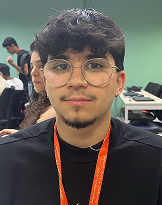

# IARA

Você investiga um caso de horror corporativo envolvendo IARA, uma inteligência
artificial fictícia. Quanto mais questiona as respostas dela em vez de
aceitá-las automaticamente, mais precisa recorrer à lógica para provar
as inconsistências. Assim, a mecânica ensina ao mesmo tempo ética em IA e lógica clássica.

## Tecnologias


- **Motor e gameplay:** C, para o game loop, menus, gerenciamento de estado e persistência.
- **Renderização:** [raylib](https://www.raylib.com/), biblioteca gráfica em C, 2D.
- **Regras puras:** Haskell, para pontuação, validação de respostas e seleção de conteúdo.
- **Versionamento:** GitHub, com o fluxo descrito no [`CONTRIBUTING.md`](CONTRIBUTING.md).

## Como compilar e executar

Todos os comandos devem ser executados **na raiz do repositório**, porque o jogo carrega os assets por caminhos relativos (`code/assets/...`).

### Requisitos

- Compilador `gcc` (no Windows, via [MSYS2](https://www.msys2.org/) UCRT64).
- Biblioteca [raylib](https://www.raylib.com/): no MSYS2, `pacman -S mingw-w64-ucrt-x86_64-raylib`; no Linux, o pacote `raylib` da sua distribuição.

### Windows (MSYS2 UCRT64)

```bash
gcc code/src/*.c -o iara.exe -I C:/msys64/ucrt64/include -L C:/msys64/ucrt64/lib -lraylib -lopengl32 -lgdi32 -lwinmm
./iara.exe
```

### Linux

```bash
gcc code/src/*.c -o iara -lraylib -lGL -lm -lpthread -ldl -lrt -lX11
./iara
```

No VS Code, o mesmo processo está na tarefa `run raylib` (`.vscode/tasks.json`).

> **Versão para terminal (Unidade 1 de PIF):** a versão em texto, exigida na primeira entrega parcial, ainda está em desenvolvimento. Esta seção será atualizada com os comandos de compilação e execução dela.

## Entregas por disciplina

| Disciplina | O que se espera no projeto |
|---|---|
| **FDS**<br>[Fundamentos de Desenvolvimento de Software](docs/fds/README.md) | • Histórias de usuário, backlog e board<br>• Diagramas de atividade<br>• Protótipos lo-fi e screencast<br>• Sprints com versionamento e testes<br>• `CONTRIBUTING.md` |
| **PIF**<br>[Programação Imperativa e Funcional](docs/pif/README.md) | • Núcleo do jogo em C (menu, game loop, quiz jogável)<br>• Regras puras em Haskell |
| **IHC**<br>[Interação Humano-Computador](docs/ihc/README.md) | • Personas<br>• Protótipo lo-fi e screencast<br>• Avaliação heurística (Nielsen)<br>• Critérios de usabilidade e acessibilidade |
| **LMC**<br>[Lógica para Computação](docs/lmc/README.md) | • Especificação lógica das regras do jogo<br>• Puzzles de lógica clássica |

## Squad
 
Fotos e sprites ficam em [`docs/assets/`](docs/assets).
 
| Foto | Sprite | Nome | Função | GitHub | LinkedIn | Email |
|---|---|---|---|---|---|---|
|  |  | Anderson Santos | Lógica matemática | [acampospsantos](https://github.com/acampospsantos) | [andersoncampospsantos](https://www.linkedin.com/in/andersoncampospsantos) | acps@cesar.school |
|  |  | João Pedro | Desenvolvimento das regras em Haskell | [jpsouza25](https://github.com/jpsouza25) | [joão-pedro-souza-costa](https://www.linkedin.com/in/jo%C3%A3o-pedro-souza-costa-a0456430b/) | jpsc@cesar.school |
|  |  | João Vitor Medeiros | Desenvolvimento do motor em C | [JvMedeiros7](https://github.com/JvMedeiros7) | [jvmedeiros7](https://www.linkedin.com/in/jvmedeiros7/) | jvm7@cesar.school |
|  |  | Julio Cesar Lins | Desenvolvimento do motor em C | [Lins-ju](https://github.com/Lins-ju) | [júlio-lins](https://www.linkedin.com/in/j%C3%BAlio-lins-123905182/) | jcsl@cesar.school |
|  |  | Laura Brayner | Design e integração | [laurabrayner](https://github.com/laurabrayner) | [laurabrayner](https://www.linkedin.com/in/laurabrayner) | lcbc@cesar.school |
|  |  | Luan Arruda | Design e integração | [luan-arruda](https://github.com/luan-arruda) | [luan-arruda-548a9534b](https://www.linkedin.com/in/luan-arruda-548a9534b) | las9@cesar.school |
|  |  | Nicolas Mauricio | Gestão ágil | [nicollasfr](https://github.com/nicollasfr) | [nicollasmfranca](https://www.linkedin.com/in/nicollasmfranca/) | nmcf@cesar.school |
|  |  | Rodrigo Vasco | Engenharia de software | [ByRodrigoVasco](https://github.com/ByRodrigoVasco) | [rodrigo-vlm](https://www.linkedin.com/in/rodrigo-vlm/) | rvlm@cesar.school |
