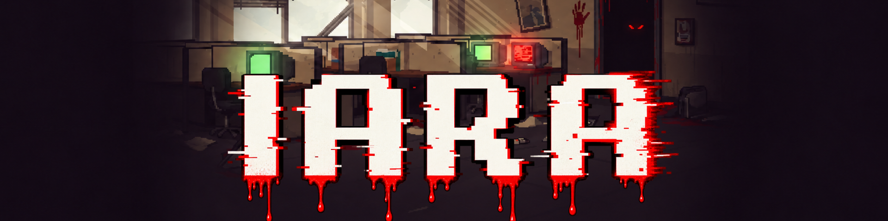

# IARA

Você investiga um caso de horror corporativo envolvendo IARA, uma inteligência
artificial fictícia. Quanto mais questiona as respostas dela em vez de
aceitá-las automaticamente, mais precisa recorrer à lógica para provar
as inconsistências. Assim, a mecânica ensina ao mesmo tempo ética em IA e lógica clássica.

<p align="center">
  
</p>

> **Entrega 3 (FDS):** [Report da Sprint 01](docs/fds/sprint-01/README.md), com histórias, versionamento, testes, programação em pares e evidências.

## Tecnologias


- **Motor e gameplay:** C, para o game loop, menus, gerenciamento de estado e persistência.
- **Renderização:** [raylib](https://www.raylib.com/), biblioteca gráfica em C, 2D.
- **Áudio:** raylib, com música em loop durante a navegação do menu, configurações e créditos, música de gameplay e efeitos para cliques e passos durante a movimentação. A voz da IARA acompanha a digitação da sugestão e para quando o texto termina. O volume geral pode ser ajustado nas configurações e fica salvo nas preferências.
- **Regras puras:** Haskell, para pontuação, validação de respostas e seleção de conteúdo.
- **Versionamento:** GitHub, com o fluxo descrito no [`CONTRIBUTING.md`](CONTRIBUTING.md).

## Links externos

Materiais hospedados fora do repositório:

| Recurso | Descrição | Disciplina |
|---|---|---|
| [Jira](https://csprj-adsr-2p-e8.atlassian.net/jira/software/c/projects/PI2/boards/2/backlog) | Board e backlog do projeto | [FDS](docs/fds/README.md) |
| [Figma](https://www.figma.com/design/DpnmgBif3vJcn336pefbpa/IARA---PROTOTIPO-FDS?node-id=0-1&t=vm69jod3fxAtJGjN-1) | Protótipos de baixa fidelidade | [FDS](docs/fds/README.md) e [IHC](docs/ihc/README.md) |
| [Screencast do protótipo](https://youtu.be/qE2Gn79bmqw) | Vídeo de demonstração do protótipo lo-fi | [FDS](docs/fds/README.md) e [IHC](docs/ihc/README.md) |
| [User Stories](https://docs.google.com/document/d/1xystBOI81sAymF35XBoupr6fe_IPjK8L6bB3qOobUpk/edit) | Histórias de usuário que originaram os diagramas de atividade | [FDS](docs/fds/README.md) |
| [raylib](https://www.raylib.com/) | Biblioteca gráfica usada no núcleo em C | [PIF](docs/pif/README.md) |

## Como compilar e executar

### 1. Instalar o MSYS2

1. Baixe o instalador em [msys2.org](https://www.msys2.org/) e execute.
2. Clique em "Next" até o fim, **sem mudar a pasta de instalação** (`C:\msys64`).

### 2. Abrir o terminal

No menu Iniciar, abra o **MSYS2 UCRT64**.

### 3. Instalar as dependências

```bash
pacman -S --needed git mingw-w64-ucrt-x86_64-gcc mingw-w64-ucrt-x86_64-raylib
```

Se perguntar `[Y/n]`, digite `Y`.

### 4. Baixar o projeto

```bash
git clone https://github.com/ByRodrigoVasco/IARA.git
cd IARA
```

### 5. Compilar

```bash
gcc -O2 code/src/*.c code/src/*/*.c -Icode/src -Icode/src/core -Icode/src/screens -Icode/src/ui -Icode/src/game -Icode/src/survival -o iara.exe -lraylib -lopengl32 -lgdi32 -lwinmm
```
O `-O2` liga as otimizações do compilador e deixa o jogo bem mais leve; sem ele, o jogo roda, mas gasta mais do processador.

Ou, no VS Code com a pasta `IARA` aberta, aperte `Ctrl + Shift + B`: ele compila e já abre o jogo.

### 6. Jogar

```bash
./iara.exe
```

O jogo abre em janela, que pode ser redimensionada. **F11** ou a caixa **Tela cheia**, em `CONFIGURAÇÕES` no menu, alternam entre janela e tela cheia. A mesma tela ajusta o brilho e o alto contraste, e as escolhas ficam salvas em `iara.ini`. **ESC** sai do computador e volta ao escritório; no escritório (ou com **P**) pausa o jogo, com CONTINUAR, COMO JOGAR, VOLTAR AO MENU e SAIR DO JOGO; nos créditos, nas configurações e na ajuda volta ao menu; e no menu pergunta se você quer mesmo sair. O progresso é salvo ao voltar ao menu e ao fechar o jogo, e a opção **AJUDA** do menu explica como jogar. A auditoria de usabilidade está em `docs/fds/usabilidade-nielsen.md`.

### Modos e saves

`INICIAR` abre a escolha do **modo**: `MODO NORMAL` (a campanha) ou `MODO SOBREVIVÊNCIA`. Depois do modo vem a escolha do **save**: a lista dos saves daquele modo, `NOVO SAVE` para criar um com outro nome e **Del** (ou o botão `DEL: APAGAR`) para apagar o save escolhido, sempre com uma confirmação. Um nome de save não pode repetir outro do mesmo modo (sem diferenciar maiúsculas de minúsculas), e cada modo pode ter quantos saves quiser.

Os saves ficam numa pasta própria, ao lado do executável, um por pasta:

```
saves/
  normal/<nome do save>/progresso.save
  sobrevivencia/<nome do save>/progresso.survival
```

Quem já jogava antes disso não perde nada: o `iara.save` e o `iara.survival` antigos viram o save `Principal` de cada modo na primeira abertura. A campanha grava o progresso do save ao voltar ao menu e ao fechar o jogo, e o Modo Sobrevivência grava a cada compra e ao fim de cada partida.

### Modo Sobrevivência

O `MODO SOBREVIVÊNCIA`, na escolha do modo depois de `INICIAR`, é separado da campanha: dez minutos de expediente em um mapa grande de 15 áreas do escritório, com cinco atos e cinco chefes, do Impressora de Rescisões à própria IARA. Mova a Estagiária com **WASD** ou as setas. Os poderes atacam sozinhos, e cada nível dá a escolha de um poder novo ou de um upgrade. **ESC** pausa.

O Banco de Horas coletado na partida, mesmo que você perca, compra upgrades permanentes no `PLANO DE CARREIRA`. O progresso fica no save escolhido (`saves/sobrevivencia/<nome do save>/progresso.survival`). Sprites e sons vêm de `code/assets/sprites/sobrevivencia` e `code/assets/audio`, e o áudio segue as regras de mistura em `code/src/survival/sv_audio.h`.

#### Modo debug (para testar à mão)

Na partida do Sobrevivência, **F1** liga e desliga o modo debug. Ligado, ele mostra por cima do jogo os obstáculos do mapa (caixa de colisão em vermelho), os círculos de colisão dos inimigos e do jogador, o alcance de coleta, os chefes, as zonas dos poderes, os perigos dos chefes, os tiros com o caminho que ainda vão percorrer, e um painel com os números da partida (FPS, tempo de cada quadro, inimigos, poderes e atributos). Também libera todos os personagens.

Com o debug ligado, **F2** abre o menu de cheats e para a partida: dar ou tirar poderes e passivos no nível escolhido (**Esq/Dir** muda o nível, **Del** tira), chamar qualquer chefe ou qualquer inimigo (em 1, 5, 10, 25 ou 50 de uma vez), ficar invulnerável, curar, subir de nível, derrubar tudo com um golpe, pular o tempo, ir para antes de cada chefe, parar os nascimentos e congelar os inimigos. **Setas/WASD** escolhem, **Enter** aplica, **Esc** volta e o mouse também funciona.

Uma partida em que qualquer cheat foi usado **não conta para o progresso do save**: não dá Banco de Horas, não conta vitória nem recorde. A tela de fim avisa.

O jogo também registra em `iara-desempenho.log` (ao lado do executável, ignorado pelo git) os quadros que passaram de 60 ms, com a hora e a tela. É o primeiro lugar para olhar quando alguém disser que o jogo travou.

> **Versão para terminal (PIF):** em desenvolvimento.

### Gerar o pacote para outras máquinas

```powershell
powershell -ExecutionPolicy Bypass -File tools/pacote/empacotar.ps1
powershell -ExecutionPolicy Bypass -File tools/pacote/testar_pacote.ps1
```

O primeiro comando gera `build/IARA-windows.zip`, com o executável, as DLLs e os assets. Quem recebe só extrai e abre o `iara.exe`: não precisa de instalação, conta, internet nem administrador. O segundo testa o pacote fora do ambiente de desenvolvimento; o teste em máquina real segue o [roteiro de máquina limpa](docs/fds/testes/maquina-limpa.md).

## Entregas por disciplina

| Disciplina | O que se espera no projeto |
|---|---|
| **FDS**<br>[Fundamentos de Desenvolvimento de Software](docs/fds/README.md) | • Histórias de usuário, backlog e board<br>• Diagramas de atividade<br>• Protótipos lo-fi e screencast<br>• Sprints com versionamento e testes<br>• `CONTRIBUTING.md` |
| **PIF**<br>[Programação Imperativa e Funcional](docs/pif/README.md) | • Núcleo do jogo em C (menu, game loop, quiz jogável)<br>• Regras puras em Haskell |
| **IHC**<br>[Interação Humano-Computador](docs/ihc/README.md) | • Personas<br>• Protótipo lo-fi e screencast<br>• Avaliação heurística (Nielsen)<br>• Critérios de usabilidade e acessibilidade |
| **LMC**<br>[Lógica para Computação](docs/lmc/README.md) | • Especificação lógica das regras do jogo<br>• Puzzles de lógica clássica |

## Squad
 
Fotos e sprites ficam em [`docs/assets/`](docs/assets).
 
| Foto | Sprite | Nome | Função | GitHub | LinkedIn | Email |
|---|---|---|---|---|---|---|
|  |  | Anderson Santos | Lógica matemática | [acampospsantos](https://github.com/acampospsantos) | [andersoncampospsantos](https://www.linkedin.com/in/andersoncampospsantos) | acps@cesar.school |
|  |  | João Vitor Medeiros | Desenvolvimento do motor em C | [JvMedeiros7](https://github.com/JvMedeiros7) | [jvmedeiros7](https://www.linkedin.com/in/jvmedeiros7/) | jvm7@cesar.school |
|  |  | Julio Cesar Lins | Desenvolvimento do motor em C | [Lins-ju](https://github.com/Lins-ju) | [júlio-lins](https://www.linkedin.com/in/j%C3%BAlio-lins-123905182/) | jcsl@cesar.school |
|  |  | Laura Brayner | Design e integração | [laurabrayner](https://github.com/laurabrayner) | [laurabrayner](https://www.linkedin.com/in/laurabrayner) | lcbc@cesar.school |
|  |  | Luan Arruda | Design e integração | [luan-arruda](https://github.com/luan-arruda) | [luan-arruda-548a9534b](https://www.linkedin.com/in/luan-arruda-548a9534b) | las9@cesar.school |
|  |  | Nicolas Mauricio | Gestão ágil | [nicollasfr](https://github.com/nicollasfr) | [nicollasmfranca](https://www.linkedin.com/in/nicollasmfranca/) | nmcf@cesar.school |
|  |  | Rodrigo Vasco | Engenharia de software | [ByRodrigoVasco](https://github.com/ByRodrigoVasco) | [rodrigo-vlm](https://www.linkedin.com/in/rodrigo-vlm/) | rvlm@cesar.school |
