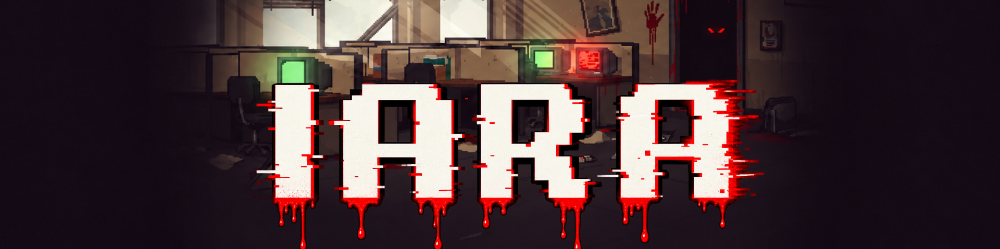

# IARA

Você investiga um caso de horror corporativo envolvendo IARA, uma inteligência
artificial fictícia. Quanto mais questiona as respostas dela em vez de
aceitá-las automaticamente, mais precisa recorrer à lógica para provar
as inconsistências. Assim, a mecânica ensina ao mesmo tempo ética em IA e lógica clássica.

O jogo tem dois jeitos de jogar:

- **Modo História:** cem dias de expediente na CISSA, vividos em nove dias jogáveis. Em cada chamado você decide se resolve sozinho, confere a sugestão da IARA ou envia sem conferir, e as escolhas levam a um dos 4 finais.
- **Modo Sobrevivência:** um **roguelike** de dez minutos. Cada partida começa do zero, você escolhe poderes a cada nível, enfrenta cinco chefes e, com o que conquistar, libera melhorias e personagens. Dá para jogar sozinho ou em dupla.

<p align="center">
  
</p>

<p align="center">
  <a href="https://iara-ranking-ao-vivo.vercel.app/"><b>Ranking ao vivo</b></a> ·
  <a href="https://iara-tech-night.vercel.app/"><b>Manual do jogo</b></a> ·
  <a href="https://github.com/ByRodrigoVasco/IARA/releases/latest"><b>Baixar o jogo</b></a>
</p>

> **Entrega final (Unidade 2):** versão publicada nas [Releases do GitHub](https://github.com/ByRodrigoVasco/IARA/releases/latest), com o `IARA-windows.zip` pronto para baixar e jogar, reports das sprints [01](docs/fds/sprint-01/README.md), [02](docs/fds/sprint-02/README.md) e [03](docs/fds/sprint-03/README.md), [rastreabilidade das 16 histórias](docs/fds/sprint-03/README.md#rastreabilidade-das-histórias-pi2-330) e [bug tracker](docs/fds/testes/bugs.md).

## Novidades da Unidade 2

Na Unidade 1 o jogo era o núcleo em C: menu, máquina de estados, o escritório com colisões e um
quiz jogável. Desde então entrou:

| Novidade | O que é |
|---|---|
| **Campanha do Dia 1 ao Dia 100** | O expediente inteiro, com 9 dias jogáveis, Flashes do dia e saltos no calendário. Cada dia traz um conceito de lógica dentro do trabalho, e as escolhas levam a um dos 4 finais |
| **Modo Sobrevivência** | Dez minutos num mapa de 14 áreas do escritório, com 5 atos, 5 chefes, Banco de Horas para comprar melhorias e ranking de partidas |
| **Sobrevivência em dupla** | Duas pessoas no mesmo computador, com controles separados, XP dividida e ranking próprio |
| **Progressão e conquistas** | 12 personagens, cada um com o seu poder, liberados por objetivos, com notificação de conquista |
| **Arte nova** | Personagens e Colegas de Plantão redesenhados em alta resolução, e o executável reduzido de cerca de 54 MB para 30 MB |
| **Versão para terminal** | A campanha em texto, sem janela e sem raylib, para PIF |
| **Eventos** | Saves e rankings compartilhados entre notebooks, opcional |
| **Saves por modo** | Save automático com vários slots, separados entre campanha, Sobrevivência e dupla |
| **Configurações** | Volume da música e dos efeitos, brilho, tela cheia e janela maximizada, guardados entre sessões |
| **Acessibilidade** | Alto contraste, pausa, tela de ajuda e confirmação antes de sair ou desistir |

Tudo isso roda a partir de um `iara.exe` único, sem instalação nem conta. O detalhamento por sprint
está em [Como o software evoluiu](#como-o-software-evoluiu).

## Sumário

| Seção | O que tem |
|---|---|
| [Como compilar e executar](#como-compilar-e-executar) | Baixar o jogo pronto ou compilar, controles e versão para terminal |
| [Funcionalidades](#funcionalidades) | O que cada modo faz |
| [Documentação](#documentação) | Guia do jogo, nuvem, terminal, contribuição e manual |
| [Entregas por matéria](#entregas-por-matéria) | [FDS](#fds-fundamentos-de-desenvolvimento-de-software), [PIF](#pif-programação-imperativa-e-funcional), [IHC](#ihc-interação-humano-computador) e [LMC](#lmc-lógica-para-computação) |
| [Como o software evoluiu](#como-o-software-evoluiu) | Da concepção à entrega final |
| [Tecnologias](#tecnologias) e [links externos](#links-externos) | Ferramentas, board, protótipos e vídeos |
| [Uso de ponteiros](#uso-de-ponteiros) | Quatro exemplos no código C |
| [Qualidade e testes](#qualidade-e-testes) | Suíte, evidências e bug tracker |
| [Como contribuir](#como-contribuir), [créditos de arte](#créditos-de-arte) e [squad](#squad) | Equipe e regras do repositório |

## Como compilar e executar

**Só quer jogar?** Baixe o `IARA-windows.zip` nas [Releases](https://github.com/ByRodrigoVasco/IARA/releases/latest), extraia e abra o `iara.exe`. Não precisa instalar nada.

Para compilar, siga os passos abaixo.

### 1. Instalar o MSYS2

1. Baixe o instalador em [msys2.org](https://www.msys2.org/) e execute.
2. Clique em "Next" até o fim, **sem mudar a pasta de instalação** (`C:\msys64`).

### 2. Abrir o terminal

No menu Iniciar, abra o **MSYS2 UCRT64**.

### 3. Instalar as dependências

```bash
pacman -S --needed git mingw-w64-ucrt-x86_64-gcc mingw-w64-ucrt-x86_64-raylib
```

Se perguntar `[Y/n]`, digite `Y`.

### 4. Baixar o projeto

```bash
git clone https://github.com/ByRodrigoVasco/IARA.git
cd IARA
```

### 5. Compilar

```bash
gcc -O2 code/src/*.c code/src/*/*.c -Icode/src -Icode/src/core -Icode/src/screens -Icode/src/ui -Icode/src/game -Icode/src/survival -o iara.exe -lraylib -lopengl32 -lgdi32 -lwinmm
```
O `-O2` liga as otimizações do compilador e deixa o jogo bem mais leve; sem ele, o jogo roda, mas gasta mais do processador.

Ou, no VS Code com a pasta `IARA` aberta, aperte `Ctrl + Shift + B`: ele compila e já abre o jogo.

### 6. Jogar

```bash
./iara.exe
```

| Ação | Teclas |
|---|---|
| Andar | **WASD** ou setas (na dupla, o jogador 2 usa as setas) |
| Interagir, no Modo História | **ESPAÇO** |
| Escolher carta, no Sobrevivência | Setas ou **1**, **2**, **3**, e **ENTER** |
| Velocidade do tempo, no Sobrevivência | **TAB** (x1, x2, x3) |
| Pausar ou voltar | **ESC** (ou **P**) |
| Tela cheia | **F11** |

Janela, saves, modo debug e os outros detalhes estão no [guia do jogo](docs/jogo/README.md).

### Versão para terminal (PIF)

O jogo também roda dentro do terminal, em texto, sem abrir janela e sem depender do raylib. No **MSYS2 UCRT64**, na pasta do projeto:

```bash
gcc -O2 -std=c11 code/terminal/*.c code/src/game/logic.c -Icode/terminal -Icode/src/game -Icode/src/core -Icode/src/screens -o iara-terminal.exe
./iara-terminal.exe
```

São os **8 dias com mesa de triagem** (3, 12, 27, 41, 58, 74, 89 e 100), com os mesmos enunciados e fórmulas do jogo gráfico. A campanha gráfica tem 9 dias jogáveis porque inclui o Dia 1, de perguntas sobre IA. Detalhes em [`code/terminal/LEIA-ME.md`](code/terminal/LEIA-ME.md).

## Funcionalidades

**Modo História (`MODO NORMAL` no menu)**
- 100 dias de expediente: 9 dias jogáveis, Flashes do dia e saltos no calendário, para a história caber numa sessão curta.
- Em cada chamado o jogador escolhe: resolver sozinho, conferir a sugestão da IARA ou enviar sem conferir. A escolha pesa na pontuação e decide qual dos 4 finais o jogador recebe.
- Puzzles de lógica proposicional ensinados pela própria história, com a colinha dos símbolos no Dia 1.
- Dicas leves pelos NPCs e pelo mural, nunca a resposta pronta, e failsafe depois de 3 erros para ninguém ficar travado.
- NPCs com diálogo opcional e um escritório que muda com os dias e com as escolhas, sem HUD numérico.
- Save automático, com vários saves por modo.

**Modo Sobrevivência**
- Dez minutos num mapa de 14 áreas do escritório, com 5 atos e 5 chefes.
- Banco de Horas para comprar melhorias no Plano de Carreira, e ranking de partidas.
- 12 personagens e 17 poderes. O poder de cada personagem só aparece nas cartas depois que ele é liberado, e cada liberação vira uma [conquista](docs/jogo/README.md#personagens-poderes-e-conquistas).
- Velocidade do tempo em x1, x2 ou x3, a partida inteira.
- Sobrevivência em dupla, para duas pessoas no mesmo computador.

**Para todos os modos**
- Configurações: volume da música e dos efeitos, brilho, alto contraste, tela cheia e janela maximizada.
- Pausa, ajuda e confirmação antes de sair ou desistir.
- Trilha sonora por momento do jogo e efeitos sonoros de ações e ambiente.
- Um `iara.exe` só, sem instalação nem conta, que funciona sem internet.
- Versão para eventos, opcional: [saves e rankings compartilhados entre notebooks](docs/jogo/README.md#eventos-saves-e-rankings-na-nuvem) e [ranking ao vivo na web](https://iara-ranking-ao-vivo.vercel.app/).

## Documentação

| Documento | O que explica |
|---|---|
| [Guia do jogo](docs/jogo/README.md) | Modos e saves, Sobrevivência, personagens e conquistas, dupla, debug, nuvem e pacote |
| [Manual do jogo](https://iara-tech-night.vercel.app/) | Página para quem joga, feita para o celular ([fonte](docs/tech-night/README.md)) |
| [Ranking ao vivo](https://iara-ranking-ao-vivo.vercel.app/) | Os rankings do evento ([repositório](https://github.com/ByRodrigoVasco/IARA-Ranking-ao-vivo)) |
| [Jogo no terminal](code/terminal/LEIA-ME.md) | Como compilar, jogar e como o código é organizado |
| [Nuvem](tools/nuvem/LEIA-ME.md) | Banco de dados, configuração do build e testes |
| [Contribuição](CONTRIBUTING.md) | Ambiente, branches, commits, issues e Pull Requests |
| [Arquivo](arquivo/README.md) | Arte e áudio antigos, fora do executável |

## Entregas por matéria

Cada matéria tem uma página própria com todas as suas entregas.

### FDS: Fundamentos de Desenvolvimento de Software

[Página de FDS](docs/fds/README.md)

| Entrega | Onde está |
|---|---|
| Histórias de usuário, backlog e board | [Backlog e board](docs/fds/backlog-board/README.md) e [Jira](https://csprj-adsr-2p-e8.atlassian.net/jira/software/c/projects/PI2/boards/2/backlog) |
| Diagramas de atividade | [Um por história](docs/fds/diagramas-atividade/README.md) |
| Protótipos lo-fi e screencast | [Protótipos](docs/fds/prototipos-lofi/README.md) e [vídeo](https://youtu.be/qE2Gn79bmqw) |
| Reports das sprints | [Sprint 01](docs/fds/sprint-01/README.md), [Sprint 02](docs/fds/sprint-02/README.md) e [Sprint 03](docs/fds/sprint-03/README.md) |
| Testes, bugs e rastreabilidade | [Testes](docs/fds/testes/README.md), [bug tracker](docs/fds/testes/bugs.md) e [rastreabilidade](docs/fds/sprint-03/README.md#rastreabilidade-das-histórias-pi2-330) |
| Versionamento | [`CONTRIBUTING.md`](CONTRIBUTING.md) |

### PIF: Programação Imperativa e Funcional

[Página de PIF](docs/pif/README.md)

| Entrega | Onde está |
|---|---|
| Núcleo do jogo em C (Unidade 1) | [`code/src`](code/src) e [screencast](https://www.youtube.com/watch?v=z4OrasORL4c) |
| Jogo no terminal (Unidade 2) | [`code/terminal`](code/terminal/LEIA-ME.md) |
| Screencast da Unidade 2 | [Vídeo](https://drive.google.com/file/d/1soQDTz9SJSCRORCqMzA3ldWT3vO0Zb2M/view) |
| Uso de ponteiros | [Quatro exemplos](#uso-de-ponteiros) |

### IHC: Interação Humano-Computador

[Página de IHC](docs/ihc/README.md)

| Entrega | Onde está |
|---|---|
| Protótipo lo-fi e screencast | [Protótipos](docs/fds/prototipos-lofi/README.md) e [vídeo](https://youtu.be/qE2Gn79bmqw) |
| Avaliação heurística (Nielsen) | [Auditoria de usabilidade](docs/fds/usabilidade-nielsen.md) e [relatório](https://drive.google.com/file/d/1koLQyc7byRok119UhpnPiuLb0MBrtWH4/view) |
| Comprovação de usabilidade | [Vídeo](https://www.youtube.com/watch?v=w3n0H6hxeks) |
| Acessibilidade | [Modo de alto contraste](docs/ihc/alto-contraste.md) |

### LMC: Lógica para Computação

[Página de LMC](docs/lmc/README.md)

| Entrega | Onde está |
|---|---|
| Puzzles ligados à teoria | [Mapeamento e auditoria](docs/lmc/mapeamento-puzzles.md) |
| Regras lógicas das histórias | [US07](docs/fds/diagramas-atividade/US07-logica-narrativa.md) e [US09](docs/fds/diagramas-atividade/US09-revisao-correcao-logica.md) |
| Avaliador de fórmulas no código | [`game/logic.c`](code/src/game/logic.c) |

## Como o software evoluiu

| Etapa | Período | O que entrou |
|---|---|---|
| Concepção | Ago a set/2026 | Personas, histórias de usuário, backlog no Trello, [diagramas de atividade](docs/fds/diagramas-atividade/README.md) e [protótipos lo-fi](docs/fds/prototipos-lofi/README.md) com screencast |
| Núcleo em C | Set a out/2026 | Menu, máquina de estados, escritório com colisões e o primeiro quiz jogável ([screencast do núcleo](https://www.youtube.com/watch?v=z4OrasORL4c)) |
| [Sprint 01](docs/fds/sprint-01/README.md) | 19/10 a 26/10 | Protótipo jogável para o teste de usabilidade, tela de créditos e a primeira suíte de testes de sistema (32 de 35 aprovados, 8 bugs abertos) |
| [Sprint 02](docs/fds/sprint-02/README.md) | 26/10 a 06/11 | Save automático, sprites em 8 direções, campanha do Dia 1 ao Dia 100, alto contraste e configurações; suíte com 76 casos, todos aprovados |
| [Sprint 03](docs/fds/sprint-03/README.md) | 07/11 a 21/11 | Modo Sobrevivência (e em dupla), NPCs, áudio e trilha por momento, pausa e ajuda pelas heurísticas de Nielsen, sintomas visuais e o `CONTRIBUTING.md`; testes CT-94 a CT-105 com um screencast por caso |
| Final | 23/11 a 04/12 | Executável único, correções do bug tracker, escolha de jogar novamente ou sair no fim da partida, nuvem para eventos, versão para terminal, arte nova dos personagens, colegas e poderes, Aviso Prévio no lugar do Ponteiro, progressão com conquistas, jogo mais leve e a Release |

## Tecnologias


- **Motor e gameplay:** C, para o game loop, menus, gerenciamento de estado e persistência.
- **Renderização:** [raylib](https://www.raylib.com/), biblioteca gráfica em C, 2D.
- **Áudio:** raylib, com música em loop durante a navegação do menu, configurações e créditos, música de gameplay e efeitos para cliques e passos durante a movimentação. A trilha acompanha o momento da campanha: o ambiente do escritório (que fica mais tenso com os dias), uma faixa própria na tela do quiz, e a trilha abafada com um som curto de entrada nos cartões de Flash do dia e de salto puro. A troca entre faixas e entre telas é um fade suave de 0,8 s. A voz da IARA acompanha a digitação da sugestão e para quando o texto termina. O volume geral pode ser ajustado nas configurações e fica salvo nas preferências.
- **Versão para terminal:** C puro, sem raylib, lendo o mesmo roteiro e as mesmas regras de lógica do jogo gráfico.
- **Versionamento:** GitHub, com o fluxo descrito no [`CONTRIBUTING.md`](CONTRIBUTING.md).

## Links externos

Materiais hospedados fora do repositório:

| Recurso | Descrição | Disciplina |
|---|---|---|
| [Ranking ao vivo](https://iara-ranking-ao-vivo.vercel.app/) | Rankings solo e de duplas em tempo real | Todas |
| [Manual do jogo](https://iara-tech-night.vercel.app/) | Como jogar, chefes, monstros e personagens | Todas |
| [Releases](https://github.com/ByRodrigoVasco/IARA/releases/latest) | Versão publicada da Unidade 2, com o `IARA-windows.zip` gerado pelo `empacotar.ps1` | [FDS](docs/fds/README.md) e [PIF](docs/pif/README.md) |
| [Jira](https://csprj-adsr-2p-e8.atlassian.net/jira/software/c/projects/PI2/boards/2/backlog) | Board e backlog do projeto | [FDS](docs/fds/README.md) |
| [Figma](https://www.figma.com/design/DpnmgBif3vJcn336pefbpa/IARA---PROTOTIPO-FDS?node-id=0-1&t=vm69jod3fxAtJGjN-1) | Protótipos de baixa fidelidade | [FDS](docs/fds/README.md) e [IHC](docs/ihc/README.md) |
| [Screencast do protótipo](https://youtu.be/qE2Gn79bmqw) | Vídeo de demonstração do protótipo lo-fi | [FDS](docs/fds/README.md) e [IHC](docs/ihc/README.md) |
| [Comprovação de usabilidade](https://www.youtube.com/watch?v=w3n0H6hxeks) | Vídeo do jogo mostrando os critérios de usabilidade atendidos (entrega de 20/11/2026) | [IHC](docs/ihc/README.md) |
| [User Stories](https://docs.google.com/document/d/1xystBOI81sAymF35XBoupr6fe_IPjK8L6bB3qOobUpk/edit) | Histórias de usuário que originaram os diagramas de atividade | [FDS](docs/fds/README.md) |
| [raylib](https://www.raylib.com/) | Biblioteca gráfica usada no núcleo em C | [PIF](docs/pif/README.md) |

## Uso de ponteiros

O jogo usa ponteiros em todo o código C. Quatro exemplos:

| Uso | Onde | Como |
|---|---|---|
| Passagem por referência | `fade_in_texture()` em [`ui/animations.c`](code/src/ui/animations.c) | Recebe `Color *color` e `bool *is_animation_finished`: a função muda o alpha da cor de quem chamou e avisa o fim da animação pelo mesmo ponteiro, sem precisar devolver nada. |
| Vetor de ponteiros | `day_27_clauses[]` e `day_58_clauses[]` em [`screens/computer_days.h`](code/src/screens/computer_days.h), lidos por `logic_is_satisfiable()` em [`game/logic.c`](code/src/game/logic.c) | Cada dia guarda suas cláusulas como `const LogicExpression *const day_N_clauses[]`, um vetor de ponteiros para fórmulas. A função recebe esse vetor como `const LogicExpression *const *expressions` e testa todas as combinações de valores. |
| Struct ligada por ponteiros | `LogicExpression` em [`game/logic.h`](code/src/game/logic.h) e `logic_evaluate()` em [`game/logic.c`](code/src/game/logic.c) | Cada fórmula é uma árvore: a struct aponta para as subfórmulas pelos campos `left` e `right`, e `logic_evaluate()` percorre a árvore de forma recursiva seguindo esses ponteiros. |
| Manipulação de struct por ponteiro | `recompute_stats()` em [`survival/sv_game.c`](code/src/survival/sv_game.c) | `SvPlayer *p = &sv_run.player;` aponta para o jogador da partida, e a função recalcula vida, dano, velocidade e os outros atributos direto na struct original, com `p->campo`. |

Além disso, os textos do jogo circulam como `const char *`, e o save é lido e gravado com `FILE *` em `save_game_state()` e `load_game_state()` ([`core/save.c`](code/src/core/save.c)).

## Qualidade e testes

A suíte automatizada (`tools/tests/run_tests.ps1`) monta o jogo de verdade e o conduz como um jogador. O relatório completo está em [docs/fds/testes](docs/fds/testes/README.md).

As evidências da Sprint 03, com pré-condição, passos, resultado de cada caso (CT-94 a CT-105), um screencast por caso e os prints do Jira, estão no [report da Sprint 03](docs/fds/sprint-03/README.md).

### Bug Tracker

Print de **25/11/2026**, véspera da entrega, das [Issues do GitHub](https://github.com/ByRodrigoVasco/IARA/issues?q=is%3Aissue+label%3Abug), com as abertas e as fechadas: **44 bugs, 6 em aberto**. Cada issue tem o label da sprint, um responsável e aponta para a história do Jira, o teste e o PR da correção. O status de cada bug também fica em [bugs.md](docs/fds/testes/bugs.md), em dia com as issues.


## Como contribuir

O passo a passo para configurar o ambiente, o fluxo de branches (GitFlow), o padrão de commits, as issues e os Pull Requests estão no [`CONTRIBUTING.md`](CONTRIBUTING.md). Bugs e tarefas abertas ficam nas [Issues](https://github.com/ByRodrigoVasco/IARA/issues).

## Créditos de arte

Os móveis do Modo Sobrevivência (mesas, cadeiras, arquivos, estantes, cofre, caixas, lixeira, planta e longarina) foram recortados do pacote gratuito [Post Apoc Office](https://0-mem0ry.itch.io/), de **0_mem0ry**. A licença permite usar e modificar os assets em projetos comerciais e não comerciais, mas não permite revender ou redistribuir o pacote original; por isso o repositório guarda só os recortes usados no jogo.

## Squad
 
Fotos e sprites ficam em [`docs/assets/`](docs/assets).
 
| Foto | Sprite | Nome | Função | GitHub | LinkedIn | Email |
|---|---|---|---|---|---|---|
|  |  | Anderson Santos | Lógica matemática | [acampospsantos](https://github.com/acampospsantos) | [andersoncampospsantos](https://www.linkedin.com/in/andersoncampospsantos) | acps@cesar.school |
|  |  | João Vitor Medeiros | Desenvolvimento do motor em C | [JvMedeiros7](https://github.com/JvMedeiros7) | [jvmedeiros7](https://www.linkedin.com/in/jvmedeiros7/) | jvm7@cesar.school |
|  |  | Julio Cesar Lins | Desenvolvimento do motor em C | [Lins-ju](https://github.com/Lins-ju) | [júlio-lins](https://www.linkedin.com/in/j%C3%BAlio-lins-123905182/) | jcsl@cesar.school |
|  |  | Laura Brayner | Design e integração | [laurabrayner](https://github.com/laurabrayner) | [laurabrayner](https://www.linkedin.com/in/laurabrayner) | lcbc@cesar.school |
|  |  | Luan Arruda | Design e integração | [luan-arruda](https://github.com/luan-arruda) | [luan-arruda-548a9534b](https://www.linkedin.com/in/luan-arruda-548a9534b) | las9@cesar.school |
|  |  | Nicolas Mauricio | Gestão ágil | [nicollasfr](https://github.com/nicollasfr) | [nicollasmfranca](https://www.linkedin.com/in/nicollasmfranca/) | nmcf@cesar.school |
|  |  | Rodrigo Vasco | Engenharia de software | [ByRodrigoVasco](https://github.com/ByRodrigoVasco) | [rodrigo-vlm](https://www.linkedin.com/in/rodrigo-vlm/) | rvlm@cesar.school |
