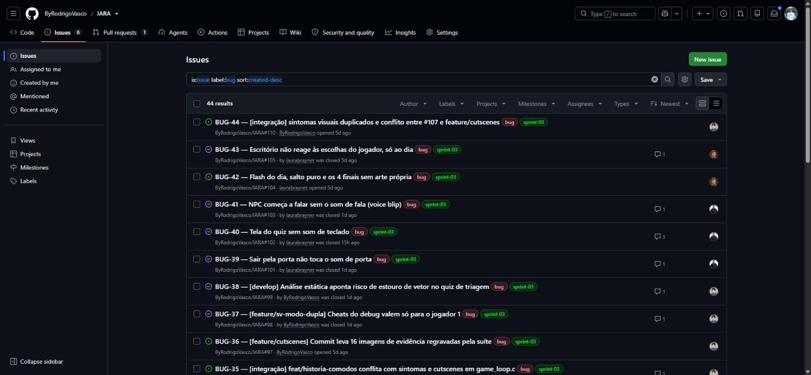

# IARA

Você investiga um caso de horror corporativo envolvendo IARA, uma inteligência
artificial fictícia. Quanto mais questiona as respostas dela em vez de
aceitá-las automaticamente, mais precisa recorrer à lógica para provar
as inconsistências. Assim, a mecânica ensina ao mesmo tempo ética em IA e lógica clássica.

<p align="center">
  
</p>

> **Entrega final (Unidade 2):** versão publicada nas [Releases do GitHub](https://github.com/ByRodrigoVasco/IARA/releases), reports das sprints [01](docs/fds/sprint-01/README.md), [02](docs/fds/sprint-02/README.md) e [03](docs/fds/sprint-03/README.md), [rastreabilidade das 16 histórias](docs/fds/sprint-03/README.md#rastreabilidade-das-histórias-pi2-330) e [bug tracker](docs/fds/testes/bugs.md).

## Novidades da Unidade 2

Na Unidade 1 o jogo era o núcleo em C: menu, máquina de estados, o escritório com colisões e um
quiz jogável. Desde então entrou:

| Novidade | O que é |
|---|---|
| **Campanha do Dia 1 ao Dia 100** | O expediente inteiro, com 9 dias jogáveis, Flashes do dia e saltos no calendário. Cada dia traz um conceito de lógica dentro do trabalho, e as escolhas levam a um dos 4 finais |
| **Modo Sobrevivência** | Dez minutos num mapa de 15 áreas do escritório, com 5 atos, 5 chefes, Banco de Horas para comprar melhorias e ranking de partidas |
| **Sobrevivência em dupla** | Duas pessoas no mesmo computador, com controles separados, XP dividida e ranking próprio |
| **Saves por modo** | Save automático com vários slots, separados entre campanha, Sobrevivência e dupla |
| **Configurações** | Volume da música e dos efeitos, brilho, tela cheia e janela maximizada, guardados entre sessões |
| **Acessibilidade** | Alto contraste, pausa, tela de ajuda e confirmação antes de sair ou desistir |

Tudo isso roda a partir de um `iara.exe` único, sem instalação nem conta. O detalhamento por sprint
está em [Como o software evoluiu](#como-o-software-evoluiu).

## Funcionalidades

**Campanha (modo normal)**
- 100 dias de expediente: 9 dias jogáveis, Flashes do dia e saltos no calendário, para a história caber numa sessão curta.
- Em cada chamado o jogador escolhe: resolver sozinho, conferir a sugestão da IARA ou enviar sem conferir. A escolha pesa na pontuação e decide qual dos 4 finais o jogador recebe.
- Puzzles de lógica proposicional ensinados pela própria história, com a colinha dos símbolos no Dia 1.
- Dicas leves pelos NPCs e pelo mural, nunca a resposta pronta, e failsafe depois de 3 erros para ninguém ficar travado.
- NPCs com diálogo opcional e um escritório que muda com os dias e com as escolhas, sem HUD numérico.
- Save automático, com vários saves por modo.

**Modo Sobrevivência**
- Dez minutos num mapa de 15 áreas do escritório, com 5 atos e 5 chefes.
- Banco de Horas para comprar melhorias no Plano de Carreira, e ranking de partidas.
- Sobrevivência em dupla, para duas pessoas no mesmo computador.

**Para todos os modos**
- Configurações: volume da música e dos efeitos, brilho, alto contraste, tela cheia e janela maximizada.
- Pausa, ajuda e confirmação antes de sair ou desistir.
- Trilha sonora por momento do jogo e efeitos sonoros de ações e ambiente.
- Um `iara.exe` só, sem instalação nem conta, que funciona sem internet.
- Versão para eventos, opcional: [saves e rankings compartilhados entre notebooks](#eventos-saves-e-rankings-na-nuvem) e [ranking ao vivo na web](https://github.com/ByRodrigoVasco/IARA-Ranking-ao-vivo).

## Como o software evoluiu

| Etapa | Período | O que entrou |
|---|---|---|
| Concepção | Ago a set/2026 | Personas, histórias de usuário, backlog no Trello, [diagramas de atividade](docs/fds/diagramas-atividade/README.md) e [protótipos lo-fi](docs/fds/prototipos-lofi/README.md) com screencast |
| Núcleo em C | Set a out/2026 | Menu, máquina de estados, escritório com colisões e o primeiro quiz jogável ([screencast do núcleo](https://www.youtube.com/watch?v=z4OrasORL4c)) |
| [Sprint 01](docs/fds/sprint-01/README.md) | 19/10 a 26/10 | Protótipo jogável para o teste de usabilidade, tela de créditos e a primeira suíte de testes de sistema (32 de 35 aprovados, 8 bugs abertos) |
| [Sprint 02](docs/fds/sprint-02/README.md) | 26/10 a 06/11 | Save automático, sprites em 8 direções, campanha do Dia 1 ao Dia 100, alto contraste e configurações; suíte com 76 casos, todos aprovados |
| [Sprint 03](docs/fds/sprint-03/README.md) | 07/11 a 21/11 | Modo Sobrevivência (e em dupla), NPCs, áudio e trilha por momento, pausa e ajuda pelas heurísticas de Nielsen, sintomas visuais e o `CONTRIBUTING.md`; testes CT-94 a CT-105 com um screencast por caso |
| Final | 23/11 a 04/12 | Executável único, correções do bug tracker e documentação final. Em andamento: escolha de jogar novamente ou sair no fim da partida e a Release |


## Tecnologias


- **Motor e gameplay:** C, para o game loop, menus, gerenciamento de estado e persistência.
- **Renderização:** [raylib](https://www.raylib.com/), biblioteca gráfica em C, 2D.
- **Áudio:** raylib, com música em loop durante a navegação do menu, configurações e créditos, música de gameplay e efeitos para cliques e passos durante a movimentação. A trilha acompanha o momento da campanha: o ambiente do escritório (que fica mais tenso com os dias), uma faixa própria na tela do quiz, e a trilha abafada com um som curto de entrada nos cartões de Flash do dia e de salto puro. A troca entre faixas e entre telas é um fade suave de 0,8 s. A voz da IARA acompanha a digitação da sugestão e para quando o texto termina. O volume geral pode ser ajustado nas configurações e fica salvo nas preferências.
- **Regras puras:** Haskell, para pontuação, validação de respostas e seleção de conteúdo.
- **Versionamento:** GitHub, com o fluxo descrito no [`CONTRIBUTING.md`](CONTRIBUTING.md).

## Links externos

Materiais hospedados fora do repositório:

| Recurso | Descrição | Disciplina |
|---|---|---|
| [Jira](https://csprj-adsr-2p-e8.atlassian.net/jira/software/c/projects/PI2/boards/2/backlog) | Board e backlog do projeto | [FDS](docs/fds/README.md) |
| [Figma](https://www.figma.com/design/DpnmgBif3vJcn336pefbpa/IARA---PROTOTIPO-FDS?node-id=0-1&t=vm69jod3fxAtJGjN-1) | Protótipos de baixa fidelidade | [FDS](docs/fds/README.md) e [IHC](docs/ihc/README.md) |
| [Screencast do protótipo](https://youtu.be/qE2Gn79bmqw) | Vídeo de demonstração do protótipo lo-fi | [FDS](docs/fds/README.md) e [IHC](docs/ihc/README.md) |
| [Comprovação de usabilidade](https://www.youtube.com/watch?v=w3n0H6hxeks) | Vídeo do jogo mostrando os critérios de usabilidade atendidos (entrega de 20/11/2026) | [IHC](docs/ihc/README.md) |
| [User Stories](https://docs.google.com/document/d/1xystBOI81sAymF35XBoupr6fe_IPjK8L6bB3qOobUpk/edit) | Histórias de usuário que originaram os diagramas de atividade | [FDS](docs/fds/README.md) |
| [raylib](https://www.raylib.com/) | Biblioteca gráfica usada no núcleo em C | [PIF](docs/pif/README.md) |

## Como compilar e executar

### 1. Instalar o MSYS2

1. Baixe o instalador em [msys2.org](https://www.msys2.org/) e execute.
2. Clique em "Next" até o fim, **sem mudar a pasta de instalação** (`C:\msys64`).

### 2. Abrir o terminal

No menu Iniciar, abra o **MSYS2 UCRT64**.

### 3. Instalar as dependências

```bash
pacman -S --needed git mingw-w64-ucrt-x86_64-gcc mingw-w64-ucrt-x86_64-raylib
```

Se perguntar `[Y/n]`, digite `Y`.

### 4. Baixar o projeto

```bash
git clone https://github.com/ByRodrigoVasco/IARA.git
cd IARA
```

### 5. Compilar

```bash
gcc -O2 code/src/*.c code/src/*/*.c -Icode/src -Icode/src/core -Icode/src/screens -Icode/src/ui -Icode/src/game -Icode/src/survival -o iara.exe -lraylib -lopengl32 -lgdi32 -lwinmm
```
O `-O2` liga as otimizações do compilador e deixa o jogo bem mais leve; sem ele, o jogo roda, mas gasta mais do processador.

Ou, no VS Code com a pasta `IARA` aberta, aperte `Ctrl + Shift + B`: ele compila e já abre o jogo.

### 6. Jogar

```bash
./iara.exe
```

O jogo abre em janela. Ele tem três modos de tela, sempre um só: **janela** de tamanho fixo (o padrão), **janela maximizada** e **tela cheia**. As caixas **Tela cheia** e **Janela maximizada**, em `CONFIGURAÇÕES` no menu, escolhem o modo, e **F11** alterna a tela cheia com a última janela. A mesma tela ajusta o brilho e o alto contraste, e as escolhas ficam salvas em `iara.ini`. **ESC** sai do computador e volta ao escritório; no escritório (ou com **P**) pausa o jogo, com CONTINUAR, SAIR PARA O MENU e SAIR PARA A ÁREA DE TRABALHO; nos créditos, nas configurações e na ajuda volta ao menu; e no menu pergunta se você quer mesmo sair. O progresso é salvo ao voltar ao menu e ao fechar o jogo, e a opção **AJUDA** do menu explica como jogar. Nos cartões de início e de fim de cada dia, **ESPAÇO**, **ENTER**, um clique ou o botão PULAR passam à frente. A auditoria de usabilidade está em `docs/fds/usabilidade-nielsen.md`.

### Modos e saves

`INICIAR` abre a escolha do **modo**: `MODO NORMAL` (a campanha), `MODO SOBREVIVÊNCIA` ou `SOBREVIVÊNCIA EM DUPLA`. Depois do modo vem a escolha do **save**: a lista dos saves daquele modo, `NOVO SAVE` para criar um com outro nome e **Del** (ou o botão `DEL: APAGAR`) para apagar o save escolhido, sempre com uma confirmação. Um nome de save não pode repetir outro do mesmo modo (sem diferenciar maiúsculas de minúsculas), e cada modo pode ter quantos saves quiser.

Os saves ficam numa pasta própria, ao lado do executável, um por pasta:

```
saves/
  normal/<nome do save>/progresso.save
  sobrevivencia/<nome do save>/progresso.survival
  dupla/<nome da dupla>/progresso.survival
```

Quem já jogava antes disso não perde nada: o `iara.save` e o `iara.survival` antigos viram o save `Principal` de cada modo na primeira abertura. A campanha grava o progresso do save ao voltar ao menu e ao fechar o jogo, e o Modo Sobrevivência grava a cada compra e ao fim de cada partida.

### Modo Sobrevivência

O `MODO SOBREVIVÊNCIA`, na escolha do modo depois de `INICIAR`, é separado da campanha: dez minutos de expediente em um mapa grande de 15 áreas do escritório, com cinco atos e cinco chefes, do Impressora de Rescisões à própria IARA. Mova a Estagiária com **WASD** ou as setas. Os poderes atacam sozinhos, e cada nível dá a escolha de um poder novo ou de um upgrade. **ESC** pausa.

O Banco de Horas coletado na partida, mesmo que você perca, compra upgrades permanentes no `PLANO DE CARREIRA`. O progresso fica no save escolhido (`saves/sobrevivencia/<nome do save>/progresso.survival`). Sprites e sons vêm de `code/assets/sprites/sobrevivencia` e `code/assets/audio` (músicas e ambientes em OGG, efeitos em WAV), e o áudio segue as regras de mistura em `code/src/survival/sv_audio.h`.

Os 12 personagens e os 4 Colegas de Plantão são desenhados em alta resolução (192x192 por quadro, no mesmo espaço de tela do antigo pixel art), a partir das folhas de `docs/arte/conceito`, com `tools/sprites/preparar_personagem_hd.py` e `tools/sprites/preparar_colegas_hd.py` (precisam de Pillow e NumPy). A arte e o áudio originais ficam em [`arquivo/`](arquivo), fora do executável.

O ranking (`iara.ranking`) ordena os jogadores pela **pontuação** da melhor partida de cada um: **10 pontos por inimigo derrotado, 5 por segundo sobrevivido, 500 por chefe derrotado e 2000 de bônus por desligar a IARA**. Os abates pesam mais que o tempo, então quem só foge sem lutar não passa na frente de quem durou um pouco menos mas derrotou mais inimigos. No empate de pontos, fica na frente quem tem mais abates, depois quem sobreviveu mais tempo e, por fim, quem jogou primeiro. A pontuação é calculada na hora a partir do arquivo, então os pesos podem ser ajustados em `code/src/survival/sv_ranking.h` sem apagar o ranking da feira.

#### Sobrevivência em dupla

`SOBREVIVÊNCIA EM DUPLA` é o mesmo modo para duas pessoas no mesmo computador, na mesma tela. O **jogador 1** anda com **WASD** (ou o controle 1) e o **jogador 2** com as **setas** (ou o controle 2). Cada um tem a sua vida, os seus poderes e o seu personagem (em `PERSONAGENS`, **TAB** troca de jogador). A XP é dividida: um chip pego por qualquer um sobe a barra dos dois, e cada um escolhe a sua carta, primeiro o jogador 1. Quem fica sem vida **cai**; o parceiro o levanta ficando parado ao lado dele por 3 segundos, e a partida só acaba quando os dois caem. Os dois ficam sempre na mesma tela, e há mais inimigos e chefes mais fortes que no solo.

Cada save da dupla é uma dupla (o nome aparece no ranking, por exemplo `Ana e Beto`), com Banco de Horas e Plano de Carreira próprios. As duplas têm um ranking separado (`iara_duplas.ranking`) e não entram no ranking solo. As regras e os números ficam em `code/src/survival/sv_duo.h`.

#### Modo debug (para testar à mão)

Na partida do Sobrevivência, **F1** liga e desliga o modo debug. Ligado, ele mostra por cima do jogo os obstáculos do mapa (caixa de colisão em vermelho), os círculos de colisão dos inimigos e do jogador, o alcance de coleta, os chefes, as zonas dos poderes, os perigos dos chefes, os tiros com o caminho que ainda vão percorrer, e um painel com os números da partida (FPS, tempo de cada quadro, inimigos, poderes e atributos). Também libera todos os personagens.

Com o debug ligado, **F2** abre o menu de cheats e para a partida: dar ou tirar poderes e passivos no nível escolhido (**Esq/Dir** muda o nível, **Del** tira), chamar qualquer chefe ou qualquer inimigo (em 1, 5, 10, 25 ou 50 de uma vez), ficar invulnerável, curar, subir de nível, derrubar tudo com um golpe, pular o tempo, ir para antes de cada chefe, parar os nascimentos e congelar os inimigos. **Setas/WASD** escolhem, **Enter** aplica, **Esc** volta e o mouse também funciona.

Uma partida em que qualquer cheat foi usado **não conta para o progresso do save**: não dá Banco de Horas, não conta vitória nem recorde. A tela de fim avisa.

O jogo também registra em `iara-desempenho.log` (ao lado do executável, ignorado pelo git) os quadros que passaram de 60 ms, com a hora e a tela. É o primeiro lugar para olhar quando alguém disser que o jogo travou.

### Eventos: saves e rankings na nuvem

Para um evento com vários notebooks, o `iara.exe` pode ser gerado com a nuvem ligada ([Supabase](https://supabase.com/)). Sem ela, tudo continua local, como descrito acima.

- Os saves dos três modos e os rankings solo e de duplas são os mesmos em todos os notebooks. As configurações (`iara.ini`) e o log continuam em cada um.
- Um save aberto em um notebook fica **em uso** para os outros. A trava vence em 2 minutos sem contato, e uma gravação mais velha que a do servidor é recusada.
- Escolher, criar e apagar save precisam de internet; apagar pede a senha da organização. Se a rede cair durante a partida, o que não subiu fica numa fila e sobe depois.
- Os menus mostram a conexão (**online** ou **offline**), e o motivo de uma queda vai para o `iara-desempenho.log`.
- Partidas com cheats não entram no ranking.
- O [ranking ao vivo na web](https://github.com/ByRodrigoVasco/IARA-Ranking-ao-vivo) mostra os dois rankings para um telão ou para o celular.

Como montar o banco, configurar o build e testar: [tools/nuvem/LEIA-ME.md](tools/nuvem/LEIA-ME.md). A URL e a chave ficam em `tools/nuvem/nuvem.local`, que não vai para o git.

**Antes do evento:** o plano gratuito do Supabase pausa o projeto após cerca de 7 dias sem atividade.

### Gerar o pacote para outras máquinas

```powershell
powershell -ExecutionPolicy Bypass -File tools/pacote/empacotar.ps1
powershell -ExecutionPolicy Bypass -File tools/pacote/testar_pacote.ps1
```

O primeiro comando gera `build/IARA-windows.zip`, com um `iara.exe` só: as imagens, os sons e as bibliotecas (raylib, GLFW) estão dentro dele, e o jogo roda sem pastas nem DLLs ao lado. Para gerar só o executável, use `tools/release/build_release.ps1` (saída em `build/release/iara.exe`). Quem recebe só abre o `iara.exe`: não precisa de instalação, conta, internet nem administrador (a versão com a [nuvem](#eventos-saves-e-rankings-na-nuvem) precisa de internet para escolher o save). O segundo testa o pacote fora do ambiente de desenvolvimento; o teste em máquina real segue o [roteiro de máquina limpa](docs/fds/testes/maquina-limpa.md).

## Entregas por disciplina

| Disciplina | O que se espera no projeto |
|---|---|
| **FDS**<br>[Fundamentos de Desenvolvimento de Software](docs/fds/README.md) | • Histórias de usuário, backlog e board<br>• Diagramas de atividade<br>• Protótipos lo-fi e screencast<br>• Sprints com versionamento e testes<br>• `CONTRIBUTING.md` |
| **PIF**<br>[Programação Imperativa e Funcional](docs/pif/README.md) | • Núcleo do jogo em C (menu, game loop, quiz jogável)<br>• Regras puras em Haskell |
| **IHC**<br>[Interação Humano-Computador](docs/ihc/README.md) | • Personas<br>• Protótipo lo-fi e screencast<br>• Avaliação heurística (Nielsen)<br>• Critérios de usabilidade e acessibilidade |
| **LMC**<br>[Lógica para Computação](docs/lmc/README.md) | • Especificação lógica das regras do jogo<br>• Puzzles de lógica clássica |

## Uso de ponteiros

O jogo usa ponteiros em todo o código C. Quatro exemplos:

| Uso | Onde | Como |
|---|---|---|
| Passagem por referência | `fade_in_texture()` em [`ui/animations.c`](code/src/ui/animations.c) | Recebe `Color *color` e `bool *is_animation_finished`: a função muda o alpha da cor de quem chamou e avisa o fim da animação pelo mesmo ponteiro, sem precisar devolver nada. |
| Vetor de ponteiros | `day_27_clauses[]` e `day_58_clauses[]` em [`screens/computer_days.h`](code/src/screens/computer_days.h), lidos por `logic_is_satisfiable()` em [`game/logic.c`](code/src/game/logic.c) | Cada dia guarda suas cláusulas como `const LogicExpression *const day_N_clauses[]`, um vetor de ponteiros para fórmulas. A função recebe esse vetor como `const LogicExpression *const *expressions` e testa todas as combinações de valores. |
| Struct ligada por ponteiros | `LogicExpression` em [`game/logic.h`](code/src/game/logic.h) e `logic_evaluate()` em [`game/logic.c`](code/src/game/logic.c) | Cada fórmula é uma árvore: a struct aponta para as subfórmulas pelos campos `left` e `right`, e `logic_evaluate()` percorre a árvore de forma recursiva seguindo esses ponteiros. |
| Manipulação de struct por ponteiro | `recompute_stats()` em [`survival/sv_game.c`](code/src/survival/sv_game.c) | `SvPlayer *p = &sv_run.player;` aponta para o jogador da partida, e a função recalcula vida, dano, velocidade e os outros atributos direto na struct original, com `p->campo`. |

Além disso, os textos do jogo circulam como `const char *`, e o save é lido e gravado com `FILE *` em `save_game_state()` e `load_game_state()` ([`core/save.c`](code/src/core/save.c)).

## Qualidade e testes

A suíte automatizada (`tools/tests/run_tests.ps1`) monta o jogo de verdade e o conduz como um jogador. O relatório completo está em [docs/fds/testes](docs/fds/testes/README.md), e as evidências de cada sprint nos reports de [FDS](docs/fds/README.md).

### Evidências da Sprint 03

Testes de sistema das histórias que ainda não tinham caso de teste, executados em 20/11/2026 na `develop` (`2386a1c`): **7 de 12 aprovados**, 5 falhas registradas no bug tracker. Pré-condição, passos, esperado e obtido de cada caso estão no [report da Sprint 03](docs/fds/sprint-03/README.md), junto com os [prints do Jira](docs/fds/sprint-03/README.md#prints-do-jira): o backlog da sprint e cada card de história com o link do seu screencast.

| Caso | História | Resultado | Screencast |
|---|---|---|---|
| CT-94 | US16: som de passos | ✅ | [CT-94_US-16.mp4](docs/fds/sprint-03/screencasts/CT-94_US-16.mp4) |
| CT-95 | US16: som de porta | ❌ [#101](https://github.com/ByRodrigoVasco/IARA/issues/101) | [CT-95_US-16.mp4](docs/fds/sprint-03/screencasts/CT-95_US-16.mp4) |
| CT-96 | US16: ambiente contínuo | ✅ | [CT-96_US-16.mp4](docs/fds/sprint-03/screencasts/CT-96_US-16.mp4) |
| CT-97 | US16: som de teclado no quiz | ❌ [#102](https://github.com/ByRodrigoVasco/IARA/issues/102) | [CT-97_US-16.mp4](docs/fds/sprint-03/screencasts/CT-97_US-16.mp4) |
| CT-98 | US16: voz dos NPCs | ❌ [#103](https://github.com/ByRodrigoVasco/IARA/issues/103) | [CT-98_US-16.mp4](docs/fds/sprint-03/screencasts/CT-98_US-16.mp4) |
| CT-99 | US17: sprites dos NPCs | ✅ | [CT-99_US-17.mp4](docs/fds/sprint-03/screencasts/CT-99_US-17.mp4) |
| CT-100 | US17: arte do flash, salto e finais | ❌ [#104](https://github.com/ByRodrigoVasco/IARA/issues/104) | [CT-100_US-17.mp4](docs/fds/sprint-03/screencasts/CT-100_US-17.mp4) |
| CT-101 | US10: sem HUD numérico | ✅ | [CT-101_US-10.mp4](docs/fds/sprint-03/screencasts/CT-101_US-10.mp4) |
| CT-102 | US10: cenário reage ao jogador | ❌ [#105](https://github.com/ByRodrigoVasco/IARA/issues/105) | [CT-102_US-10.mp4](docs/fds/sprint-03/screencasts/CT-102_US-10.mp4) |
| CT-103 | US13: tensão progressiva | ✅ | [CT-103_US-13.mp4](docs/fds/sprint-03/screencasts/CT-103_US-13.mp4) |
| CT-104 | US04: dica pelo NPC | ✅ | [CT-104_US-04.mp4](docs/fds/sprint-03/screencasts/CT-104_US-04.mp4) |
| CT-105 | US11: pontuação por método | ✅ | [CT-105_US-11.mp4](docs/fds/sprint-03/screencasts/CT-105_US-11.mp4) |

### Bug Tracker

Print de **25/11/2026**, véspera da entrega, das [Issues do GitHub](https://github.com/ByRodrigoVasco/IARA/issues?q=is%3Aissue+label%3Abug), com as abertas e as fechadas: **44 bugs, 6 em aberto**. Cada issue tem o label da sprint, um responsável e aponta para a história do Jira, o teste e o PR da correção. O status de cada bug também fica em [bugs.md](docs/fds/testes/bugs.md), em dia com as issues.



## Como contribuir

O passo a passo para configurar o ambiente, o fluxo de branches (GitFlow), o padrão de commits, as issues e os Pull Requests estão no [`CONTRIBUTING.md`](CONTRIBUTING.md). Bugs e tarefas abertas ficam nas [Issues](https://github.com/ByRodrigoVasco/IARA/issues).

## Créditos de arte

Os móveis do Modo Sobrevivência (mesas, cadeiras, arquivos, estantes, cofre, caixas, lixeira, planta e longarina) foram recortados do pacote gratuito [Post Apoc Office](https://0-mem0ry.itch.io/), de **0_mem0ry**. A licença permite usar e modificar os assets em projetos comerciais e não comerciais, mas não permite revender ou redistribuir o pacote original; por isso o repositório guarda só os recortes usados no jogo.

## Squad
 
Fotos e sprites ficam em [`docs/assets/`](docs/assets).
 
| Foto | Sprite | Nome | Função | GitHub | LinkedIn | Email |
|---|---|---|---|---|---|---|
|  |  | Anderson Santos | Lógica matemática | [acampospsantos](https://github.com/acampospsantos) | [andersoncampospsantos](https://www.linkedin.com/in/andersoncampospsantos) | acps@cesar.school |
|  |  | João Vitor Medeiros | Desenvolvimento do motor em C | [JvMedeiros7](https://github.com/JvMedeiros7) | [jvmedeiros7](https://www.linkedin.com/in/jvmedeiros7/) | jvm7@cesar.school |
|  |  | Julio Cesar Lins | Desenvolvimento do motor em C | [Lins-ju](https://github.com/Lins-ju) | [júlio-lins](https://www.linkedin.com/in/j%C3%BAlio-lins-123905182/) | jcsl@cesar.school |
|  |  | Laura Brayner | Design e integração | [laurabrayner](https://github.com/laurabrayner) | [laurabrayner](https://www.linkedin.com/in/laurabrayner) | lcbc@cesar.school |
|  |  | Luan Arruda | Design e integração | [luan-arruda](https://github.com/luan-arruda) | [luan-arruda-548a9534b](https://www.linkedin.com/in/luan-arruda-548a9534b) | las9@cesar.school |
|  |  | Nicolas Mauricio | Gestão ágil | [nicollasfr](https://github.com/nicollasfr) | [nicollasmfranca](https://www.linkedin.com/in/nicollasmfranca/) | nmcf@cesar.school |
|  |  | Rodrigo Vasco | Engenharia de software | [ByRodrigoVasco](https://github.com/ByRodrigoVasco) | [rodrigo-vlm](https://www.linkedin.com/in/rodrigo-vlm/) | rvlm@cesar.school |
