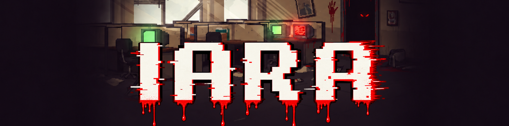

# IARA

Você investiga um caso de horror corporativo envolvendo IARA, uma inteligência
artificial fictícia. Quanto mais questiona as respostas dela em vez de
aceitá-las automaticamente, mais precisa recorrer à lógica para provar
as inconsistências. Assim, a mecânica ensina ao mesmo tempo ética em IA e lógica clássica.

<p align="center">
  
</p>

## Tecnologias


- **Motor e gameplay:** C, para o game loop, menus, gerenciamento de estado e persistência.
- **Renderização:** [raylib](https://www.raylib.com/), biblioteca gráfica em C, 2D.
- **Regras puras:** Haskell, para pontuação, validação de respostas e seleção de conteúdo.
- **Versionamento:** GitHub, com o fluxo descrito no [`CONTRIBUTING.md`](CONTRIBUTING.md).

## Links externos

Materiais hospedados fora do repositório:

| Recurso | Descrição | Disciplina |
|---|---|---|
| [Trello](https://trello.com/b/ifJwhbVe/iara-projeto-integrador-squad-8) | Board e backlog do projeto | [FDS](docs/fds/README.md) |
| [Figma](https://www.figma.com/design/DpnmgBif3vJcn336pefbpa/IARA---PROTOTIPO-FDS?node-id=0-1&t=vm69jod3fxAtJGjN-1) | Protótipos de baixa fidelidade | [FDS](docs/fds/README.md) e [IHC](docs/ihc/README.md) |
| [Screencast do protótipo](https://youtu.be/qE2Gn79bmqw) | Vídeo de demonstração do protótipo lo-fi | [FDS](docs/fds/README.md) e [IHC](docs/ihc/README.md) |
| [User Stories](https://docs.google.com/document/d/1xystBOI81sAymF35XBoupr6fe_IPjK8L6bB3qOobUpk/edit) | Histórias de usuário que originaram os diagramas de atividade | [FDS](docs/fds/README.md) |
| [raylib](https://www.raylib.com/) | Biblioteca gráfica usada no núcleo em C | [PIF](docs/pif/README.md) |

## Como compilar e executar

### 1. Instalar o MSYS2

1. Baixe o instalador em [msys2.org](https://www.msys2.org/) e execute.
2. Clique em "Next" até o fim, **sem mudar a pasta de instalação** (`C:\msys64`).

### 2. Abrir o terminal

No menu Iniciar, abra o **MSYS2 UCRT64**.

### 3. Instalar as dependências

```bash
pacman -S --needed git mingw-w64-ucrt-x86_64-gcc mingw-w64-ucrt-x86_64-raylib
```

Se perguntar `[Y/n]`, digite `Y`.

### 4. Baixar o projeto

```bash
git clone https://github.com/ByRodrigoVasco/IARA.git
cd IARA
```

### 5. Compilar

```bash
gcc code/src/*.c -o iara.exe -lraylib -lopengl32 -lgdi32 -lwinmm
```
Ou, no VS Code com a pasta `IARA` aberta, aperte `Ctrl + Shift + B`: ele compila e já abre o jogo.

### 6. Jogar

```bash
./iara.exe
```

> **Versão para terminal (PIF):** em desenvolvimento.

## Entregas por disciplina

| Disciplina | O que se espera no projeto |
|---|---|
| **FDS**<br>[Fundamentos de Desenvolvimento de Software](docs/fds/README.md) | • Histórias de usuário, backlog e board<br>• Diagramas de atividade<br>• Protótipos lo-fi e screencast<br>• Sprints com versionamento e testes<br>• `CONTRIBUTING.md` |
| **PIF**<br>[Programação Imperativa e Funcional](docs/pif/README.md) | • Núcleo do jogo em C (menu, game loop, quiz jogável)<br>• Regras puras em Haskell |
| **IHC**<br>[Interação Humano-Computador](docs/ihc/README.md) | • Personas<br>• Protótipo lo-fi e screencast<br>• Avaliação heurística (Nielsen)<br>• Critérios de usabilidade e acessibilidade |
| **LMC**<br>[Lógica para Computação](docs/lmc/README.md) | • Especificação lógica das regras do jogo<br>• Puzzles de lógica clássica |

## Squad
 
Fotos e sprites ficam em [`docs/assets/`](docs/assets).
 
| Foto | Sprite | Nome | Função | GitHub | LinkedIn | Email |
|---|---|---|---|---|---|---|
|  |  | Anderson Santos | Lógica matemática | [acampospsantos](https://github.com/acampospsantos) | [andersoncampospsantos](https://www.linkedin.com/in/andersoncampospsantos) | acps@cesar.school |
|  |  | João Vitor Medeiros | Desenvolvimento do motor em C | [JvMedeiros7](https://github.com/JvMedeiros7) | [jvmedeiros7](https://www.linkedin.com/in/jvmedeiros7/) | jvm7@cesar.school |
|  |  | Julio Cesar Lins | Desenvolvimento do motor em C | [Lins-ju](https://github.com/Lins-ju) | [júlio-lins](https://www.linkedin.com/in/j%C3%BAlio-lins-123905182/) | jcsl@cesar.school |
|  |  | Laura Brayner | Design e integração | [laurabrayner](https://github.com/laurabrayner) | [laurabrayner](https://www.linkedin.com/in/laurabrayner) | lcbc@cesar.school |
|  |  | Luan Arruda | Design e integração | [luan-arruda](https://github.com/luan-arruda) | [luan-arruda-548a9534b](https://www.linkedin.com/in/luan-arruda-548a9534b) | las9@cesar.school |
|  |  | Nicolas Mauricio | Gestão ágil | [nicollasfr](https://github.com/nicollasfr) | [nicollasmfranca](https://www.linkedin.com/in/nicollasmfranca/) | nmcf@cesar.school |
|  |  | Rodrigo Vasco | Engenharia de software | [ByRodrigoVasco](https://github.com/ByRodrigoVasco) | [rodrigo-vlm](https://www.linkedin.com/in/rodrigo-vlm/) | rvlm@cesar.school |
