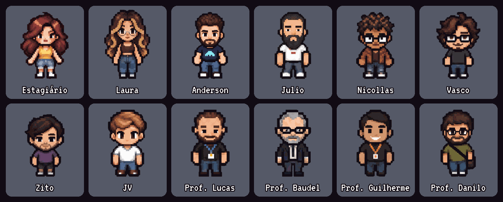
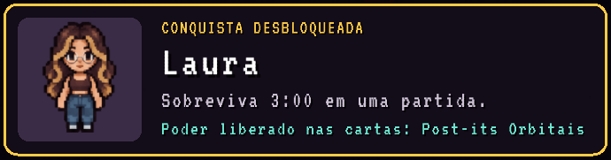
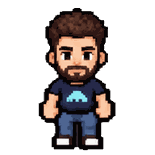
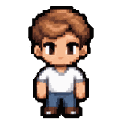

<p align="center">
  
</p>

<p align="center">
  <a href="https://iara-ranking-ao-vivo.vercel.app/"></a>
  <a href="https://iara-tech-night.vercel.app/"></a>
  <a href="https://github.com/ByRodrigoVasco/IARA/releases/latest"></a>
</p>

<p align="center">
  <a href="#a-história">História</a> ·
  <a href="#tecnologias">Tecnologias</a> ·
  <a href="#entregáveis">Entregáveis</a> ·
  <a href="#como-instalar-e-rodar">Instalar e rodar</a> ·
  <a href="#funcionalidades">Funcionalidades</a> ·
  <a href="#squad">Squad</a> ·
  <a href="#créditos-e-menções-honrosas">Créditos</a>
</p>

## A história

Você é o estagiário recém-chegado à CISSA e vai trabalhar ao lado da **IARA**, a inteligência artificial da empresa. Ela responde rápido, com confiança, e quase sempre acerta. Os dias passam, o escritório vai mudando e algumas respostas deixam de fazer sentido. Para investigar o que está acontecendo, só há uma ferramenta confiável: a **lógica**. No caminho, o jogo ensina ao mesmo tempo ética em IA e lógica clássica.

## Como se joga

<table>
<tr>
<td width="50%" valign="top">

### Modo História

Ande pelo escritório, converse com os colegas e resolva os chamados no computador. Em cada um você escolhe:

- **resolver sozinho**;
- **conferir** a sugestão da IARA;
- **enviar sem conferir**.

São 100 dias de expediente, vividos em 9 dias jogáveis, com puzzles de lógica. As suas escolhas levam a um dos **4 finais**.

</td>
<td width="50%" valign="top">

### Modo Sobrevivência

Um **roguelike** de 10 minutos, sozinho ou em dupla:

- você anda, e os **poderes atacam sozinhos**;
- a cada nível, **escolha uma carta**: poder novo ou melhoria;
- **cinco chefes** aparecem ao longo da partida;
- o **Banco de Horas** compra melhorias permanentes;
- objetivos cumpridos **liberam personagens e poderes**.

</td>
</tr>
</table>

## Tecnologias

<p align="center">

      

</p>

| Tecnologia | Para que é usada |
|---|---|
| **C** e **raylib** | O jogo: loop, telas, desenho 2D, áudio e saves. A versão para terminal é C puro |
| **PowerShell** | Testes e geração do executável |
| **Supabase** | Banco de dados dos saves e rankings compartilhados |
| **Vercel** | Hospedagem do ranking ao vivo e do manual do jogo |
| **GitHub**, **Jira** e **Figma** | Versionamento, gestão das sprints e protótipos |

## Entregáveis

### Introdução: novidades da Unidade 2

Na Unidade 1 o jogo era o núcleo em C: menu, máquina de estados, o escritório com colisões e um
quiz jogável. Desde então entrou:

| Novidade | O que é |
|---|---|
| **Campanha do Dia 1 ao Dia 100** | O expediente inteiro, com 9 dias jogáveis, Flashes do dia e saltos no calendário. Cada dia traz um conceito de lógica dentro do trabalho, e as escolhas levam a um dos 4 finais |
| **Modo Sobrevivência** | Dez minutos num mapa de 14 áreas do escritório, com 5 atos, 5 chefes, Banco de Horas para comprar melhorias e ranking de partidas |
| **Sobrevivência em dupla** | Duas pessoas no mesmo computador, com controles separados, XP dividida e ranking próprio |
| **Progressão e conquistas** | 12 personagens, cada um com o seu poder, liberados por objetivos, com notificação de conquista |
| **Arte nova** | Personagens e Colegas de Plantão redesenhados em alta resolução, e o executável reduzido de cerca de 54 MB para 30 MB |
| **Versão para terminal** | A campanha em texto, sem janela e sem raylib, para PIF |
| **Eventos** | Saves e rankings compartilhados entre notebooks, opcional |
| **Saves por modo** | Save automático com vários slots, separados entre campanha, Sobrevivência e dupla |
| **Configurações** | Volume da música e dos efeitos, brilho, tela cheia e janela maximizada, guardados entre sessões |
| **Acessibilidade** | Alto contraste, pausa, tela de ajuda e confirmação antes de sair ou desistir |

Tudo isso roda a partir de um `iara.exe` único, sem instalação nem conta. O detalhamento por sprint
está em [Como o software evoluiu](docs/entregaveis/README.md#como-o-software-evoluiu).

Abaixo estão os atalhos para tudo o que foi entregue: histórias, protótipos, sprints, testes, o jogo no terminal, usabilidade, acessibilidade e lógica. A página **[Entregáveis](docs/entregaveis/README.md)** reúne os detalhes, a evolução do software, o uso de ponteiros e o bug tracker.

### Sumário dos entregáveis

| Matéria | Destaques | Página |
|---|---|---|
| **FDS** · Fundamentos de Desenvolvimento de Software | [Backlog](docs/fds/backlog-board/README.md) · [Diagramas](docs/fds/diagramas-atividade/README.md) · [Protótipos](docs/fds/prototipos-lofi/README.md) · [Sprint 01](docs/fds/sprint-01/README.md) · [02](docs/fds/sprint-02/README.md) · [03](docs/fds/sprint-03/README.md) · [Testes](docs/fds/testes/README.md) · [Bugs](docs/fds/testes/bugs.md) | [Abrir](docs/entregaveis/README.md#fds-fundamentos-de-desenvolvimento-de-software) |
| **PIF** · Programação Imperativa e Funcional | [Núcleo em C](code/src) · [Jogo no terminal](code/terminal/LEIA-ME.md) · [Uso de ponteiros](docs/entregaveis/README.md#uso-de-ponteiros) · [Screencast U2](https://drive.google.com/file/d/1soQDTz9SJSCRORCqMzA3ldWT3vO0Zb2M/view) | [Abrir](docs/entregaveis/README.md#pif-programação-imperativa-e-funcional) |
| **IHC** · Interação Humano-Computador | [Heurísticas de Nielsen](docs/fds/usabilidade-nielsen.md) · [Alto contraste](docs/ihc/alto-contraste.md) · [Vídeo de usabilidade](https://www.youtube.com/watch?v=w3n0H6hxeks) | [Abrir](docs/entregaveis/README.md#ihc-interação-humano-computador) |
| **LMC** · Lógica para Computação | [Puzzles e auditoria de teoria](docs/lmc/mapeamento-puzzles.md) | [Abrir](docs/entregaveis/README.md#lmc-lógica-para-computação) |

**Mais:** [Guia do jogo](docs/entregaveis/guia-do-jogo.md) · [Evolução do software](docs/entregaveis/README.md#como-o-software-evoluiu) · [Como contribuir](CONTRIBUTING.md) · [Links externos](docs/entregaveis/README.md#links-externos) · [Arte e áudio originais](arquivo/README.md)

## Como instalar e rodar

### Só quero jogar

Baixe o `IARA-windows.zip` nas [Releases](https://github.com/ByRodrigoVasco/IARA/releases/latest), extraia e abra o `iara.exe`. Não precisa instalar nada.

### Compilar o projeto (Windows)

**1.** Instale o [MSYS2](https://www.msys2.org/) sem mudar a pasta (`C:\msys64`) e abra o **MSYS2 UCRT64**.

**2.** Instale as ferramentas:

```bash
pacman -S --needed git mingw-w64-ucrt-x86_64-gcc mingw-w64-ucrt-x86_64-raylib mingw-w64-ucrt-x86_64-glfw
```

**3.** Baixe o projeto:

```bash
git clone https://github.com/ByRodrigoVasco/IARA.git
cd IARA
```

**4.** Compile e jogue:

```bash
gcc -O2 code/src/*.c code/src/*/*.c -Icode/src -Icode/src/core -Icode/src/screens -Icode/src/ui -Icode/src/game -Icode/src/survival -o iara.exe -lraylib -lopengl32 -lgdi32 -lwinmm
./iara.exe
```

No VS Code, `Ctrl + Shift + B` compila e abre o jogo.

| Ação | Teclas |
|---|---|
| Andar | **WASD** ou setas (na dupla, o jogador 2 usa as setas) |
| Interagir, no Modo História | **ESPAÇO** |
| Escolher carta, no Sobrevivência | Setas ou **1**, **2**, **3**, e **ENTER** |
| Velocidade do tempo, no Sobrevivência | **TAB** (x1, x2, x3) |
| Pausar ou voltar | **ESC** (ou **P**) |
| Tela cheia | **F11** |

<details>
<summary><b>Versão para terminal</b></summary>

<br>

O jogo também roda em texto, sem janela e sem raylib, com os 8 dias que têm mesa de triagem:

```bash
gcc -O2 -std=c11 code/terminal/*.c code/src/game/logic.c -Icode/terminal -Icode/src/game -Icode/src/core -Icode/src/screens -o iara-terminal.exe
./iara-terminal.exe
```

Detalhes em [`code/terminal/LEIA-ME.md`](code/terminal/LEIA-ME.md).

</details>

<details>
<summary><b>Gerar o pacote para outras máquinas</b></summary>

<br>

```powershell
powershell -ExecutionPolicy Bypass -File tools/pacote/empacotar.ps1
```

Gera `build/IARA-windows.zip` e `build/release/iara.exe`, um arquivo só, com imagens, sons e bibliotecas dentro. Para testar o pacote fora do ambiente de desenvolvimento: `tools/pacote/testar_pacote.ps1` e o [roteiro de máquina limpa](docs/fds/testes/maquina-limpa.md).

</details>

<details>
<summary><b>Opcional: hospedar o banco, o ranking ao vivo e o manual</b></summary>

<br>

Sem estes passos o jogo funciona normalmente, com tudo salvo no próprio computador.

**Banco de dados (Supabase)**

1. Em [supabase.com](https://supabase.com), crie um projeto gratuito na região South America (São Paulo).
2. No **SQL Editor**, cole e execute o conteúdo de [`tools/nuvem/supabase.sql`](tools/nuvem/supabase.sql).
3. Defina a senha de apagar saves, trocando `SUA-SENHA` (não salve essa consulta):

   ```sql
   insert into iara_config (chave, valor)
   values ('senha_apagar', encode(sha256(convert_to('SUA-SENHA', 'UTF8')), 'hex'))
   on conflict (chave) do update set valor = excluded.valor;
   ```

4. Crie o arquivo `tools/nuvem/nuvem.local` (o git o ignora) com a *Project URL* e a chave **publishable**. Nunca use a chave secreta.

   ```
   NUVEM_URL=https://<id-do-projeto>.supabase.co
   NUVEM_CHAVE=<chave publishable>
   ```

5. Gere o jogo com `tools/pacote/empacotar.ps1` e confira a mensagem **`nuvem ligada`**. Compilar pelo `gcc` ou pelo VS Code gera o jogo sem nuvem.

**Ranking ao vivo (Vercel):** importe o repositório [IARA-Ranking-ao-vivo](https://github.com/ByRodrigoVasco/IARA-Ranking-ao-vivo), escolha o preset **Other**, crie as variáveis `NUVEM_URL` e `NUVEM_CHAVE` e clique em **Deploy**.

**Manual do jogo (Vercel):** importe este repositório, escolha **Root Directory** `docs/tech-night`, preset **Other** e a branch a publicar ([detalhes](docs/tech-night/README.md)).

O plano gratuito do Supabase pausa após cerca de 7 dias sem uso. O guia completo, com os testes do banco, está em [`tools/nuvem/LEIA-ME.md`](tools/nuvem/LEIA-ME.md).

</details>

## Funcionalidades

| Modo História | Modo Sobrevivência |
|---|---|
| 100 dias de expediente, com 9 dias jogáveis, Flashes do dia e saltos no calendário | Mapa com 14 áreas, 5 atos e 5 chefes |
| Resolver, conferir ou enviar sem conferir: a escolha decide entre 4 finais | 12 personagens e 17 poderes, liberados por objetivos |
| Puzzles de lógica proposicional ensinados pela história | Conquistas com notificação e som |
| Dicas pelos NPCs e pelo mural, sem resposta pronta | Plano de Carreira com melhorias permanentes |
| Escritório que muda com os dias e com as escolhas, sem HUD numérico | Sobrevivência em dupla no mesmo computador |
| Save automático com vários slots | Velocidade x1, x2 ou x3 e ranking de partidas |

**Para todos os modos:** volume, brilho, alto contraste, tela cheia, pausa, ajuda e confirmação antes de sair. Opcional para eventos: saves e rankings compartilhados entre notebooks, com [ranking ao vivo](https://iara-ranking-ao-vivo.vercel.app/).

<p align="center">
  
</p>

<p align="center">
  
  
</p>

## Squad

<table>
<tr>
<td align="center" width="25%">
<br>
<br>
<b>Anderson Santos</b><br>
<sub>Lógica matemática</sub><br>
<a href="https://github.com/acampospsantos">GitHub</a> · <a href="https://www.linkedin.com/in/andersoncampospsantos">LinkedIn</a><br>
<sub>acps@cesar.school</sub>
</td>
<td align="center" width="25%">
<br>
<br>
<b>João Vitor Medeiros</b><br>
<sub>Desenvolvimento do motor em C</sub><br>
<a href="https://github.com/JvMedeiros7">GitHub</a> · <a href="https://www.linkedin.com/in/jvmedeiros7/">LinkedIn</a><br>
<sub>jvm7@cesar.school</sub>
</td>
<td align="center" width="25%">
<br>
<br>
<b>Julio Cesar Lins</b><br>
<sub>Desenvolvimento do motor em C</sub><br>
<a href="https://github.com/Lins-ju">GitHub</a> · <a href="https://www.linkedin.com/in/j%C3%BAlio-lins-123905182/">LinkedIn</a><br>
<sub>jcsl@cesar.school</sub>
</td>
<td align="center" width="25%">
<br>
<br>
<b>Laura Brayner</b><br>
<sub>Design e integração</sub><br>
<a href="https://github.com/laurabrayner">GitHub</a> · <a href="https://www.linkedin.com/in/laurabrayner">LinkedIn</a><br>
<sub>lcbc@cesar.school</sub>
</td>
</tr>
<tr>
<td align="center" width="25%">
<br>
<br>
<b>Luan Arruda</b><br>
<sub>Design e integração</sub><br>
<a href="https://github.com/luan-arruda">GitHub</a> · <a href="https://www.linkedin.com/in/luan-arruda-548a9534b">LinkedIn</a><br>
<sub>las9@cesar.school</sub>
</td>
<td align="center" width="25%">
<br>
<br>
<b>Nicolas Mauricio</b><br>
<sub>Gestão ágil</sub><br>
<a href="https://github.com/nicollasfr">GitHub</a> · <a href="https://www.linkedin.com/in/nicollasmfranca/">LinkedIn</a><br>
<sub>nmcf@cesar.school</sub>
</td>
<td align="center" width="25%">
<br>
<br>
<b>Rodrigo Vasco</b><br>
<sub>Engenharia de software</sub><br>
<a href="https://github.com/ByRodrigoVasco">GitHub</a> · <a href="https://www.linkedin.com/in/rodrigo-vlm/">LinkedIn</a><br>
<sub>rvlm@cesar.school</sub>
</td>
</tr>
</table>

## Créditos e menções honrosas

Aos professores que acompanharam o projeto e que também estão no jogo como personagens:

<table>
<tr>
<td align="center" width="25%">
<br>
<b>Prof. Lucas</b><br>
<sub>Engenharia de Software</sub>
</td>
<td align="center" width="25%">
<br>
<b>Prof. Baudel</b><br>
<sub>Interação Humano-Computador</sub>
</td>
<td align="center" width="25%">
<br>
<b>Prof. Guilherme</b><br>
<sub>Lógica para Computação</sub>
</td>
<td align="center" width="25%">
<br>
<b>Prof. Danilo</b><br>
<sub>Programação Imperativa e Funcional</sub>
</td>
</tr>
</table>

> *Seção em construção.*

**Créditos de arte.** Os móveis do Modo Sobrevivência (mesas, cadeiras, arquivos, estantes, cofre, caixas, lixeira, planta e longarina) foram recortados do pacote gratuito [Post Apoc Office](https://0-mem0ry.itch.io/), de **0_mem0ry**. A licença permite usar e modificar os assets em projetos comerciais e não comerciais, mas não permite revender ou redistribuir o pacote original; por isso o repositório guarda só os recortes usados no jogo.
