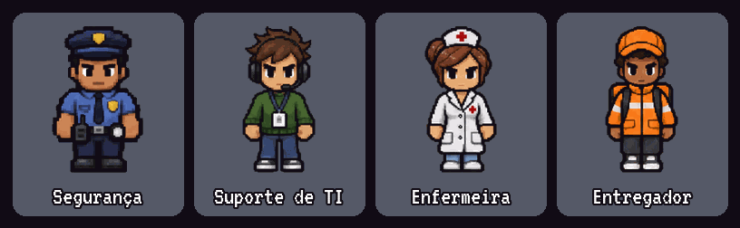

<p align="center">
  
</p>

<p align="center">
  <a href="https://iara-ranking-ao-vivo.vercel.app/"></a>
  <a href="https://iara-tech-night.vercel.app/"></a>
  <a href="https://github.com/ByRodrigoVasco/IARA/releases/latest"></a>
</p>

<p align="center">
  <a href="#a-história">História</a> ·
  <a href="#tecnologias">Tecnologias</a> ·
  <a href="#entregáveis">Entregáveis</a> ·
  <a href="#como-instalar-e-rodar">Instalar e rodar</a> ·
  <a href="#funcionalidades">Funcionalidades</a> ·
  <a href="#squad">Squad</a> ·
  <a href="#créditos-e-menções-honrosas">Créditos</a>
</p>

## A história

IARA é um jogo de terror num escritório. Você acabou de entrar como estagiário na CISSA e trabalha com a IARA, a inteligência artificial da empresa. Ela responde rápido e quase sempre acerta. Com o passar dos dias o escritório muda, algumas respostas param de fazer sentido e você precisa usar lógica para descobrir o que está acontecendo.

A ideia é ensinar ética em IA e lógica clássica enquanto se joga.

## Como se joga

<table>
<tr>
<td width="50%" valign="top">

### Modo História

Você anda pelo escritório, conversa com os colegas e atende os chamados no computador. Em cada chamado dá para:

- resolver sozinho;
- conferir a sugestão da IARA;
- enviar sem conferir.

A história passa por 100 dias, e você joga 9 deles. O que você escolhe define qual dos 4 finais vai ver.

</td>
<td width="50%" valign="top">

### Modo Sobrevivência

É um roguelike com partidas de 10 minutos, para uma ou duas pessoas:

- você só se movimenta, os poderes atacam sozinhos;
- ao subir de nível, escolhe uma carta com um poder novo ou uma melhoria;
- cinco chefes aparecem durante a partida;
- derrotada a IARA, dá para encerrar ou continuar na hora extra, com tudo em dobro;
- o Banco de Horas ganho compra melhorias que ficam no save;
- cumprir objetivos libera personagens e poderes.

</td>
</tr>
</table>

## Tecnologias

<p align="center">

      

</p>

| Tecnologia | Onde usamos |
|---|---|
| C e raylib | O jogo inteiro: telas, desenho 2D, áudio e saves. A versão para terminal usa só C |
| PowerShell | Rodar os testes e gerar o executável |
| Supabase | Banco dos saves e rankings compartilhados |
| Vercel | Hospedagem do ranking ao vivo e do manual |
| GitHub, Jira e Figma | Código, sprints e protótipos |

## Entregáveis

### Introdução: novidades da Unidade 2

Na Unidade 1 o jogo tinha o núcleo em C: menu, máquina de estados, o escritório com colisões e um
quiz jogável. De lá para cá entrou:

| Novidade | O que é |
|---|---|
| **Campanha do Dia 1 ao Dia 100** | O expediente inteiro, com 9 dias jogáveis, Flashes do dia e saltos no calendário. Cada dia traz um conceito de lógica dentro do trabalho, e as escolhas levam a um dos 4 finais |
| **Modo Sobrevivência** | Dez minutos num mapa de 14 áreas do escritório, com 5 atos, 5 chefes, Banco de Horas para comprar melhorias e ranking de partidas |
| **Sobrevivência em dupla** | Duas pessoas no mesmo computador, com controles separados, XP dividida e ranking próprio |
| **Progressão e conquistas** | 12 personagens, cada um com o seu poder, e três poderes extras, liberados por objetivos, com notificação de conquista |
| **Arte nova** | Personagens e Colegas de Plantão redesenhados em alta resolução, e o executável reduzido de cerca de 54 MB para 30 MB |
| **Versão para terminal** | A campanha em texto, sem janela e sem raylib, para PIF |
| **Eventos** | Saves e rankings compartilhados entre dispositivos (opcional). Sem internet, o jogo salva no dispositivo e envia depois |
| **Saves por modo** | Save automático com vários slots, separados entre campanha, Sobrevivência e dupla |
| **Configurações** | Volume da música e dos efeitos, brilho, tela cheia e janela maximizada, guardados entre sessões |
| **Acessibilidade** | Alto contraste, pausa, tela de ajuda e confirmação antes de sair ou desistir |

Tudo roda em um único `iara.exe`, sem instalar nada e sem criar conta. O que entrou em cada sprint está
em [Como o software evoluiu](docs/entregaveis/README.md#como-o-software-evoluiu).

A tabela abaixo leva direto ao que entregamos em cada matéria. A página [Entregáveis](docs/entregaveis/README.md) tem tudo com mais detalhe, além do uso de ponteiros e do bug tracker.

### Sumário dos entregáveis

| Matéria ou tema | Atalhos | Página |
|---|---|---|
| **FDS** · Fundamentos de Desenvolvimento de Software | [Backlog](docs/fds/backlog-board/README.md) · [Diagramas](docs/fds/diagramas-atividade/README.md) · [Protótipos](docs/fds/prototipos-lofi/README.md) · [Sprint 01](docs/fds/sprint-01/README.md) · [02](docs/fds/sprint-02/README.md) · [03](docs/fds/sprint-03/README.md) · [Testes](docs/fds/testes/README.md) · [Bugs](docs/fds/testes/bugs.md) | [Abrir](docs/entregaveis/README.md#fds-fundamentos-de-desenvolvimento-de-software) |
| **PIF** · Programação Imperativa e Funcional | [Núcleo em C](code/src) · [Jogo no terminal](code/terminal/LEIA-ME.md) · [Uso de ponteiros](docs/entregaveis/README.md#uso-de-ponteiros) · [Screencast U2](https://drive.google.com/file/d/1soQDTz9SJSCRORCqMzA3ldWT3vO0Zb2M/view) | [Abrir](docs/entregaveis/README.md#pif-programação-imperativa-e-funcional) |
| **IHC** · Interação Humano-Computador | [Heurísticas de Nielsen](docs/fds/usabilidade-nielsen.md) · [Alto contraste](docs/ihc/alto-contraste.md) · [Vídeo de usabilidade](https://www.youtube.com/watch?v=w3n0H6hxeks) | [Abrir](docs/entregaveis/README.md#ihc-interação-humano-computador) |
| **LMC** · Lógica para Computação | [Puzzles e auditoria de teoria](docs/lmc/mapeamento-puzzles.md) | [Abrir](docs/entregaveis/README.md#lmc-lógica-para-computação) |
| **Metodologia** · Scrum e Kanban | [Jira](https://csprj-adsr-2p-e8.atlassian.net/jira/software/c/projects/PI2/boards/2/backlog) · [Como contribuímos](CONTRIBUTING.md) | [Abrir](docs/entregaveis/README.md#metodologia) |

**Mais:** [Guia do jogo](docs/entregaveis/guia-do-jogo.md) · [Evolução do software](docs/entregaveis/README.md#como-o-software-evoluiu) · [Como contribuir](CONTRIBUTING.md) · [Links externos](docs/entregaveis/README.md#links-externos) · [Arte e áudio originais](arquivo/README.md)

## Como instalar e rodar

### Para jogar

Baixe o `IARA-windows.zip` nas [Releases](https://github.com/ByRodrigoVasco/IARA/releases/latest), extraia e abra o `iara.exe`.

### Compilar o projeto (Windows)

**1.** Instale o [MSYS2](https://www.msys2.org/) na pasta padrão (`C:\msys64`) e abra o **MSYS2 UCRT64**.

**2.** Instale as ferramentas:

```bash
pacman -S --needed git mingw-w64-ucrt-x86_64-gcc mingw-w64-ucrt-x86_64-raylib mingw-w64-ucrt-x86_64-glfw
```

**3.** Baixe o projeto:

```bash
git clone https://github.com/ByRodrigoVasco/IARA.git
cd IARA
```

**4.** Compile e jogue:

```bash
gcc -O2 code/src/*.c code/src/*/*.c -Icode/src -Icode/src/core -Icode/src/screens -Icode/src/ui -Icode/src/game -Icode/src/survival -o iara.exe -lraylib -lopengl32 -lgdi32 -lwinmm
./iara.exe
```

No VS Code, `Ctrl + Shift + B` compila e abre o jogo.

| Ação | Teclas |
|---|---|
| Andar | **WASD** ou setas (na dupla, o jogador 2 usa as setas) |
| Interagir, no Modo História | **ESPAÇO** |
| Escolher carta, no Sobrevivência | Setas ou **1**, **2**, **3**, e **ENTER** |
| Velocidade do tempo, no Sobrevivência | **TAB** (x1, x2, x3) |
| Pausar ou voltar | **ESC** (ou **P**) |
| Tela cheia | **F11** |

<details>
<summary><b>Versão para terminal</b></summary>

<br>

Também dá para jogar no terminal, só em texto e sem raylib. Essa versão tem os 8 dias com mesa de triagem:

```bash
gcc -O2 -std=c11 code/terminal/*.c code/src/game/logic.c -Icode/terminal -Icode/src/game -Icode/src/core -Icode/src/screens -o iara-terminal.exe
./iara-terminal.exe
```

Detalhes em [`code/terminal/LEIA-ME.md`](code/terminal/LEIA-ME.md).

</details>

<details>
<summary><b>Gerar o pacote para outros dispositivos</b></summary>

<br>

```powershell
powershell -ExecutionPolicy Bypass -File tools/pacote/empacotar.ps1
```

O script cria `build/IARA-windows.zip` e `build/release/iara.exe`. O executável já leva imagens, sons e bibliotecas. Para testar fora do ambiente de desenvolvimento, use `tools/pacote/testar_pacote.ps1` e siga o [roteiro de máquina limpa](docs/fds/testes/maquina-limpa.md).

</details>

<details>
<summary><b>Opcional: hospedar o banco, o ranking ao vivo e o manual</b></summary>

<br>

Só é preciso para compartilhar saves e ranking. Sem isso, o jogo salva tudo no próprio dispositivo. Com o banco ligado, ele continua funcionando sem internet e sincroniza quando a rede volta.

**Banco de dados (Supabase)**

1. Em [supabase.com](https://supabase.com), crie um projeto gratuito na região South America (São Paulo).
2. No **SQL Editor**, cole e execute o conteúdo de [`tools/nuvem/supabase.sql`](tools/nuvem/supabase.sql). Em um banco já criado, execute de novo sempre que o arquivo mudar.
3. Defina a senha de apagar saves, trocando `SUA-SENHA` (não salve essa consulta):

   ```sql
   insert into iara_config (chave, valor)
   values ('senha_apagar', encode(sha256(convert_to('SUA-SENHA', 'UTF8')), 'hex'))
   on conflict (chave) do update set valor = excluded.valor;
   ```

4. Crie o arquivo `tools/nuvem/nuvem.local` (o git o ignora) com a *Project URL* e a chave **publishable**. Nunca use a chave secreta.

   ```
   NUVEM_URL=https://<id-do-projeto>.supabase.co
   NUVEM_CHAVE=<chave publishable>
   ```

5. Gere o jogo com `tools/pacote/empacotar.ps1` e confira a mensagem **`nuvem ligada`**. Compilar pelo `gcc` ou pelo VS Code gera o jogo sem nuvem.

**Ranking ao vivo (Vercel):** importe o repositório [IARA-Ranking-ao-vivo](https://github.com/ByRodrigoVasco/IARA-Ranking-ao-vivo), escolha o preset **Other**, crie as variáveis `NUVEM_URL` e `NUVEM_CHAVE` e clique em **Deploy**.

**Manual do jogo (Vercel):** importe este repositório, escolha **Root Directory** `docs/tech-night`, preset **Other** e a branch a publicar ([detalhes](docs/tech-night/README.md)).

Atenção: o plano gratuito do Supabase pausa o projeto depois de uns 7 dias parado. O passo a passo completo, com os testes do banco, está em [`tools/nuvem/LEIA-ME.md`](tools/nuvem/LEIA-ME.md).

</details>

## Funcionalidades

| Modo História | Modo Sobrevivência |
|---|---|
| 100 dias de história, 9 deles jogáveis, com Flashes do dia e saltos no calendário | Mapa com 14 áreas, 5 atos e 5 chefes |
| 4 finais, de acordo com as suas escolhas | 12 personagens e 17 poderes para liberar |
| Puzzles de lógica proposicional explicados pela própria história | Conquistas com aviso na tela e som |
| Dicas dos colegas e do mural, sem entregar a resposta | Plano de Carreira com melhorias permanentes |
| O escritório muda com os dias e com as escolhas, sem números na tela | Modo em dupla no mesmo computador |
| Save automático, com vários saves | Velocidade x1, x2 ou x3, hora extra depois da IARA e ranking |

Nos dois modos há ajuste de volume e brilho, alto contraste, tela cheia, pausa, ajuda e confirmação antes de sair. Em eventos, saves e rankings podem ser compartilhados entre dispositivos e aparecem no [ranking ao vivo](https://iara-ranking-ao-vivo.vercel.app/).

<p align="center">
  
</p>

<p align="center">
  
  
</p>

## Squad

| Foto | Personagem | Nome | Função | Contato |
|:---:|:---:|---|---|---|
|  |  | **Anderson Santos** | Lógica matemática | [GitHub](https://github.com/acampospsantos) · [LinkedIn](https://www.linkedin.com/in/andersoncampospsantos)<br>acps@cesar.school |
|  |  | **João Vitor Medeiros** | Desenvolvimento do motor em C | [GitHub](https://github.com/JvMedeiros7) · [LinkedIn](https://www.linkedin.com/in/jvmedeiros7/)<br>jvm7@cesar.school |
|  |  | **Julio Cesar Lins** | Desenvolvimento do motor em C | [GitHub](https://github.com/Lins-ju) · [LinkedIn](https://www.linkedin.com/in/j%C3%BAlio-lins-123905182/)<br>jcsl@cesar.school |
|  |  | **Laura Brayner** | Design e integração | [GitHub](https://github.com/laurabrayner) · [LinkedIn](https://www.linkedin.com/in/laurabrayner)<br>lcbc@cesar.school |
|  |  | **Luan Arruda** | Design e integração | [GitHub](https://github.com/luan-arruda) · [LinkedIn](https://www.linkedin.com/in/luan-arruda-548a9534b)<br>las9@cesar.school |
|  |  | **Nicolas Mauricio** | Gestão ágil | [GitHub](https://github.com/nicollasfr) · [LinkedIn](https://www.linkedin.com/in/nicollasmfranca/)<br>nmcf@cesar.school |
|  |  | **Rodrigo Vasco** | Engenharia de software | [GitHub](https://github.com/ByRodrigoVasco) · [LinkedIn](https://www.linkedin.com/in/rodrigo-vlm/)<br>rvlm@cesar.school |

## Créditos e menções honrosas

Nosso agradecimento aos professores que acompanharam o projeto. Eles também são personagens do jogo.

<table>
<tr>
<td align="center" width="25%">
<br>
<b>Prof. Lucas</b><br>
<sub>Engenharia de Software</sub>
</td>
<td align="center" width="25%">
<br>
<b>Prof. Baudel</b><br>
<sub>Interação Humano-Computador</sub>
</td>
<td align="center" width="25%">
<br>
<b>Prof. Guilherme</b><br>
<sub>Lógica para Computação</sub>
</td>
<td align="center" width="25%">
<br>
<b>Prof. Danilo</b><br>
<sub>Programação Imperativa e Funcional</sub>
</td>
</tr>
</table>

> *Seção em construção.*
