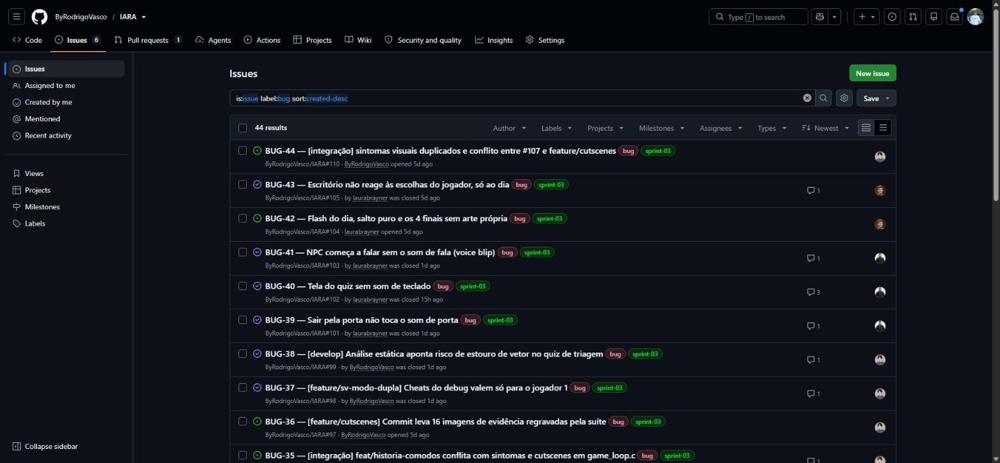

# Entregáveis

Tudo o que foi entregue em cada matéria, em uma página. [Voltar ao início](../../README.md)

**Ir para:** [FDS](#fds-fundamentos-de-desenvolvimento-de-software) · [PIF](#pif-programação-imperativa-e-funcional) · [IHC](#ihc-interação-humano-computador) · [LMC](#lmc-lógica-para-computação) · [Links externos](#links-externos) · [Guia do jogo](guia-do-jogo.md) · [Contribuição](../../CONTRIBUTING.md)

---

## FDS: Fundamentos de Desenvolvimento de Software

Entregas da disciplina que já estão versionadas neste repositório.

| Entrega | Artefato |
|---|---|
| Backlog e board (Entrega 01) | [Backlog e board](../fds/backlog-board/README.md), com o [board no Trello](https://trello.com/b/ifJwhbVe/iara-projeto-integrador-squad-8) |
| Diagramas de atividade, um por história de usuário (Entrega 02) | [Diagramas de atividade](../fds/diagramas-atividade/README.md) |
| Protótipos lo-fi (Entrega 02) | [Protótipos lo-fi](../fds/prototipos-lofi/README.md), elaborados no [Figma](https://www.figma.com/design/DpnmgBif3vJcn336pefbpa/IARA---PROTOTIPO-FDS?node-id=0-1&t=vm69jod3fxAtJGjN-1) |
| Screencast do protótipo de baixa fidelidade (Entrega 02), compartilhado com [IHC](#ihc-interação-humano-computador) | [Vídeo no YouTube](https://youtu.be/qE2Gn79bmqw) |
| Testes de sistema | [Relatório dos testes](../fds/testes/README.md), com os [bugs encontrados](../fds/testes/bugs.md) e o [roteiro do screencast](../fds/testes/roteiro-screencast.md) |
| Rastreabilidade | [Matriz de rastreabilidade](../fds/testes/rastreabilidade.md) |
| Teste em máquina limpa (US02) | [Roteiro](../fds/testes/maquina-limpa.md) |
| Release | [Versões publicadas](https://github.com/ByRodrigoVasco/IARA/releases/latest) |
| Processo e versionamento | [CONTRIBUTING.md](../../CONTRIBUTING.md): fluxo de branches (GitFlow), padrão de commits e Pull Requests |
| Report da Sprint 01 (Entrega 03) | [Report da Sprint 01](../fds/sprint-01/README.md): histórias implementadas, versionamento, testes, programação em pares e evidências |
| Report da Sprint 02 | [Report da Sprint 02](../fds/sprint-02/README.md): histórias da Week 13e14, testes de sistema, [screencast dos testes](../fds/sprint-02/screencast-testes.mp4), bug tracker, programação em pares e prints do board |
| Report da Sprint 03 | [Report da Sprint 03](../fds/sprint-03/README.md): testes de sistema das histórias restantes (CT-94 a CT-105), um screencast por caso, o bug tracker atualizado, os prints do board da sprint final e a [rastreabilidade das 16 histórias entregues](../fds/sprint-03/README.md#rastreabilidade-das-histórias-pi2-330) |

### Screencast do protótipo

### Como o software evoluiu

| Etapa | Período | O que entrou |
|---|---|---|
| Concepção | Ago a set/2026 | Personas, histórias de usuário, backlog no Trello, [diagramas de atividade](../fds/diagramas-atividade/README.md) e [protótipos lo-fi](../fds/prototipos-lofi/README.md) com screencast |
| Núcleo em C | Set a out/2026 | Menu, máquina de estados, escritório com colisões e o primeiro quiz jogável ([screencast do núcleo](https://www.youtube.com/watch?v=z4OrasORL4c)) |
| [Sprint 01](../fds/sprint-01/README.md) | 19/10 a 26/10 | Protótipo jogável para o teste de usabilidade, tela de créditos e a primeira suíte de testes de sistema (32 de 35 aprovados, 8 bugs abertos) |
| [Sprint 02](../fds/sprint-02/README.md) | 26/10 a 06/11 | Save automático, sprites em 8 direções, campanha do Dia 1 ao Dia 100, alto contraste e configurações; suíte com 76 casos, todos aprovados |
| [Sprint 03](../fds/sprint-03/README.md) | 07/11 a 21/11 | Modo Sobrevivência (e em dupla), NPCs, áudio e trilha por momento, pausa e ajuda pelas heurísticas de Nielsen, sintomas visuais e o `CONTRIBUTING.md`; testes CT-94 a CT-105 com um screencast por caso |
| Final | 23/11 a 04/12 | Executável único, correções do bug tracker, escolha de jogar novamente ou sair no fim da partida, nuvem para eventos, versão para terminal, arte nova dos personagens, colegas e poderes, Aviso Prévio no lugar do Ponteiro, progressão com conquistas, jogo mais leve e a Release |

### Qualidade e testes

A suíte automatizada (`tools/tests/run_tests.ps1`) monta o jogo de verdade e o conduz como um jogador. O relatório completo está em [docs/fds/testes](../fds/testes/README.md).

As evidências da Sprint 03, com pré-condição, passos, resultado de cada caso (CT-94 a CT-105), um screencast por caso e os prints do Jira, estão no [report da Sprint 03](../fds/sprint-03/README.md).

### Evidências da Sprint 03

Testes de sistema das histórias que ainda não tinham caso de teste, executados em 20/11/2026 na `develop` (`2386a1c`): **7 de 12 aprovados**, 5 falhas registradas no bug tracker. Pré-condição, passos, esperado e obtido de cada caso estão no [report da Sprint 03](../fds/sprint-03/README.md), junto com os [prints do Jira](../fds/sprint-03/README.md#prints-do-jira): o backlog da sprint e cada card de história com o link do seu screencast.

| Caso | História | Resultado | Screencast |
|---|---|---|---|
| CT-94 | US16: som de passos | ✅ | [CT-94_US-16.mp4](../fds/sprint-03/screencasts/CT-94_US-16.mp4) |
| CT-95 | US16: som de porta | ❌ [#101](https://github.com/ByRodrigoVasco/IARA/issues/101) | [CT-95_US-16.mp4](../fds/sprint-03/screencasts/CT-95_US-16.mp4) |
| CT-96 | US16: ambiente contínuo | ✅ | [CT-96_US-16.mp4](../fds/sprint-03/screencasts/CT-96_US-16.mp4) |
| CT-97 | US16: som de teclado no quiz | ❌ [#102](https://github.com/ByRodrigoVasco/IARA/issues/102) | [CT-97_US-16.mp4](../fds/sprint-03/screencasts/CT-97_US-16.mp4) |
| CT-98 | US16: voz dos NPCs | ❌ [#103](https://github.com/ByRodrigoVasco/IARA/issues/103) | [CT-98_US-16.mp4](../fds/sprint-03/screencasts/CT-98_US-16.mp4) |
| CT-99 | US17: sprites dos NPCs | ✅ | [CT-99_US-17.mp4](../fds/sprint-03/screencasts/CT-99_US-17.mp4) |
| CT-100 | US17: arte do flash, salto e finais | ❌ [#104](https://github.com/ByRodrigoVasco/IARA/issues/104) | [CT-100_US-17.mp4](../fds/sprint-03/screencasts/CT-100_US-17.mp4) |
| CT-101 | US10: sem HUD numérico | ✅ | [CT-101_US-10.mp4](../fds/sprint-03/screencasts/CT-101_US-10.mp4) |
| CT-102 | US10: cenário reage ao jogador | ❌ [#105](https://github.com/ByRodrigoVasco/IARA/issues/105) | [CT-102_US-10.mp4](../fds/sprint-03/screencasts/CT-102_US-10.mp4) |
| CT-103 | US13: tensão progressiva | ✅ | [CT-103_US-13.mp4](../fds/sprint-03/screencasts/CT-103_US-13.mp4) |
| CT-104 | US04: dica pelo NPC | ✅ | [CT-104_US-04.mp4](../fds/sprint-03/screencasts/CT-104_US-04.mp4) |
| CT-105 | US11: pontuação por método | ✅ | [CT-105_US-11.mp4](../fds/sprint-03/screencasts/CT-105_US-11.mp4) |

### Bug Tracker

Print de **25/11/2026**, véspera da entrega, das [Issues do GitHub](https://github.com/ByRodrigoVasco/IARA/issues?q=is%3Aissue+label%3Abug), com as abertas e as fechadas: **44 bugs, 6 em aberto**. Cada issue tem o label da sprint, um responsável e aponta para a história do Jira, o teste e o PR da correção. O status de cada bug também fica em [bugs.md](../fds/testes/bugs.md), em dia com as issues.

---

## PIF: Programação Imperativa e Funcional

Entregas da disciplina que já estão versionadas neste repositório.

| Entrega | Artefato |
|---|---|
| Núcleo do jogo em C | Código-fonte em [`code/src`](../../code/src), renderizado com [raylib](https://www.raylib.com/) |
| Como compilar e executar | Seção [Como instalar e rodar](../../README.md#como-instalar-e-rodar) do README principal |
| Screencast do núcleo em C (Unidade 1) | [Vídeo no YouTube](https://www.youtube.com/watch?v=z4OrasORL4c) |
| Screencast da Unidade 2 | [Vídeo no Google Drive](https://drive.google.com/file/d/1soQDTz9SJSCRORCqMzA3ldWT3vO0Zb2M/view) |
| Jogo no terminal (Unidade 2) | [`code/terminal`](../../code/terminal/LEIA-ME.md), sem raylib, com o mesmo roteiro do jogo gráfico |
| Uso de ponteiros | [Quatro exemplos](#uso-de-ponteiros) nesta página |
| Programação em pares | Relatos nas sprints [01](../fds/sprint-01/README.md) e [03](../fds/sprint-03/README.md) |
| Regras em Haskell | Não cobrado na U2 |

### Screencast da Unidade 1

Versão pré-alpha, com o núcleo do jogo em C.

### Uso de ponteiros

O jogo usa ponteiros em todo o código C. Quatro exemplos:

| Uso | Onde | Como |
|---|---|---|
| Passagem por referência | `fade_in_texture()` em [`ui/animations.c`](../../code/src/ui/animations.c) | Recebe `Color *color` e `bool *is_animation_finished`: a função muda o alpha da cor de quem chamou e avisa o fim da animação pelo mesmo ponteiro, sem precisar devolver nada. |
| Vetor de ponteiros | `day_27_clauses[]` e `day_58_clauses[]` em [`screens/computer_days.h`](../../code/src/screens/computer_days.h), lidos por `logic_is_satisfiable()` em [`game/logic.c`](../../code/src/game/logic.c) | Cada dia guarda suas cláusulas como `const LogicExpression *const day_N_clauses[]`, um vetor de ponteiros para fórmulas. A função recebe esse vetor como `const LogicExpression *const *expressions` e testa todas as combinações de valores. |
| Struct ligada por ponteiros | `LogicExpression` em [`game/logic.h`](../../code/src/game/logic.h) e `logic_evaluate()` em [`game/logic.c`](../../code/src/game/logic.c) | Cada fórmula é uma árvore: a struct aponta para as subfórmulas pelos campos `left` e `right`, e `logic_evaluate()` percorre a árvore de forma recursiva seguindo esses ponteiros. |
| Manipulação de struct por ponteiro | `recompute_stats()` em [`survival/sv_game.c`](../../code/src/survival/sv_game.c) | `SvPlayer *p = &sv_run.player;` aponta para o jogador da partida, e a função recalcula vida, dano, velocidade e os outros atributos direto na struct original, com `p->campo`. |

Além disso, os textos do jogo circulam como `const char *`, e o save é lido e gravado com `FILE *` em `save_game_state()` e `load_game_state()` ([`core/save.c`](../../code/src/core/save.c)).

---

## IHC: Interação Humano-Computador

Entregas da disciplina que já estão versionadas neste repositório.

| Entrega | Artefato |
|---|---|
| Protótipo de baixa fidelidade | [Protótipos lo-fi](../fds/prototipos-lofi/README.md), elaborados no [Figma](https://www.figma.com/design/DpnmgBif3vJcn336pefbpa/IARA---PROTOTIPO-FDS?node-id=0-1&t=vm69jod3fxAtJGjN-1) |
| Screencast do protótipo de baixa fidelidade | [Vídeo no YouTube](https://youtu.be/qE2Gn79bmqw) |
| Comprovação de usabilidade (entrega de 20/11/2026) | [Vídeo no YouTube](https://www.youtube.com/watch?v=w3n0H6hxeks), com os [critérios demonstrados](#comprovação-de-usabilidade) |
| Comprovação das Heurísticas de Nielsen (IHC2) | [Relatório final da equipe](https://drive.google.com/file/d/1koLQyc7byRok119UhpnPiuLb0MBrtWH4/view) |

O protótipo e o screencast dele são compartilhados com [FDS](#fds-fundamentos-de-desenvolvimento-de-software).

### Screencast do protótipo

### Comprovação de usabilidade

[Vídeo no YouTube](https://www.youtube.com/watch?v=w3n0H6hxeks), entregue em 20/11/2026: o jogo rodando, mostrando os critérios de usabilidade que a equipe atendeu.

Critérios demonstrados:

- **As heurísticas de Nielsen**, com o antes e o depois de cada uma na [auditoria de usabilidade](../fds/usabilidade-nielsen.md):
  - **Visibilidade do status:** aviso "Progresso salvo." ao salvar.
  - **Controle e liberdade:** pausa na campanha (ESC ou P), com voltar ao menu e sair do jogo.
  - **Consistência e reconhecimento:** as mesmas peças de interface e as dicas de tecla no rodapé de todas as telas.
  - **Prevenção de erros:** o jogo pergunta antes de sair e antes de desistir da partida, com o botão de cancelar já escolhido.
  - **Flexibilidade:** teclado e mouse em todas as telas, F11 para tela cheia e abertura que pode ser pulada.
  - **Mensagens de erro claras:** uma falha ao salvar diz o que conferir.
  - **Ajuda:** AJUDA no menu e COMO JOGAR no Modo Sobrevivência.
- **Acessibilidade:** [modo de alto contraste](../ihc/alto-contraste.md), com um contorno diferente para cada tipo de elemento e teste com daltonismo simulado.

A avaliação heurística do protótipo, feita antes dessas mudanças, está no relatório [Comprovação das Heurísticas de Nielsen (IHC2)](https://drive.google.com/file/d/1koLQyc7byRok119UhpnPiuLb0MBrtWH4/view).

---

## LMC: Lógica para Computação

Entregas da disciplina que já estão versionadas neste repositório.

| Entrega | Artefato |
|---|---|
| Puzzles ligados à teoria | [Mapeamento de puzzles e auditoria de teoria](../lmc/mapeamento-puzzles.md): cada puzzle associado ao conceito formal de lógica, aguardando a revisão com o material da disciplina |
| Lógica nas histórias de usuário | Diagramas de atividade [US07](../fds/diagramas-atividade/US07-logica-narrativa.md) e [US09](../fds/diagramas-atividade/US09-revisao-correcao-logica.md), em [FDS](../fds/diagramas-atividade/README.md) |
| Avaliador de fórmulas | [`code/src/game/logic.c`](../../code/src/game/logic.c), usado pelo jogo gráfico e pelo [jogo no terminal](../../code/terminal/LEIA-ME.md) |

---

## Links externos

Materiais hospedados fora do repositório:

| Recurso | Descrição | Disciplina |
|---|---|---|
| [Ranking ao vivo](https://iara-ranking-ao-vivo.vercel.app/) | Rankings solo e de duplas em tempo real | Todas |
| [Manual do jogo](https://iara-tech-night.vercel.app/) | Como jogar, chefes, monstros e personagens | Todas |
| [Releases](https://github.com/ByRodrigoVasco/IARA/releases/latest) | Versão publicada da Unidade 2, com o `IARA-windows.zip` gerado pelo `empacotar.ps1` | [FDS](#fds-fundamentos-de-desenvolvimento-de-software) e [PIF](../pif/README.md) |
| [Release v1.0.0](https://github.com/ByRodrigoVasco/IARA/releases/tag/v1.0.0) | Versão entregue na Unidade 2 | [FDS](#fds-fundamentos-de-desenvolvimento-de-software) e [PIF](#pif-programação-imperativa-e-funcional) |
| [Issues](https://github.com/ByRodrigoVasco/IARA/issues) | Bugs e tarefas abertas | [FDS](#fds-fundamentos-de-desenvolvimento-de-software) |
| [Jira](https://csprj-adsr-2p-e8.atlassian.net/jira/software/c/projects/PI2/boards/2/backlog) | Board e backlog do projeto | [FDS](#fds-fundamentos-de-desenvolvimento-de-software) |
| [Figma](https://www.figma.com/design/DpnmgBif3vJcn336pefbpa/IARA---PROTOTIPO-FDS?node-id=0-1&t=vm69jod3fxAtJGjN-1) | Protótipos de baixa fidelidade | [FDS](#fds-fundamentos-de-desenvolvimento-de-software) e [IHC](#ihc-interação-humano-computador) |
| [Screencast do protótipo](https://youtu.be/qE2Gn79bmqw) | Vídeo de demonstração do protótipo lo-fi | [FDS](#fds-fundamentos-de-desenvolvimento-de-software) e [IHC](#ihc-interação-humano-computador) |
| [Comprovação de usabilidade](https://www.youtube.com/watch?v=w3n0H6hxeks) | Vídeo do jogo mostrando os critérios de usabilidade atendidos (entrega de 20/11/2026) | [IHC](#ihc-interação-humano-computador) |
| [User Stories](https://docs.google.com/document/d/1xystBOI81sAymF35XBoupr6fe_IPjK8L6bB3qOobUpk/edit) | Histórias de usuário que originaram os diagramas de atividade | [FDS](#fds-fundamentos-de-desenvolvimento-de-software) |
| [raylib](https://www.raylib.com/) | Biblioteca gráfica usada no núcleo em C | [PIF](../pif/README.md) |
