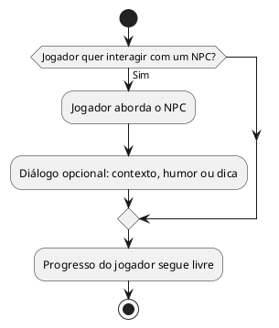

# US14: Interação opcional com NPCs

**User Story:** Como Lívia, quero poder interagir/conversar com NPCs, para ter uma alternativa que não seja só resolver puzzle sozinha.

## Diagrama de atividades

**Critérios cobertos:** NPCs alcançáveis por escolha do jogador; pelo menos 1 interação de diálogo disponível; interação opcional, não bloqueia o progresso.

## Implementação no jogo

- No Dia 1, os colegas começam a se mover em momentos diferentes depois da recepção. Cada um tem destinos e tempos de permanência próprios e retorna à cadeira entre atividades.
- As primeiras saídas têm prioridade. A pausa de Laura com Anderson pode aguardar brevemente as duas vagas para acontecer.
- As cenas 01M e 01F suspendem as rotinas. JV e Vasco podem se levantar e caminhar até o Estagiário antes da fala, com limite de seis segundos por cena.
- Cada NPC conserva sua definição, seus cumprimentos e suas falas por dia em `code/src/game/npcs.c`. A mesa encobre as pernas e a base da cadeira durante a animação.
- A dica alterna entre os NPCs a cada dia jogável, com exatamente um dono por tarefa; os primeiros sete dias jogáveis têm donos diferentes. O balão só aparece depois que o jogador entra na tarefa do computador. A fala permanece opcional e não altera a pontuação.
- Aproxime-se e pressione **Espaço** para abrir ou avançar a conversa. No Dia 1, computador, mural e saída têm prioridade quando as zonas de interação se sobrepõem. NPCs em pé ocupam espaço no piso, e as rotinas pausam durante o diálogo.
