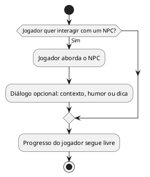

# US14: Interação opcional com NPCs

**User Story:** Como Lívia, quero poder interagir/conversar com NPCs, para ter uma alternativa que não seja só resolver puzzle sozinha.

## Diagrama de atividades

**Critérios cobertos:** NPCs alcançáveis por escolha do jogador; pelo menos 1 interação de diálogo disponível; interação opcional, não bloqueia o progresso.

## Implementação no jogo

- O escritório apresenta NPCs posicionados junto às mesas e áreas mostradas no protótipo.
- Cada personagem tem dados próprios de sprite, posição, orientação e etapas de diálogo em `code/src/game/npcs.c`. Todos permanecem parados; as poses de Anderson, Laura, Nicollas e Vasco são recortadas para parecerem sentados.
- Julio e JV ficam próximos, frente a frente, com um pequeno espaço entre eles; Zito fica ao lado de Vasco, olhando para o norte.
- Anderson, Laura, Nicollas e Vasco ficam alinhados ao centro de suas cadeiras, atrás das mesas. As sprites sentadas são recortadas na altura do peito e terminam junto à borda da mesa; esses NPCs não bloqueiam a movimentação do jogador.
- Para acrescentar uma conversa exclusiva de um dia, adicione as linhas e um `NpcSpecialConversation` com o número do dia na definição do personagem. Essa conversa substitui a conversa padrão naquele dia; a dica diária, se for daquele personagem, continua ao final.
- A dica alterna entre os NPCs a cada dia jogável, com exatamente um dono por tarefa; os primeiros sete dias jogáveis têm donos diferentes. O balão só aparece depois que o jogador entra na tarefa do computador. A fala permanece opcional e não altera a pontuação.
- Aproxime-se e pressione **Espaço** para abrir ou avançar a conversa. O jogador colide com Julio, JV e Zito; os personagens sentados não bloqueiam sua movimentação.
