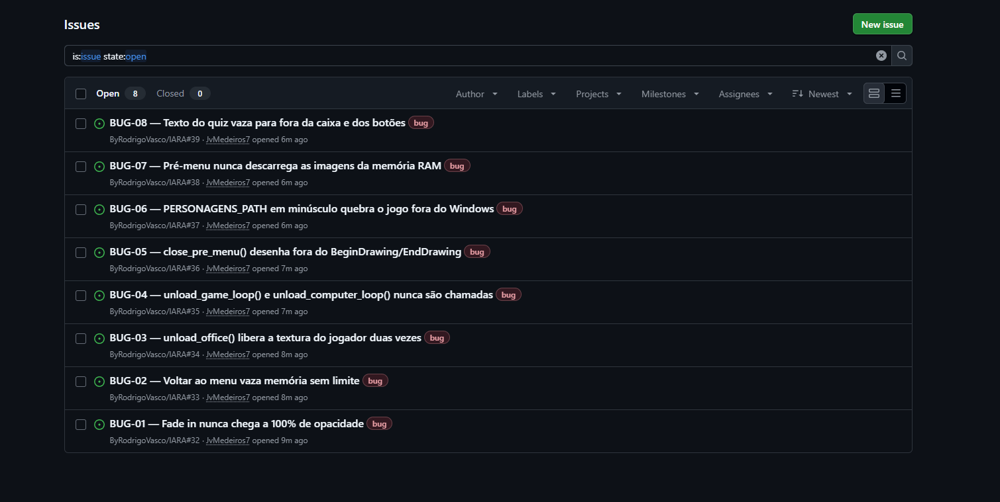
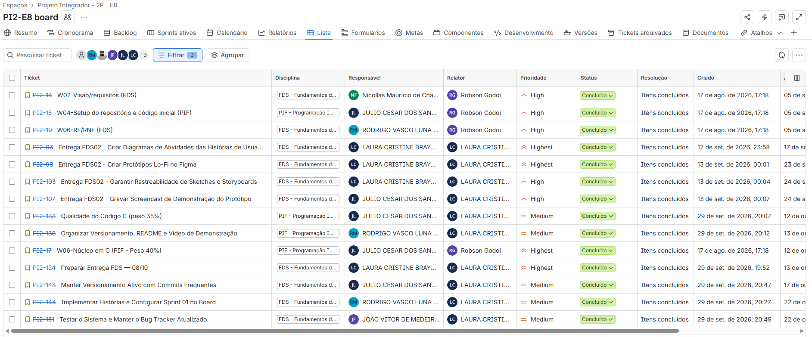
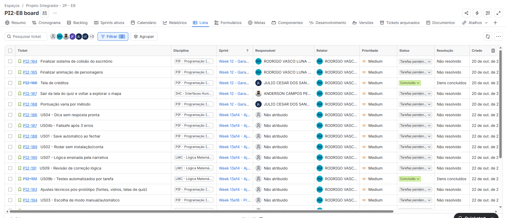
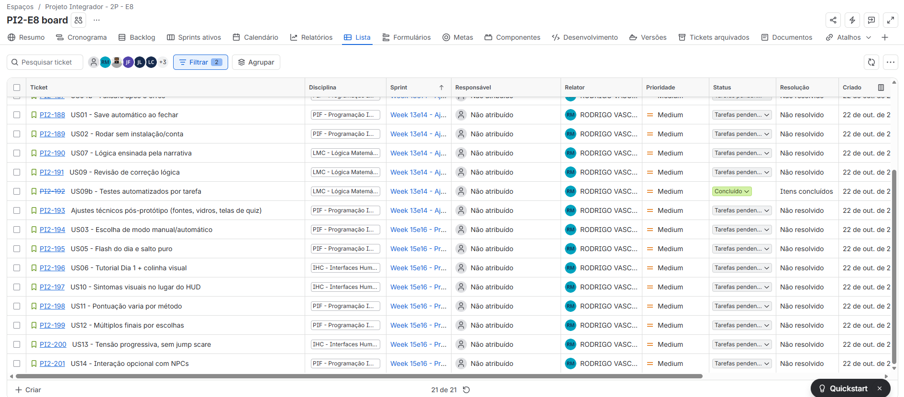
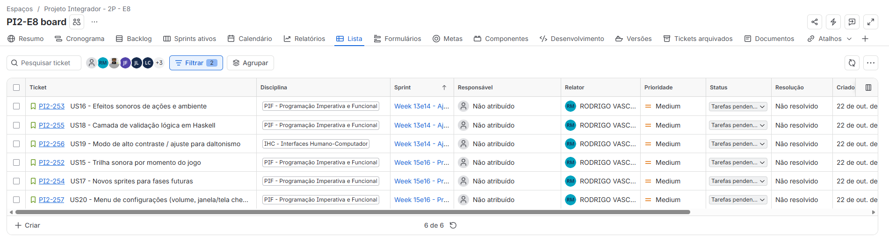

# Report da Sprint 01

Evidências da Entrega 3 de [FDS](../README.md). Cada seção responde a um dos quatro critérios de avaliação.

| Recurso | Link |
|---|---|
| Board (Jira, projeto PI2) | [Board da Sprint](https://csprj-adsr-2p-e8.atlassian.net/jira/software/c/projects/PI2/boards/2/backlog) |
| Repositório | [ByRodrigoVasco/IARA](https://github.com/ByRodrigoVasco/IARA) |
| Bug tracker | [Issues no GitHub](https://github.com/ByRodrigoVasco/IARA/issues) |

## 1. Implementação

Sprint: **Week 12 - Garantir Protótipo** (19/10 a 24/10/2026). Objetivo: garantir um protótipo jogável para o teste de usabilidade.

Histórias com status **Concluído** no Jira:

| Card | História | Responsável | Entrega no repositório |
|---|---|---|---|
| [PI2-166](https://csprj-adsr-2p-e8.atlassian.net/browse/PI2-166) | Tela de créditos | Julio Lins | Branch `Feature/creditos` (`40c918f`) |
| [PI2-192](https://csprj-adsr-2p-e8.atlassian.net/browse/PI2-192) | US09b, Testes automatizados por tarefa | Equipe | PR #31, `feature/testes-de-sistema` (`code/tests/`) |
| [PI2-151](https://csprj-adsr-2p-e8.atlassian.net/browse/PI2-151) | Testar o sistema e manter o bug tracker atualizado | João Vitor Medeiros | PR #31, [relatório de testes](../testes/README.md), issues #32 a #39 |
| [PI2-144](https://csprj-adsr-2p-e8.atlassian.net/browse/PI2-144) | Implementar histórias e configurar a Sprint 01 no board | Rodrigo Vasco | Board do Jira |

Em andamento na sprint (Week 12), ainda não concluídas:

| Card | História | Responsável |
|---|---|---|
| [PI2-164](https://csprj-adsr-2p-e8.atlassian.net/browse/PI2-164) | Finalizar sistema de colisão do escritório (branch já no `develop`; falta o comportamento dos vidros) | Rodrigo Vasco |
| [PI2-165](https://csprj-adsr-2p-e8.atlassian.net/browse/PI2-165) | Finalizar animação de personagens (branch já no `develop`; faltam os frames de norte, sul e diagonais) | Rodrigo Vasco |
| [PI2-155](https://csprj-adsr-2p-e8.atlassian.net/browse/PI2-155) | Documentar pair programming e evidências da sprint | Rodrigo Vasco |
| [PI2-167](https://csprj-adsr-2p-e8.atlassian.net/browse/PI2-167) | Sair da tela do quiz e voltar a explorar o mapa | Anderson Santos |
| [PI2-168](https://csprj-adsr-2p-e8.atlassian.net/browse/PI2-168) | Pontuação varia por método | Julio Lins |

## 2. Versionamento

O fluxo de branches (GitFlow) e o padrão de commits estão no [`CONTRIBUTING.md`](../../../CONTRIBUTING.md). O padrão é validado por um hook (`.githooks/commit-msg`).

- Histórico de commits: [commits da `develop`](https://github.com/ByRodrigoVasco/IARA/commits/develop)
- Pull Requests: [PRs fechados](https://github.com/ByRodrigoVasco/IARA/pulls?q=is%3Apr+is%3Aclosed)

## 3. Qualidade e testes

A equipe usou **testes automatizados** (suíte em C, em `code/tests/`) e **screencast** da execução. A suíte monta o jogo de verdade e o conduz como um jogador faria, da abertura ao fim do quiz.

- **Relatório:** [testes de sistema](../testes/README.md). Na execução de 22/10/2026 foram **32 de 35 casos aprovados**, com 3 falhas registradas como bug.
- **Como executar:**

```powershell
powershell -ExecutionPolicy Bypass -File tools/tests/run_tests.ps1
```

- **Screencast dos testes:** [vídeo no YouTube](https://www.youtube.com/watch?v=QiokVq4x-Ao), gravado por João Vitor e Anderson. O mesmo vídeo deve estar anexado ao card [PI2-153](https://csprj-adsr-2p-e8.atlassian.net/browse/PI2-153).
- **Bugs encontrados:** oito, detalhados em [bugs.md](../testes/bugs.md) e abertos como issues no [bug tracker do GitHub](https://github.com/ByRodrigoVasco/IARA/issues).

| Bug | Problema | Issue |
|---|---|---|
| BUG-01 | Fade in nunca chega a 100% de opacidade | [#32](https://github.com/ByRodrigoVasco/IARA/issues/32) |
| BUG-02 | Voltar ao menu vaza memória sem limite | [#33](https://github.com/ByRodrigoVasco/IARA/issues/33) |
| BUG-03 | `unload_office()` libera a textura do jogador duas vezes | [#34](https://github.com/ByRodrigoVasco/IARA/issues/34) |
| BUG-04 | `unload_game_loop()` e `unload_computer_loop()` nunca são chamadas | [#35](https://github.com/ByRodrigoVasco/IARA/issues/35) |
| BUG-05 | `close_pre_menu()` desenha fora do `BeginDrawing`/`EndDrawing` | [#36](https://github.com/ByRodrigoVasco/IARA/issues/36) |
| BUG-06 | `PERSONAGENS_PATH` em minúsculo quebra o jogo fora do Windows | [#37](https://github.com/ByRodrigoVasco/IARA/issues/37) |
| BUG-07 | Pré-menu nunca descarrega as imagens da memória RAM | [#38](https://github.com/ByRodrigoVasco/IARA/issues/38) |
| BUG-08 | Texto do quiz vaza para fora da caixa e dos botões | [#39](https://github.com/ByRodrigoVasco/IARA/issues/39) |



## 4. Colaboração e evidências

### Programação em pares

| Dupla | O que implementaram | Card |
|---|---|---|
| Rodrigo Vasco e Julio Lins | A animação da tela de início do jogo e do menu. A sessão foi em chamada no Google Meet, com compartilhamento de tela. Foram duas sessões, e em cada uma um programou enquanto o outro acompanhava e ajudava, trocando de papel na segunda. | [PI2-156](https://csprj-adsr-2p-e8.atlassian.net/browse/PI2-156), [PI2-157](https://csprj-adsr-2p-e8.atlassian.net/browse/PI2-157) |
| João Vitor Medeiros e Anderson Santos | A escrita dos testes de sistema, simulando a verificação de que tudo funciona corretamente. Na mesma sessão gravaram o screencast dos testes da entrega de FDS. | [PI2-156](https://csprj-adsr-2p-e8.atlassian.net/browse/PI2-156), [PI2-157](https://csprj-adsr-2p-e8.atlassian.net/browse/PI2-157) |

Registros das sessões:

| Rodrigo Vasco e Julio Lins | João Vitor Medeiros e Anderson Santos |
|---|---|
|  |  |
| Rodrigo compartilhando a tela com `game_loop.c` aberto, e Julio acompanhando. | João Vitor compartilhando a tela com `test_sistema.c` aberto, e Anderson acompanhando. |

### Prints da Sprint e do Backlog

Board do Jira, na visão de lista, com as entregas de FDS e PIF já concluídas:



Board do Jira atual, com as histórias organizadas por sprint: **Week 12** (sprint ativa) e as próximas, **Week 13e14** e **Week 15e16**. O [backlog completo](https://csprj-adsr-2p-e8.atlassian.net/jira/software/c/projects/PI2/boards/2/backlog) fica no Jira.





Novas histórias adicionadas ao backlog (PI2-252 a PI2-257), já planejadas nas sprints **Week 13e14** e **Week 15e16**:



### Screencast das novas histórias

> **PREENCHER:** link do vídeo mostrando as histórias implementadas.
