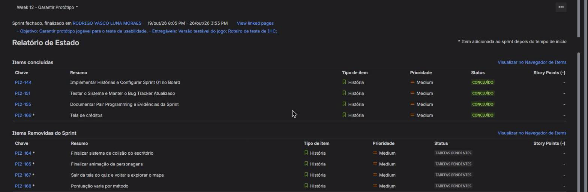
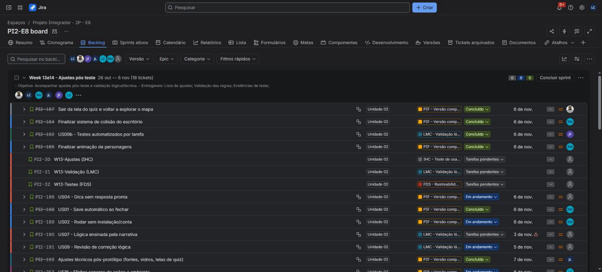
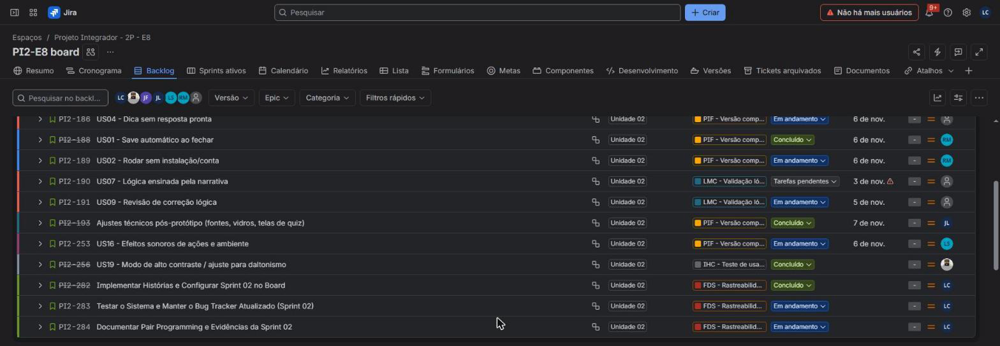

# Report da Sprint 02

Evidências da entrega da Sprint 02 de [FDS](../README.md). Cada seção responde a um dos critérios de avaliação.

| Recurso | Link |
|---|---|
| Board (Jira, projeto PI2) | [Backlog e sprints](https://csprj-adsr-2p-e8.atlassian.net/jira/software/c/projects/PI2/boards/2/backlog) |
| Repositório | [ByRodrigoVasco/IARA](https://github.com/ByRodrigoVasco/IARA) |
| Bug tracker | [Issues no GitHub](https://github.com/ByRodrigoVasco/IARA/issues?q=is%3Aissue) |
| Report anterior | [Sprint 01](../sprint-01/README.md) |

## 3. Qualidade e testes

A equipe manteve a **suíte automatizada de testes de sistema** em `code/tests/`. Ela monta o jogo de verdade e o conduz como um jogador faria, da abertura ao fim da campanha. Nesta sprint a suíte passou de 35 para **76 casos**, cobrindo o save automático, o alto contraste, a dica no mural, a lógica formal dos puzzles e a campanha do Dia 1 ao Dia 100.

- **Relatório:** [testes de sistema](../testes/README.md), com a [matriz de rastreabilidade](../testes/rastreabilidade.md).
- **Resultado:** **76 de 76 casos aprovados**, mais os quatro conjuntos de unidade (`test_collisions`, `test_characters`, `test_save` e `test_hints`).
- **Como executar:**

```powershell
powershell -ExecutionPolicy Bypass -File tools/tests/run_tests.ps1
```

### Screencast dos testes

<a href="screencast-testes.mp4">
  
</a>

[Assistir ao screencast](screencast-testes.mp4) (2 min 48 s). O terminal à esquerda mostra a compilação e cada caso aprovado. A janela à direita é o jogo sendo conduzido pelos testes: cartão do dia, escritório, computador, colinha e fim do dia. O vídeo também deve ficar anexado ao card [PI2-289](https://csprj-adsr-2p-e8.atlassian.net/browse/PI2-289).

A gravação é de 03/11/2026, sobre a `develop` no commit `63c2d01`, e o log está em [`execucao-screencast-2026-11-03.txt`](execucao-screencast-2026-11-03.txt). Ela foi feita em Linux (gcc, raylib 5.5, tela virtual Xvfb), com os mesmos conjuntos e arquivos do `run_tests.ps1`. A única diferença está no CT-24, que mede a memória do processo: no Windows a suíte usa a `kernel32`, e no Linux a medição veio do `/proc`. A execução de referência no Windows está no [relatório](../testes/README.md).

### Bug tracker

Os bugs ficam como issues no [GitHub](https://github.com/ByRodrigoVasco/IARA/issues?q=is%3Aissue), com o detalhamento em [bugs.md](../testes/bugs.md). Nesta sprint entraram os BUG-09 a BUG-12, e os BUG-01 a BUG-08 da Sprint 01 foram corrigidos e fechados.

| Bug | Problema | Issue | Situação |
|---|---|---|---|
| BUG-09 | Rótulos das mesas vazam dos botões | [#43](https://github.com/ByRodrigoVasco/IARA/issues/43) | Corrigido, issue fechada |
| BUG-10 | Falha ao trocar o save pode perder o progresso | [#44](https://github.com/ByRodrigoVasco/IARA/issues/44) | Corrigido, issue fechada |
| BUG-11 | Fundo do cartão do dia é carregado e nunca desenhado | [#45](https://github.com/ByRodrigoVasco/IARA/issues/45) | Corrigido, issue fechada |
| BUG-12 | Menu não tem como começar uma partida nova | [#46](https://github.com/ByRodrigoVasco/IARA/issues/46) | Aberto: falta decidir onde fica a opção |


## 4. Processo

### Commits

A equipe fez commits em todas as semanas da sprint, seguindo o padrão do [`CONTRIBUTING.md`](../../../CONTRIBUTING.md) (validado pelo hook `.githooks/commit-msg`):

| Semana | Commits na `develop` | Destaques |
|---|---|---|
| 26/10 a 01/11 | 5 | Save automático ([PR #41](https://github.com/ByRodrigoVasco/IARA/pull/41)) |
| 02/11 a 07/11 | 16 até 03/11 | Sprites em 8 direções, desktop e configurações, campanha do Dia 1 ao Dia 100, correções dos BUG-09 a BUG-11 ([PR #47](https://github.com/ByRodrigoVasco/IARA/pull/47)) |

- Histórico: [commits da `develop`](https://github.com/ByRodrigoVasco/IARA/commits/develop)
- Pull Requests: [PRs fechados](https://github.com/ByRodrigoVasco/IARA/pulls?q=is%3Apr+is%3Aclosed)

### Programação em pares

Na Sprint 02 a equipe **não fez sessões de programação em pares**. Cada integrante pegou uma história, implementou sozinho em uma branch própria e integrou o trabalho na `develop`, por merge da branch ou por Pull Request, seguindo o fluxo do [`CONTRIBUTING.md`](../../../CONTRIBUTING.md). As sessões em pares da equipe estão registradas no [report da Sprint 01](../sprint-01/README.md#programação-em-pares).

### Prints da Sprint e do Backlog

**Sprint 01 (Week 12 - Garantir Protótipo, 19/10 a 26/10/2026).** Relatório da sprint no Jira, com as 4 histórias concluídas e as que saíram da sprint sem concluir (PI2-164, PI2-165 e PI2-167 foram concluídas na Sprint 02):



**Sprint 02 (Week 13e14 - Ajustes pós teste, 26/10 a 06/11/2026).** Backlog do Jira com as 18 histórias da sprint e o status de cada uma:




