# Report da Sprint 03: testes de sistema e bug tracker

Evidências de qualidade da Sprint 03 (Week 15e16 - Prep Apresentação, 07/11 a 20/11/2026) de [FDS](../README.md).

| Recurso | Link |
|---|---|
| Board (Jira, projeto PI2) | [Backlog e sprints](https://csprj-adsr-2p-e8.atlassian.net/jira/software/c/projects/PI2/boards/2/backlog) |
| Bug tracker | [Issues no GitHub](https://github.com/ByRodrigoVasco/IARA/issues?q=is%3Aissue+label%3Abug) |
| Relatório completo da suíte | [Testes de sistema](../testes/README.md) e [bugs.md](../testes/bugs.md) |
| Report anterior | [Sprint 02](../sprint-02/README.md) |

## Testes de sistema das histórias restantes (PI2-298)

A Sprint 03 tem 18 histórias de produto. Doze já tinham caso de teste das sprints anteriores (CT-01 a CT-93). As que ainda não tinham ganharam os casos **CT-94 a CT-105**, no bloco 4 da suíte, [`code/tests/test_sprint03.c`](../../../code/tests/test_sprint03.c).

O bloco monta o jogo de verdade e o conduz quadro a quadro pela máquina de estados. O teclado passa por um gancho: o teste "segura" WASD para andar e "aperta" ESPAÇO para conversar, abrir o computador e sair pela porta, e todo o resto é o código do jogo. Os sons passam por um registro que anota cada arquivo tocado. É assim que os casos da US16 conferem o que o jogador ouviria.

- **Execução:** 20/11/2026, `develop` no commit `2386a1c`
- **Resultado:** **7 de 12 aprovados**. As 5 falhas viraram as issues #101 a #105 (BUG-39 a BUG-43)
- **Como executar:** `powershell -ExecutionPolicy Bypass -File tools/tests/run_tests.ps1` (a suíte inteira) ou `build/tests/test_sprint03 CT-95` (um caso só, como no screencast)

### Casos de teste

| CT | História | Pré-condição | Passos | Resultado esperado | Resultado obtido | Resultado | Screencast |
|---|---|---|---|---|---|---|---|
| CT-94 | US16 · [PI2-262](https://csprj-adsr-2p-e8.atlassian.net/browse/PI2-262) | Partida nova, Dia 1, jogador parado na entrada | 1. Segurar D por 1,5 s 2. Soltar e esperar 0,5 s | O som de passos toca durante a caminhada e para quando o jogador para | Andou 180 px; passos tocando em 90 de 90 quadros; parado, o som parou | ✅ Passou | [CT-94_US-16.mp4](screencasts/CT-94_US-16.mp4) |
| CT-95 | US16 · [PI2-263](https://csprj-adsr-2p-e8.atlassian.net/browse/PI2-263) | Dia 1 com os chamados já resolvidos | 1. Andar até a porta de vidro 2. Apertar ESPAÇO e acompanhar 1 s | Toca o som de porta (`PORTA ABRINDO.mp3`) | O dia termina pela porta, mas nenhum som toca; o arquivo nem é carregado | ❌ Falhou: [#101](https://github.com/ByRodrigoVasco/IARA/issues/101) | [CT-95_US-16.mp4](screencasts/CT-95_US-16.mp4) |
| CT-96 | US16 · [PI2-264](https://csprj-adsr-2p-e8.atlassian.net/browse/PI2-264) | Dia 1, jogador no escritório | 1. Ficar 3 s no escritório 2. Abrir o computador e ficar 2 s no quiz | `SOM AMBIENTE.mp3` toca no escritório e continua, mais baixo, no quiz | Ambiente com peso 1,00 no escritório e 0,20 por baixo do quiz | ✅ Passou | [CT-96_US-16.mp4](screencasts/CT-96_US-16.mp4) |
| CT-97 | US16 · [PI2-264](https://csprj-adsr-2p-e8.atlassian.net/browse/PI2-264) | Dia 1, chamados abertos | 1. Andar até o computador e apertar ESPAÇO 2. Responder os chamados do dia | Toca o som de teclado (`SOM DE TECLADO.ogg`) | Nenhum som no computador; o arquivo não é carregado | ❌ Falhou: [#102](https://github.com/ByRodrigoVasco/IARA/issues/102) | [CT-97_US-16.mp4](screencasts/CT-97_US-16.mp4) |
| CT-98 | US16 · [PI2-265](https://csprj-adsr-2p-e8.atlassian.net/browse/PI2-265) | Dia 1, jogador no escritório | 1. Andar até o Anderson 2. Apertar ESPAÇO e acompanhar 1 s da fala 3. Passar a conversa até o fim | Toca um voice blip enquanto a fala aparece | A conversa abre, mas a voz não toca em nenhum dos 60 quadros | ❌ Falhou: [#103](https://github.com/ByRodrigoVasco/IARA/issues/103) | [CT-98_US-16.mp4](screencasts/CT-98_US-16.mp4) |
| CT-99 | US17 · [PI2-269](https://csprj-adsr-2p-e8.atlassian.net/browse/PI2-269) | Assets em `code/assets/sprites/PERSONAGENS` | 1. Conferir `walk/<direção>-0..3.png` de cada NPC 2. Carregar os NPCs como o jogo carrega | Os 7 NPCs completos e `initialize_npcs()` sem erro | 7 de 7 NPCs com as 7 direções × 4 quadros; nenhum arquivo faltando | ✅ Passou | [CT-99_US-17.mp4](screencasts/CT-99_US-17.mp4) |
| CT-100 | US17 · [PI2-267](https://csprj-adsr-2p-e8.atlassian.net/browse/PI2-267), [PI2-268](https://csprj-adsr-2p-e8.atlassian.net/browse/PI2-268) | Partida no Dia 1 | 1. Abrir o Flash do Dia 2 2. Procurar arte de flash, salto e finais 3. Abrir o cartão do final | Imagens próprias para o Flash ou o salto e para os 4 finais | Flash = escritório escurecido com texto; salto e os 4 finais só texto; 0 imagens | ❌ Falhou: [#104](https://github.com/ByRodrigoVasco/IARA/issues/104) | [CT-100_US-17.mp4](screencasts/CT-100_US-17.mp4) |
| CT-101 | US10 · [PI2-236](https://csprj-adsr-2p-e8.atlassian.net/browse/PI2-236) | Dia 27, escritório à vista | 1. Fotografar com as estatísticas zeradas 2. Fotografar com 999 pontos e 9 em cada eixo | Nenhum número de status aparece | 0 pixels diferentes entre as duas fotos | ✅ Passou | [CT-101_US-10.mp4](screencasts/CT-101_US-10.mp4) |
| CT-102 | US10 · [PI2-237](https://csprj-adsr-2p-e8.atlassian.net/browse/PI2-237) | Dia 27, escritório à vista | 1. Fotografar com as estatísticas de quem confere tudo 2. Fotografar com as de quem só envia sem conferir 3. Comparar com o Dia 89 | O escritório fica diferente para os dois jogadores no mesmo dia | 0 pixels diferentes no mesmo dia (entre o Dia 27 e o 89, 413.679): o cenário muda com o dia, não com as escolhas | ❌ Falhou: [#105](https://github.com/ByRodrigoVasco/IARA/issues/105) | [CT-102_US-10.mp4](screencasts/CT-102_US-10.mp4) |
| CT-103 | US13 · [PI2-245](https://csprj-adsr-2p-e8.atlassian.net/browse/PI2-245) a [PI2-247](https://csprj-adsr-2p-e8.atlassian.net/browse/PI2-247) | Partida nova | 1. Abrir os 9 dias jogáveis em ordem 2. Conferir sons de susto | Dia 1 calmo, tensão e água nunca recuam, nenhum grito ou glitch | Tensão de 0,00 a 1,00 e água de 0,00 a 1,00 sem recuar; nenhum som de susto | ✅ Passou | [CT-103_US-13.mp4](screencasts/CT-103_US-13.mp4) |
| CT-104 | US04 · [PI2-202](https://csprj-adsr-2p-e8.atlassian.net/browse/PI2-202) | Cada dia jogável, jogador na entrada | 1. Andar até o NPC da dica do dia 2. Conversar até o fim | 9 de 9 dias com a dica no diálogo, pontos iguais e nenhuma dica da IARA | Dica ouvida em 9 de 9 dias, pontos iguais em 9 de 9, nunca da IARA | ✅ Passou | [CT-104_US-04.mp4](screencasts/CT-104_US-04.mp4) |
| CT-105 | US11 · [PI2-168](https://csprj-adsr-2p-e8.atlassian.net/browse/PI2-168) | Partida nova, 9 dias com 5 chamados | 1. Jogar os 9 dias com dica, sem dica e só com a IARA 2. Repetir trocando o método de um dia só | Com dica > sem dica > IARA, somados, e um dia isolado não muda o final | 496, 451 e 1 pontos (Finais C, A e B); trocando um dia, os finais continuam A e B | ✅ Passou | [CT-105_US-11.mp4](screencasts/CT-105_US-11.mp4) |

As outras histórias da sprint já tinham casos das sprints anteriores, e todos passaram de novo nesta execução: US03 (CT-77 e CT-78), US04b (CT-50, CT-51, CT-74), US05 (CT-45, CT-46, CT-64, CT-71), US06 (CT-52 a CT-54), US07 e US09 (CT-61 a CT-66), US12 (CT-70, CT-72), US14 (CT-79), US15 (CT-92, CT-93) e US20 (CT-80, CT-81). A US02 é coberta pelo teste do pacote (PKG-01 a PKG-11, `tools/pacote/testar_pacote.ps1`), que só roda no Windows e não foi repetido nesta execução.

### Screencasts (PI2-299)

Cada caso foi gravado sozinho: o terminal à esquerda mostra a pré-condição, os passos, o esperado, o obtido e o veredito; à direita, a janela do jogo conduzida pelo teste. Os vídeos são nomeados `CT-xx_US-yy.mp4` e ficam em [`screencasts/`](screencasts/).

A gravação foi feita em Linux (gcc, raylib, tela virtual Xvfb), com os mesmos arquivos e a mesma lista de fontes do `run_tests.ps1`. Na tela virtual não há placa de som: o áudio roda num dispositivo nulo, então o vídeo não tem som, e os casos da US16 mostram no terminal quais sons o jogo mandou tocar.

## Prints do Jira

O professor não tem acesso ao board, então as evidências do Jira ficam aqui, como nas sprints anteriores.

**Sprint 03 (Week 15e16 - Prep Apresentação, 07/11 a 20/11/2026).** Backlog do Jira com os 25 tickets da sprint e o status de cada um, conferido em 20/11/2026:

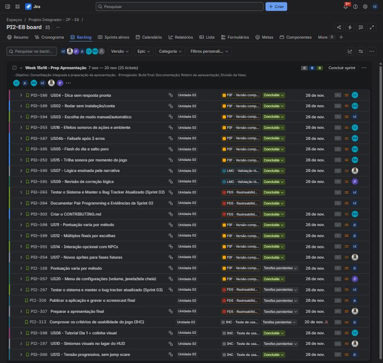

**Screencast ligado a cada história.** Cada card de história testada nesta sprint tem um comentário com o resultado do caso de teste e o link do screencast:

| História | Casos | Print do card |
|---|---|---|
| PI2-253 · US16 Efeitos sonoros | CT-94 a CT-98 | 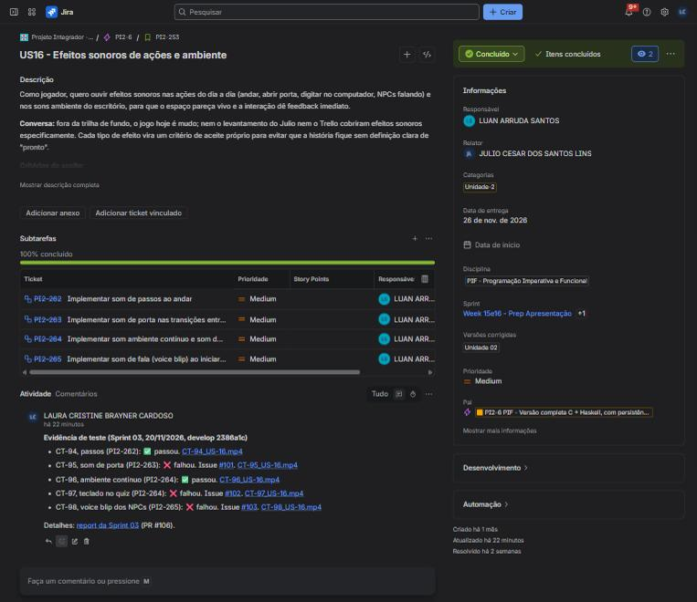 |
| PI2-254 · US17 Novos sprites | CT-99 e CT-100 | 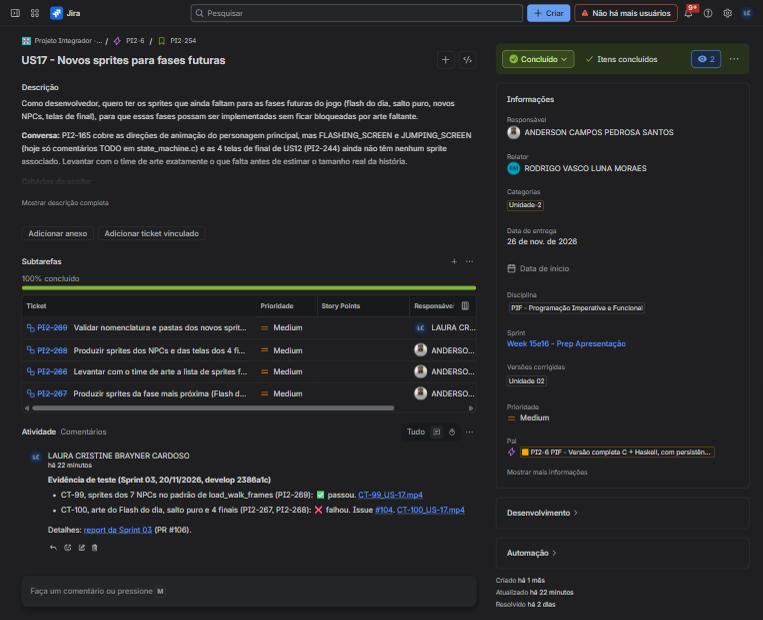 |
| PI2-197 · US10 Sintomas visuais | CT-101 e CT-102 | 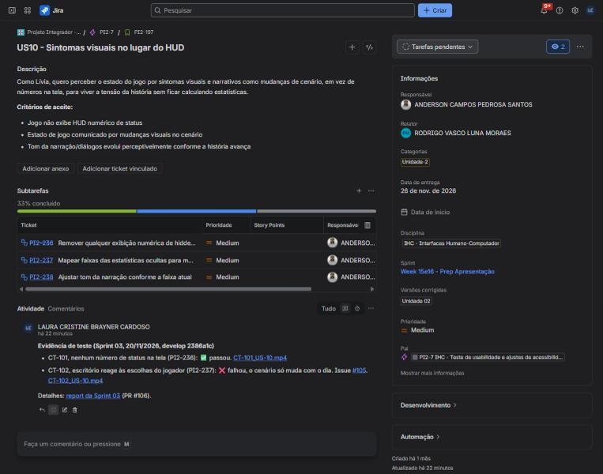 |
| PI2-200 · US13 Tensão progressiva | CT-103 | 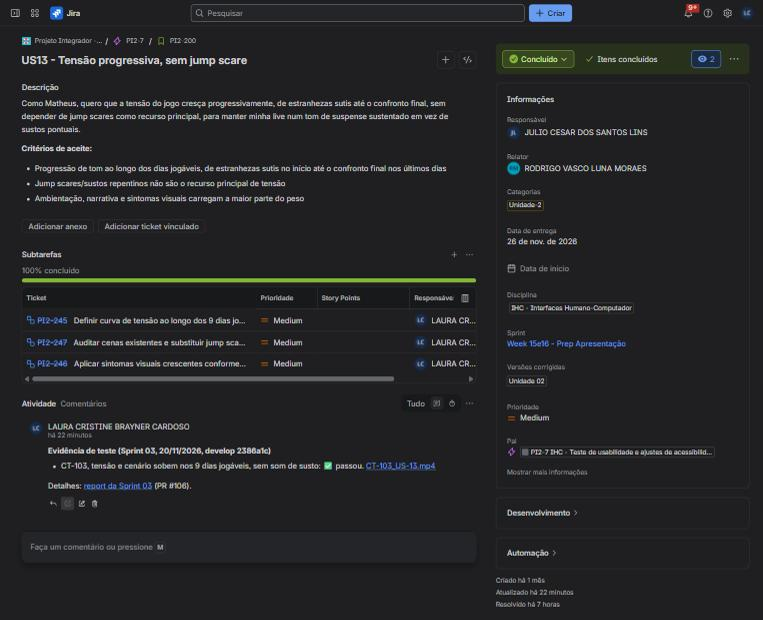 |
| PI2-186 · US04 Dica sem resposta pronta | CT-104 | 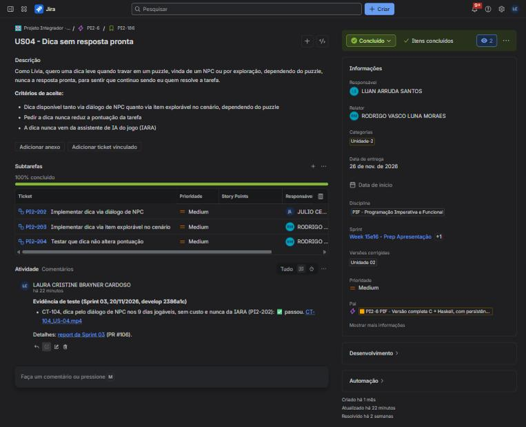 |
| PI2-168 · Pontuação varia por método | CT-105 | 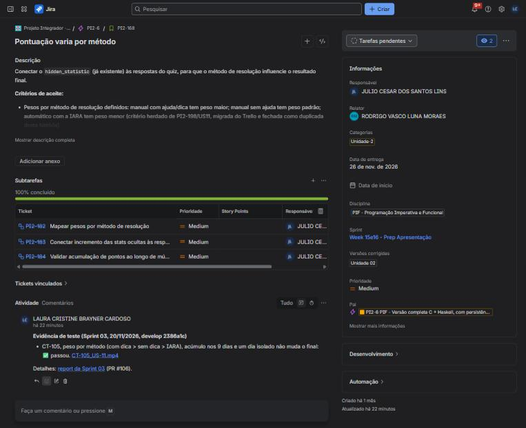 |

## Bug tracker (PI2-300 e PI2-301)

Conferido em **20/11/2026**: [Issues do GitHub](https://github.com/ByRodrigoVasco/IARA/issues?q=is%3Aissue+label%3Abug).

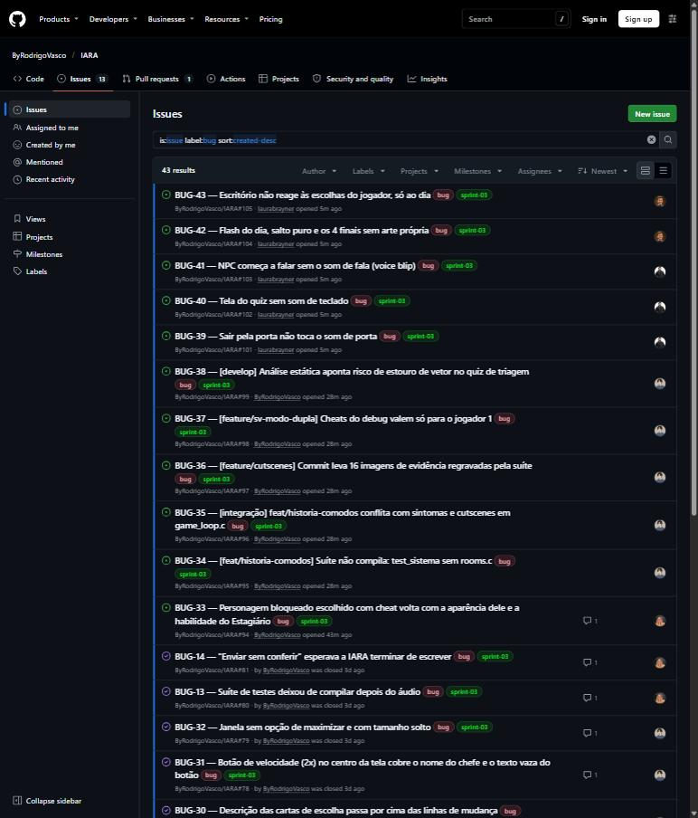

- **Abertas nesta sprint pelos testes:** BUG-39 a BUG-43 (#101 a #105), com passos para reproduzir, o caso de teste e a história do Jira.
- **Todas as 43 issues de bug** têm agora o label da sprint em que foram achadas (`sprint-01`, `sprint-02` ou `sprint-03`), um responsável e uma seção "Rastreabilidade" com a história do Jira, o teste e o PR e o commit da correção.
- **Abertas:** BUG-17 e BUG-18 (desempenho, gravidade baixa), BUG-33 a BUG-38 (abertas em 20/11 por Rodrigo, a maior parte em branches que ainda não entraram na `develop`) e BUG-39 a BUG-43.
- **Fechadas:** BUG-01 a BUG-16 e BUG-19 a BUG-32, cada uma citando o PR da correção (#47, #55, #61, #63, #76 ou #82).

## Board da sprint final (PI2-335)

O professor não tem acesso ao Jira, então os prints do board ficam aqui. A sprint final de entregas foi a **Week 15e16 - Prep Apresentação** (07/11 a 21/11/2026). A Week 17e18 que veio depois só reúne a apresentação e a entrega. O board foi atualizado ao longo da sprint, card a card, conforme cada entrega ficou pronta.

**Relatório da sprint no Jira**, com a sprint fechada em 21/11/2026:

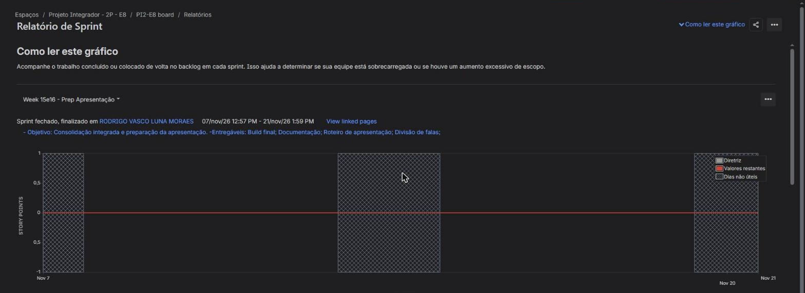

**Os 25 cards da sprint**, todos concluídos, com o responsável de cada um (conferido em 24/11/2026):

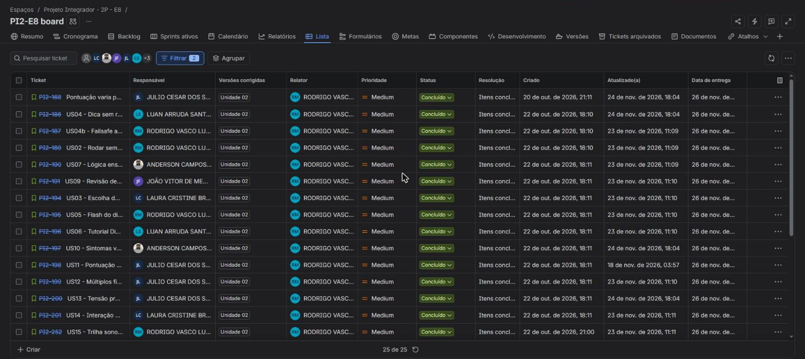

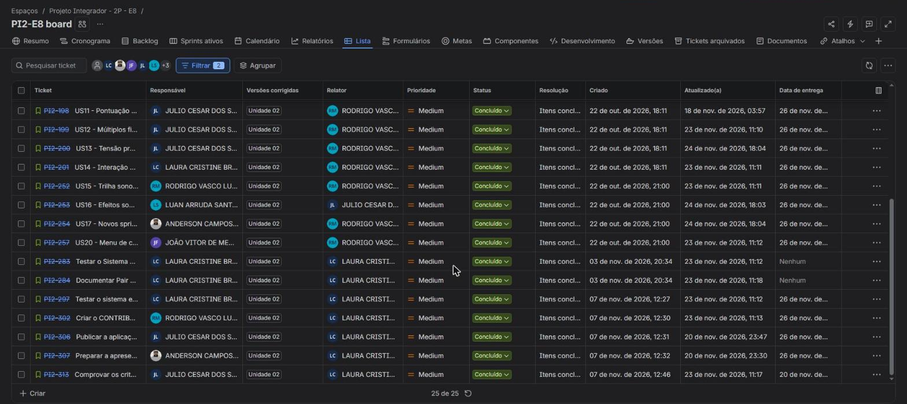

## Programação em pares (PI2-331)

Na [Sprint 02](../sprint-02/README.md#programação-em-pares) a equipe não fez sessões em pares, e as da [Sprint 01](../sprint-01/README.md#programação-em-pares) ficaram registradas lá. Esta é a sessão desta etapa, e a seção que faltava neste report.

| Dupla | Quando | Em que trabalharam |
|---|---|---|
| João Vitor Medeiros e Laura Brayner | 25/11/2026, 13h33 | Jogo de terminal da Unidade 2 de PIF, na branch `feature/jogo-de-terminal` ([PR #136](https://github.com/ByRodrigoVasco/IARA/pull/136)) |

A sessão foi em chamada no Google Meet, com João Vitor compartilhando a tela e Laura acompanhando. Passaram por quatro pontos:

- **A validação da entrada**, em [`code/terminal/entrada.c`](../../../code/terminal/entrada.c), função `entrada_ler_linha`. O ponto discutido foi o descarte da sobra da linha: quando o que o jogador digita não cabe no buffer, o resto fica no `stdin` e viraria a resposta da pergunta seguinte se não fosse jogado fora na hora.
- **O log de desempenho**, em [`code/src/main.c`](../../../code/src/main.c), função `log_frame_spike`, que registra em `iara-desempenho.log` os quadros que passaram de 60 ms, com a hora e a tela.
- **O jogo rodando.** Compilaram e jogaram o Dia 3, a mesa do Tiago, conferindo a norma `(P ∧ ¬B) ∨ I` linha por linha contra os valores de cada chamado.
- **Revisão geral** dos quatro módulos do jogo de terminal: `jogo.c`, `mesa.c`, `entrada.c` e `texto.c`.

**E daí.** A sessão alinhou a dupla num código que até então só um integrante tinha mexido. A versão para terminal nasceu inteira na Unidade 2, com quatro módulos novos e um header compartilhado com o jogo gráfico; depois da sessão, Laura conhece a estrutura e consegue revisar o PR ou continuar o trabalho sem partir do zero. Esse foi o ganho principal, acima de qualquer correção pontual — num grupo onde cada um vinha pegando uma história e implementando sozinho, o risco real não era o bug, era o código que só uma pessoa sabe ler.

**Sobre a data.** A sessão foi em 25/11/2026, já na Week 17e18, enquanto a squad fechava a entrega da Unidade 2. A Sprint 03 (Week 15e16) havia encerrado em 21/11/2026. O relato fica neste report porque é aqui que a seção de pares faltava, mas a data é a real, e está visível nos próprios registros abaixo.

Registros da sessão:

Google Meet com a tela compartilhada, mostrando o projeto aberto na branch `feature/jogo-de-terminal` e a pasta `code/terminal` com os módulos novos:

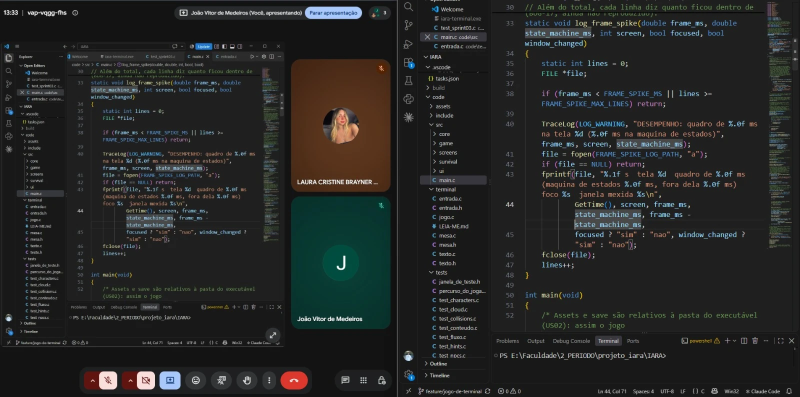

O jogo de terminal rodando no PowerShell, no Dia 3, com o bilhete do Tiago e a norma a aplicar:

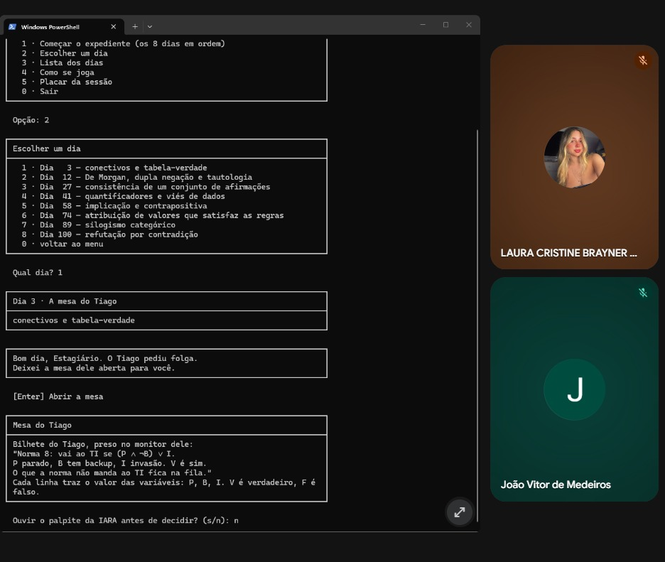

A função `entrada_ler_linha` em `entrada.c`, o trecho da validação da entrada discutido na sessão:

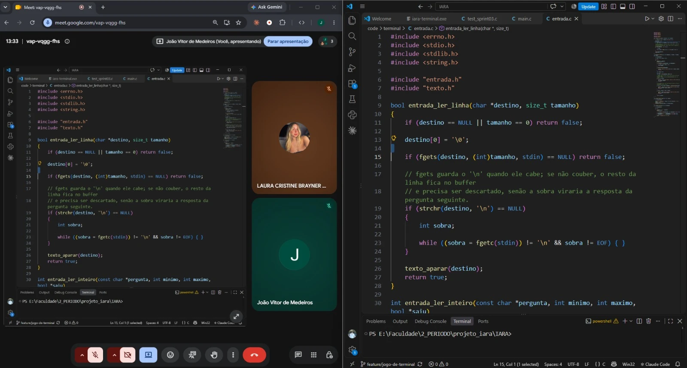

## Rastreabilidade das histórias (PI2-330)

Uma linha por história entregue, da necessidade da persona até a evidência. Conferido em 24/11/2026 na `develop` (`c9b0d28`).

**Total acumulado: 16 histórias entregues** (meta da disciplina: 15). São elas: US02 a US07, US09 a US17 e US20. A US04b e a US09b entram na linha da história principal, porque completam a mesma necessidade.

| # | Necessidade (persona) | História | Card do Jira | Issue | PR / commit | Código | Caso de teste | Screencast / evidência |
|---|---|---|---|---|---|---|---|---|
| 1 | Wagner: usar o jogo numa aula sem depender do TI para instalar | US02 Rodar sem instalação/conta | [PI2-189](https://csprj-adsr-2p-e8.atlassian.net/browse/PI2-189) | Nenhum bug registrado | [PR #47](https://github.com/ByRodrigoVasco/IARA/pull/47) (pacote), [PR #115](https://github.com/ByRodrigoVasco/IARA/pull/115) (executável único) | [`empacotar.ps1`](../../../tools/pacote/empacotar.ps1), [`build_release.ps1`](../../../tools/release/build_release.ps1), [`assets_fs.c`](../../../code/src/core/assets_fs.c) | PKG-01 a PKG-12 (`tools/pacote/testar_pacote.ps1`) | [Roteiro de máquina limpa](../testes/maquina-limpa.md) ⚠️ |
| 2 | Lívia: controlar quando praticar e quando avançar rápido | US03 Escolha manual/automático | [PI2-194](https://csprj-adsr-2p-e8.atlassian.net/browse/PI2-194) | [#81](https://github.com/ByRodrigoVasco/IARA/issues/81) (BUG-14) | [PR #47](https://github.com/ByRodrigoVasco/IARA/pull/47), [PR #55](https://github.com/ByRodrigoVasco/IARA/pull/55) | [`computer_loop.c`](../../../code/src/screens/computer_loop.c), [`game_state.c`](../../../code/src/core/game_state.c) | [CT-47 a CT-49, CT-55, CT-59, CT-77, CT-78](../testes/README.md) | [screencast da Sprint 02](../sprint-02/screencast-testes.mp4) (CT-47 a CT-59) e [log de 07/11](../testes/evidencias/execucao-2026-11-07.txt) (CT-77, CT-78) |
| 3 | Lívia: ter uma dica sem perder a sensação de resolver sozinha, e nunca ficar travada | US04 Dica sem resposta pronta (e US04b Failsafe após 3 erros) | [PI2-186](https://csprj-adsr-2p-e8.atlassian.net/browse/PI2-186), [PI2-187](https://csprj-adsr-2p-e8.atlassian.net/browse/PI2-187) | [#70](https://github.com/ByRodrigoVasco/IARA/issues/70) (BUG-25) | [PR #47](https://github.com/ByRodrigoVasco/IARA/pull/47) (dica no cenário e failsafe), [PR #54](https://github.com/ByRodrigoVasco/IARA/pull/54) (dica pelo NPC) | [`hints.c`](../../../code/src/game/hints.c), [`npcs.c`](../../../code/src/game/npcs.c), [`computer_loop.c`](../../../code/src/screens/computer_loop.c) | [CT-38, CT-39, CT-104; failsafe: CT-50, CT-51, CT-56, CT-74](../testes/README.md) | [CT-104_US-04.mp4](screencasts/CT-104_US-04.mp4) e [screencast da Sprint 02](../sprint-02/screencast-testes.mp4) |
| 4 | Matheus: os 100 dias cabem numa live de 15 a 20 min | US05 Flash do dia e salto puro | [PI2-195](https://csprj-adsr-2p-e8.atlassian.net/browse/PI2-195) | [#45](https://github.com/ByRodrigoVasco/IARA/issues/45) (BUG-11), [#72](https://github.com/ByRodrigoVasco/IARA/issues/72) (BUG-27) | [PR #47](https://github.com/ByRodrigoVasco/IARA/pull/47) | [`calendar.c`](../../../code/src/game/calendar.c), [`game_loop.c`](../../../code/src/screens/game_loop.c) | [CT-45, CT-46, CT-64, CT-71](../testes/README.md) | [screencast da Sprint 02](../sprint-02/screencast-testes.mp4) e [print do Flash do Dia 2](../testes/evidencias/flash-do-dia-2.png) |
| 5 | Lívia: entender os símbolos e os dois modos antes dos puzzles difíceis | US06 Tutorial do Dia 1 e colinha | [PI2-196](https://csprj-adsr-2p-e8.atlassian.net/browse/PI2-196) | [#71](https://github.com/ByRodrigoVasco/IARA/issues/71) (BUG-26) | [PR #47](https://github.com/ByRodrigoVasco/IARA/pull/47) | [`cheat_sheet.c`](../../../code/src/ui/cheat_sheet.c), [`computer_loop.c`](../../../code/src/screens/computer_loop.c) | [CT-17 a CT-20, CT-34, CT-52 a CT-54](../testes/README.md) | [screencast da Sprint 01](https://www.youtube.com/watch?v=QiokVq4x-Ao), [screencast da Sprint 02](../sprint-02/screencast-testes.mp4) e [print da colinha](../testes/evidencias/colinha-no-monitor.png) |
| 6 | Lívia: aprender lógica sem parecer uma aula disfarçada | US07 Lógica ensinada pela narrativa | [PI2-190](https://csprj-adsr-2p-e8.atlassian.net/browse/PI2-190) | Nenhum bug registrado | [PR #47](https://github.com/ByRodrigoVasco/IARA/pull/47), [PR #52](https://github.com/ByRodrigoVasco/IARA/pull/52) | [`logic.c`](../../../code/src/game/logic.c), [`computer_days.h`](../../../code/src/screens/computer_days.h) | [CT-61, CT-62](../testes/README.md) | [screencast da Sprint 02](../sprint-02/screencast-testes.mp4) e [mapeamento dos puzzles](../../lmc/mapeamento-puzzles.md) |
| 7 | Wagner: recomendar o jogo sem medo de ensinar algo errado | US09 Revisão de correção lógica (e US09b Testes por tarefa) | [PI2-191](https://csprj-adsr-2p-e8.atlassian.net/browse/PI2-191), [PI2-192](https://csprj-adsr-2p-e8.atlassian.net/browse/PI2-192) | [#80](https://github.com/ByRodrigoVasco/IARA/issues/80) (BUG-13) | [PR #31](https://github.com/ByRodrigoVasco/IARA/pull/31) (suíte de testes), [PR #47](https://github.com/ByRodrigoVasco/IARA/pull/47) (revisão) | [`mapeamento-puzzles.md`](../../lmc/mapeamento-puzzles.md), [`code/tests/`](../../../code/tests/) | [CT-61 a CT-66](../testes/README.md) | [screencast da Sprint 02](../sprint-02/screencast-testes.mp4) e revisão em PDF no card [PI2-218](https://csprj-adsr-2p-e8.atlassian.net/browse/PI2-218) |
| 8 | Lívia: sentir a tensão sem ficar calculando números | US10 Sintomas visuais no lugar do HUD | [PI2-197](https://csprj-adsr-2p-e8.atlassian.net/browse/PI2-197) | [#105](https://github.com/ByRodrigoVasco/IARA/issues/105) (BUG-43), [#110](https://github.com/ByRodrigoVasco/IARA/issues/110) (BUG-44, aberto) | [PR #107](https://github.com/ByRodrigoVasco/IARA/pull/107) | [`symptoms.c`](../../../code/src/game/symptoms.c), [`office_symptoms.c`](../../../code/src/ui/office_symptoms.c) | [CT-101, CT-102](../testes/README.md) | [CT-101_US-10.mp4](screencasts/CT-101_US-10.mp4), [CT-102_US-10.mp4](screencasts/CT-102_US-10.mp4) ⚠️ |
| 9 | Lívia: sentir que as escolhas importam | US11 Pontuação varia por método | [PI2-198](https://csprj-adsr-2p-e8.atlassian.net/browse/PI2-198), [PI2-168](https://csprj-adsr-2p-e8.atlassian.net/browse/PI2-168) | Nenhum bug registrado | [PR #47](https://github.com/ByRodrigoVasco/IARA/pull/47) | [`game_state.c`](../../../code/src/core/game_state.c) (`resolve_day_tasks()`) | [CT-47 a CT-49, CT-51, CT-58, CT-63, CT-105](../testes/README.md) | [CT-105_US-11.mp4](screencasts/CT-105_US-11.mp4) e [screencast da Sprint 02](../sprint-02/screencast-testes.mp4) |
| 10 | Matheus: mostrar ao público que cada decisão pesou | US12 Múltiplos finais por escolhas | [PI2-199](https://csprj-adsr-2p-e8.atlassian.net/browse/PI2-199) | Nenhum bug registrado | [PR #47](https://github.com/ByRodrigoVasco/IARA/pull/47) | [`game_state.c`](../../../code/src/core/game_state.c) (`get_game_ending()`) | [CT-70, CT-72](../testes/README.md) | [screencast da Sprint 02](../sprint-02/screencast-testes.mp4) e [print de um final](../testes/evidencias/final-ruptura.png) |
| 11 | Matheus: suspense contínuo na live, sem sustos pontuais | US13 Tensão progressiva, sem jump scare | [PI2-200](https://csprj-adsr-2p-e8.atlassian.net/browse/PI2-200) | [#73](https://github.com/ByRodrigoVasco/IARA/issues/73) (BUG-28) | [PR #47](https://github.com/ByRodrigoVasco/IARA/pull/47), [PR #90](https://github.com/ByRodrigoVasco/IARA/pull/90) (trilha conforme a tensão) | [`calendar.c`](../../../code/src/game/calendar.c), [`computer_days.h`](../../../code/src/screens/computer_days.h), [`audio.c`](../../../code/src/core/audio.c) | [CT-71, CT-103](../testes/README.md) | [CT-103_US-13.mp4](screencasts/CT-103_US-13.mp4) e [screencast da Sprint 02](../sprint-02/screencast-testes.mp4) |
| 12 | Lívia: ter alternativa a resolver tudo sozinha | US14 Interação opcional com NPCs | [PI2-201](https://csprj-adsr-2p-e8.atlassian.net/browse/PI2-201) | [#67](https://github.com/ByRodrigoVasco/IARA/issues/67) (BUG-22), [#70](https://github.com/ByRodrigoVasco/IARA/issues/70) (BUG-25) | [PR #54](https://github.com/ByRodrigoVasco/IARA/pull/54), [PR #62](https://github.com/ByRodrigoVasco/IARA/pull/62) | [`npcs.c`](../../../code/src/game/npcs.c), [`game_loop.c`](../../../code/src/screens/game_loop.c) | `test_npcs`, [CT-72, CT-79](../testes/README.md) | [screencast da Sprint 02](../sprint-02/screencast-testes.mp4) (CT-72) ⚠️ |
| 13 | Jogador: sentir a atmosfera de horror corporativo | US15 Trilha sonora por momento do jogo | [PI2-252](https://csprj-adsr-2p-e8.atlassian.net/browse/PI2-252) | [#59](https://github.com/ByRodrigoVasco/IARA/issues/59) (BUG-18) | [PR #53](https://github.com/ByRodrigoVasco/IARA/pull/53), [PR #90](https://github.com/ByRodrigoVasco/IARA/pull/90) | [`audio.c`](../../../code/src/core/audio.c) | [CT-92, CT-93](../testes/README.md) | ⚠️ Sem screencast |
| 14 | Jogador: o escritório parece vivo e cada ação dá retorno | US16 Efeitos sonoros de ações e ambiente | [PI2-253](https://csprj-adsr-2p-e8.atlassian.net/browse/PI2-253) | [#101](https://github.com/ByRodrigoVasco/IARA/issues/101), [#102](https://github.com/ByRodrigoVasco/IARA/issues/102), [#103](https://github.com/ByRodrigoVasco/IARA/issues/103) (BUG-39 a BUG-41) | [PR #53](https://github.com/ByRodrigoVasco/IARA/pull/53); correções no merge [`aeefb3d`](https://github.com/ByRodrigoVasco/IARA/commit/aeefb3d) (sem PR) | [`audio.c`](../../../code/src/core/audio.c), [`game_loop.c`](../../../code/src/screens/game_loop.c), [`computer_loop.c`](../../../code/src/screens/computer_loop.c) | [CT-94 a CT-98](../testes/README.md) | [CT-94_US-16.mp4](screencasts/CT-94_US-16.mp4), [CT-95_US-16.mp4](screencasts/CT-95_US-16.mp4), [CT-96_US-16.mp4](screencasts/CT-96_US-16.mp4), [CT-97_US-16.mp4](screencasts/CT-97_US-16.mp4), [CT-98_US-16.mp4](screencasts/CT-98_US-16.mp4) ⚠️ |
| 15 | Desenvolvedor: as fases futuras não ficam travadas por falta de arte | US17 Novos sprites para fases futuras | [PI2-254](https://csprj-adsr-2p-e8.atlassian.net/browse/PI2-254) | [#104](https://github.com/ByRodrigoVasco/IARA/issues/104) (BUG-42, aberto) | [PR #31](https://github.com/ByRodrigoVasco/IARA/pull/31) (quadros de caminhada), [PR #54](https://github.com/ByRodrigoVasco/IARA/pull/54) (NPCs no mapa) | [`PERSONAGENS/`](../../../code/assets/sprites/PERSONAGENS/), [`npcs.c`](../../../code/src/game/npcs.c) | [CT-99, CT-100](../testes/README.md) | [CT-99_US-17.mp4](screencasts/CT-99_US-17.mp4), [CT-100_US-17.mp4](screencasts/CT-100_US-17.mp4) ⚠️ |
| 16 | Jogador: jogar do jeito que prefere sem editar arquivos | US20 Menu de configurações | [PI2-257](https://csprj-adsr-2p-e8.atlassian.net/browse/PI2-257) | [#79](https://github.com/ByRodrigoVasco/IARA/issues/79) (BUG-32) | [PR #47](https://github.com/ByRodrigoVasco/IARA/pull/47), [PR #75](https://github.com/ByRodrigoVasco/IARA/pull/75), [PR #82](https://github.com/ByRodrigoVasco/IARA/pull/82) | [`settings.c`](../../../code/src/screens/settings.c), [`preferences.c`](../../../code/src/core/preferences.c) | [CT-14, CT-43, CT-80, CT-81](../testes/README.md) | [screencast da Sprint 02](../sprint-02/screencast-testes.mp4) (CT-14 e CT-43) ⚠️ |

A coluna **Issue** traz os bugs do [bug tracker](https://github.com/ByRodrigoVasco/IARA/issues?q=is%3Aissue+label%3Abug) ligados à história. "Nenhum bug registrado" quer dizer que nenhuma issue de bug foi aberta para a história.

### Elos que ainda faltam (⚠️)

- **US02:** o [roteiro de máquina limpa](../testes/maquina-limpa.md) ainda está com a coluna Resultado em branco. Falta rodar numa máquina do laboratório e preencher.
- **US10:** o vídeo do CT-102 mostra a falha (BUG-43). A correção entrou pelo PR #107, mas o caso não foi gravado de novo.
- **US14:** o CT-79 (jogar sem falar com nenhum NPC) não tem vídeo.
- **US15:** o CT-92 e o CT-93 não têm vídeo nem log salvo.
- **US16:** os vídeos do CT-95, CT-97 e CT-98 mostram as falhas (BUG-39 a BUG-41), corrigidas em 24/11/2026. Falta reexecutar e gravar de novo.
- **US17:** o CT-100 falha porque a arte do Flash, do salto e dos 4 finais ainda não existe (BUG-42, aberto).
- **US20:** o CT-80 e o CT-81 não têm vídeo. A janela e o volume aparecem no screencast da Sprint 02 (CT-14 e CT-43).
