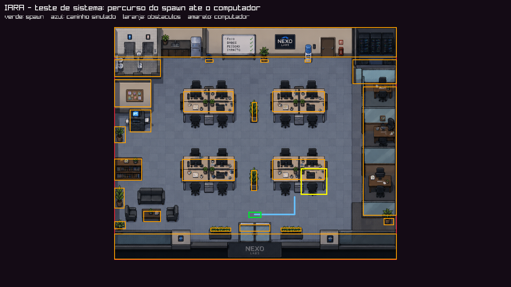
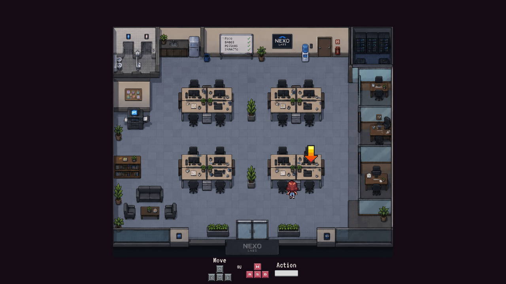
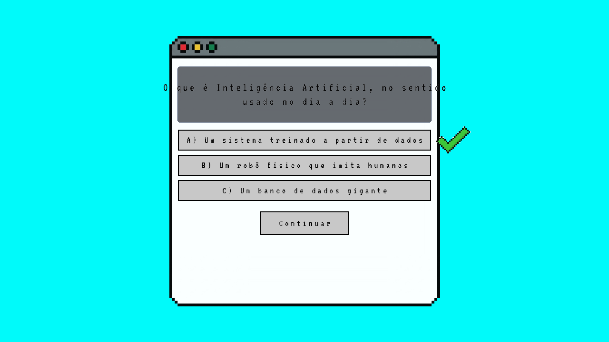

# Testes de sistema

Relatório da execução dos testes de sistema do IARA: o jogo testado como um todo,
simulando o uso real de um jogador.

| | |
|---|---|
| **Data da execução** | 22/10/2026 |
| **Versão testada** | branch `develop`, commit `b366e7c` |
| **Ambiente** | Windows 11, MSYS2 UCRT64, gcc 16.2.0, raylib |
| **Resultado** | **32 de 35 casos aprovados** — 3 falhas, todas registradas como bug |
| **Veredito** | **Aprovado com ressalvas**: nenhuma falha impede jogar |

## Como executar

```powershell
powershell -ExecutionPolicy Bypass -File tools/tests/run_tests.ps1
```

O script compila e roda os cinco conjuntos de teste e devolve um resumo. O código
de saída é `0` quando tudo passa e `1` quando há falha, o que permite ligar a
suíte a um CI mais adiante.

O parâmetro `-Pausado` espera uma tecla entre um conjunto e o outro, para dar tempo
de narrar durante a gravação do screencast.

## O que foi testado

A suíte monta o jogo de verdade — os mesmos módulos, os mesmos arquivos de mídia,
a mesma máquina de estados — e o conduz como um jogador faria. Não há simulação de
fachada: `test_sistema` (CT-01 a CT-16) inclui `game_loop.c` para alcançar o estado
interno real da partida, `test_conteudo` (CT-17 a CT-24) percorre o quiz e o menu, e
`test_fluxo` (CT-25 a CT-35) monta o jogo inteiro menos a `main.c` e o percorre do
começo ao fim com a janela à vista: abertura, menu, CRÉDITOS e a volta ao menu,
INICIAR, cartão do dia, caminhada pelo escritório e as quatro perguntas do quiz. Junto rodam os dois testes de unidade que já existiam,
`test_collisions` e `test_characters`.

## Casos de teste

| ID | Caso | Resultado |
|---|---|---|
| CT-01 | Janela do jogo inicializa | OK |
| CT-02 | Fonte do jogo cobre os acentos do português (16 de 16) | OK |
| CT-03 | Todos os arquivos de mídia usados pelo jogo existem (25 de 25) | OK |
| CT-04 | Mapa do escritório carregado na placa de vídeo | OK |
| CT-05 | Sprites das 8 direções do jogador carregados | OK |
| CT-06 | Frames do andar (leste e oeste) carregados | OK |
| CT-07 | Animação do andar percorre os 4 frames em ciclo | OK |
| CT-08 | Jogador consegue ir do spawn até o computador (72 passos) | OK |
| CT-09 | Jogador nasce livre, fora de qualquer obstáculo | OK |
| CT-10 | Jogador nunca entra em um obstáculo ao andar (20.000 passos) | OK |
| CT-11 | Jogador nunca sai dos limites do mapa | OK |
| CT-12 | Empurrar contra as 4 bordas não atravessa a parede | OK |
| CT-13 | Zona do computador só acende com o jogador em cima | OK |
| CT-14 | Redimensionar a janela mantém o jogador no mesmo ponto do mapa | OK |
| CT-15 | Fade in chega à opacidade total (alpha 255) | **FALHA — [BUG-01](bugs.md#bug-01)** |
| CT-16 | Fade out chega à transparência total (alpha 0) | OK |
| CT-17 | Roteiro do computador íntegro (textos, opções e gabarito) | OK |
| CT-18 | Roteiro abre e fecha com uma tela de texto | OK |
| CT-19 | Jogador percorre o roteiro do início ao fim (4 perguntas) | OK |
| CT-20 | Fim do roteiro encerra a tela do computador | OK |
| CT-21 | Menu abre em INICIAR, destravado | OK |
| CT-22 | Seleção do menu circula nos dois sentidos | OK |
| CT-23 | Confirmar guarda a opção escolhida e fecha o menu | OK |
| CT-24 | Abrir e fechar o menu várias vezes não acumula memória | **FALHA — [BUG-02](bugs.md#bug-02)** |
| CT-25 | Partida começa no dia 1, em um dia jogável | OK |
| CT-26 | Estatísticas ocultas começam no valor base | OK |
| CT-27 | Tela de abertura termina sozinha e entrega o menu (283 quadros) | OK |
| CT-28 | Escolher CRÉDITOS abre a tela de créditos e ela permanece aberta | OK |
| CT-29 | Voltar dos créditos e tela desconhecida devolvem o jogador ao menu | OK |
| CT-30 | Escolher INICIAR no menu começa a partida | OK |
| CT-31 | Cartão do dia termina e o escritório aparece (10,1 s) | OK |
| CT-32 | Personagem atravessa o escritório até o computador (53 passos) | OK |
| CT-33 | Interagir com o computador abre a tela do quiz | OK |
| CT-34 | Jogador responde as 4 perguntas e conclui o quiz | OK |
| CT-35 | Texto do computador cabe dentro da caixa e dos botões | **FALHA — [BUG-08](bugs.md#bug-08)** |

## Evidência do percurso

O CT-08 procura um caminho do spawn até o computador dando um passo de jogador por
vez, com as funções de colisão reais. A imagem abaixo é gerada pela própria execução
do teste: verde é o spawn, azul é o caminho encontrado, laranja são os 25 obstáculos
do escritório e amarelo é a zona de interação do computador.



O bloco 3 vai além e roda a partida na tela: abertura, menu, cartão do dia,
caminhada pelo escritório e entrada no computador. A imagem abaixo é um quadro
capturado pelo próprio teste, com o personagem parado em frente ao computador e a
seta de interação acesa.



O bloco segue até o computador e responde as quatro perguntas. Foi nesta captura
que apareceu o [BUG-08](bugs.md#bug-08): repare no enunciado vazando para fora da
caixa cinza, cortado nas duas bordas.



## Bugs encontrados

Oito problemas, três pegos pelos testes automatizados e cinco por inspeção do código
durante a escrita da suíte. O detalhamento e o texto pronto para abrir cada issue
estão em **[bugs.md](bugs.md)**.

| ID | Problema | Gravidade | Como foi achado |
|---|---|---|---|
| [BUG-01](bugs.md#bug-01) | Fade in para em alpha 250 e nunca fica 100% opaco | Baixa | CT-15 |
| [BUG-02](bugs.md#bug-02) | Voltar ao menu vaza memória sem limite (~7 MB por volta) | **Alta** | CT-24 |
| [BUG-03](bugs.md#bug-03) | `unload_office()` libera a textura do jogador duas vezes | Média | Inspeção |
| [BUG-04](bugs.md#bug-04) | `unload_game_loop()` e `unload_computer_loop()` nunca são chamadas | Baixa | Inspeção |
| [BUG-05](bugs.md#bug-05) | `close_pre_menu()` desenha fora do par `BeginDrawing`/`EndDrawing` | Baixa | Inspeção |
| [BUG-06](bugs.md#bug-06) | `PERSONAGENS_PATH` em minúsculo quebra o jogo fora do Windows | Média | Inspeção |
| [BUG-07](bugs.md#bug-07) | Pré-menu nunca descarrega as imagens da memória RAM | Média | Inspeção |
| [BUG-08](bugs.md#bug-08) | Texto do quiz vaza para fora da caixa e dos botões | Média | CT-35 |

Nenhum deles impede jogar a versão atual: o jogo abre, o menu funciona, o
personagem anda, colide e chega ao computador, e o quiz vai até o fim.

## O que a suíte ainda não cobre

**Entrada de teclado e mouse de verdade**: a raylib não permite injetar teclas, então
os testes chamam as mesmas funções de movimento que `handle_player_input()` chama,
substituindo só a leitura do teclado — o mapeamento tecla → direção continua sendo
verificado à mão. **Aparência**: os testes provam que as texturas carregam e que as
posições batem, não que a tela está legível. **Telas não implementadas**: dia de
flash e dia de salto não têm o que testar. O CT-29 verifica, para os créditos, a
volta ao menu com uma tecla simulada (só nesse ponto a leitura de teclado é
substituída, e o resto da tela é o código real) e que uma tela desconhecida também
devolve o jogador ao menu. **Haskell**: as regras puras de PIF ficam de fora.

O roteiro para gravar o screencast desta execução está em
[roteiro-screencast.md](roteiro-screencast.md).
