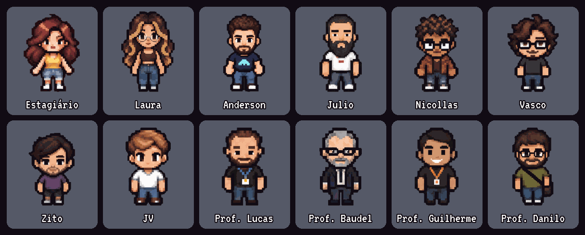
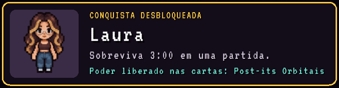
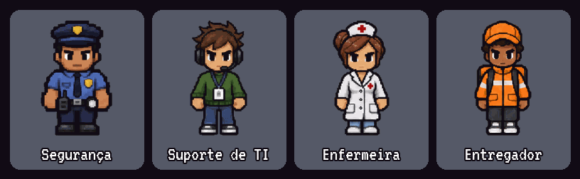

# Guia do jogo

Os detalhes de como o IARA funciona. Para instalar e compilar, veja o [README principal](../../README.md#como-compilar-e-executar).

[Ranking ao vivo](https://iara-ranking-ao-vivo.vercel.app/) · [Manual do jogo](https://iara-tech-night.vercel.app/)

## Janela, pausa e configurações

O jogo abre em janela. Ele tem três modos de tela, sempre um só: **janela** de tamanho fixo (o padrão), **janela maximizada** e **tela cheia**. As caixas **Tela cheia** e **Janela maximizada**, em `CONFIGURAÇÕES` no menu, escolhem o modo, e **F11** alterna a tela cheia com a última janela. A mesma tela ajusta o brilho e o alto contraste, e as escolhas ficam salvas em `iara.ini`. **ESC** sai do computador e volta ao escritório; no escritório (ou com **P**) pausa o jogo, com CONTINUAR, SAIR PARA O MENU e SAIR PARA A ÁREA DE TRABALHO; nos créditos, nas configurações e na ajuda volta ao menu; e no menu pergunta se você quer mesmo sair. O progresso é salvo ao voltar ao menu e ao fechar o jogo, e a opção **AJUDA** do menu explica como jogar. Nos cartões de início e de fim de cada dia, **ESPAÇO**, **ENTER**, um clique ou o botão PULAR passam à frente. A auditoria de usabilidade está em [`usabilidade-nielsen.md`](../fds/usabilidade-nielsen.md).

## Modos e saves

`INICIAR` abre a escolha do **modo**: `MODO NORMAL` (a campanha), `MODO SOBREVIVÊNCIA` ou `SOBREVIVÊNCIA EM DUPLA`. Depois do modo vem a escolha do **save**: a lista dos saves daquele modo, `NOVO SAVE` para criar um com outro nome e **Del** (ou o botão `DEL: APAGAR`) para apagar o save escolhido, sempre com uma confirmação. Um nome de save não pode repetir outro do mesmo modo (sem diferenciar maiúsculas de minúsculas), e cada modo pode ter quantos saves quiser.

Os saves ficam numa pasta própria, ao lado do executável, um por pasta:

```
saves/
  normal/<nome do save>/progresso.save
  sobrevivencia/<nome do save>/progresso.survival
  dupla/<nome da dupla>/progresso.survival
```

Quem já jogava antes disso não perde nada: o `iara.save` e o `iara.survival` antigos viram o save `Principal` de cada modo na primeira abertura. A campanha grava o progresso do save ao voltar ao menu e ao fechar o jogo, e o Modo Sobrevivência grava a cada compra e ao fim de cada partida.

## Modo Sobrevivência

O `MODO SOBREVIVÊNCIA`, na escolha do modo depois de `INICIAR`, é separado da campanha: dez minutos de expediente em um mapa grande de 14 áreas do escritório, com cinco atos e cinco chefes, do Impressora de Rescisões à própria IARA. Mova o personagem com **WASD** ou as setas. Os poderes atacam sozinhos, e cada nível dá a escolha de um poder novo ou de um upgrade. **TAB** (ou o botão **TEMPO**) alterna a velocidade entre x1, x2 e x3, e **ESC** pausa.

O Banco de Horas coletado na partida, mesmo que você perca, compra upgrades permanentes no `PLANO DE CARREIRA`. O progresso fica no save escolhido (`saves/sobrevivencia/<nome do save>/progresso.survival`). Sprites e sons vêm de `code/assets/sprites/sobrevivencia` e `code/assets/audio` (músicas e ambientes em OGG, efeitos em WAV), e o áudio segue as regras de mistura em `code/src/survival/sv_audio.h`.

Os 12 personagens e os 4 Colegas de Plantão são desenhados em alta resolução (192x192 por quadro, no mesmo espaço de tela do antigo pixel art), a partir das folhas de `docs/arte/conceito`, com `tools/sprites/preparar_personagem_hd.py` e `tools/sprites/preparar_colegas_hd.py` (precisam de Pillow e NumPy). A arte e o áudio originais ficam em [`arquivo/`](../../arquivo), fora do executável.

O ranking (`iara.ranking`) ordena os jogadores pela **pontuação** da melhor partida de cada um: **10 pontos por inimigo derrotado, 5 por segundo sobrevivido, 500 por chefe derrotado e 2000 de bônus por desligar a IARA**. Os abates pesam mais que o tempo, então quem só foge sem lutar não passa na frente de quem durou um pouco menos mas derrotou mais inimigos. No empate de pontos, fica na frente quem tem mais abates, depois quem sobreviveu mais tempo e, por fim, quem jogou primeiro. A pontuação é calculada na hora a partir do arquivo, então os pesos podem ser ajustados em `code/src/survival/sv_ranking.h` sem apagar o ranking da feira.

### Personagens, poderes e conquistas

<p align="center">
  
</p>

Cada personagem, escolhido em `PERSONAGEM`, começa com um poder próprio. Enquanto o personagem não é liberado no save, o poder dele **não aparece nas cartas** de subir de nível. Ao cumprir o objetivo, mesmo no meio da partida, o jogo avisa a **conquista**, com o desenho do personagem, o objetivo e um som.

| Personagem | Poder | Como liberar |
|---|---|---|
| Estagiário | Grampeador | Já liberado |
| Laura | Post-its Orbitais | Sobreviva 3:00 em uma partida |
| Anderson | Vera Fischer | Elimine 500 inimigos no total |
| Julio | Deploy em Produção | Jogue 5 partidas |
| Nicollas | Colega de Plantão | Sobreviva 6:30 em uma partida |
| Prof. Guilherme | Negação | Jogue 10 partidas |
| Prof. Danilo | Recursão | Elimine 1500 inimigos no total |
| Prof. Lucas | Prompt da IARA | Sobreviva 8:30 em uma partida |
| Zito | Nota Fiscal | Jogue 15 partidas |
| Vasco | Não Perturbe | Elimine 3000 inimigos no total |
| Prof. Baudel | Mapa de Calor | Sobreviva 10:00 em uma partida |
| JV | Modus Ponens | Derrote a IARA uma vez |

<p align="center">
  
</p>

Os poderes **Aviso Prévio**, **Caneca Arremessada**, **Tabela-Verdade**, **Nova Conversa** e **Fibra Óptica** não são de ninguém e valem desde a primeira partida. As regras ficam em `code/src/survival/sv_rules.c`.

Quem pega o **Colega de Plantão** luta acompanhado, cada colega com uma função: Segurança, Suporte de TI, Enfermeira do RH e Entregador.

<p align="center">
  
</p>

### Sobrevivência em dupla

`SOBREVIVÊNCIA EM DUPLA` é o mesmo modo para duas pessoas no mesmo computador, na mesma tela. O **jogador 1** anda com **WASD** (ou o controle 1) e o **jogador 2** com as **setas** (ou o controle 2). Cada um tem a sua vida, os seus poderes e o seu personagem (em `PERSONAGENS`, **TAB** troca de jogador). A XP é dividida: um chip pego por qualquer um sobe a barra dos dois, e cada um escolhe a sua carta, primeiro o jogador 1. Quem fica sem vida **cai**; o parceiro o levanta ficando parado ao lado dele por 3 segundos, e a partida só acaba quando os dois caem. Os dois ficam sempre na mesma tela, e há mais inimigos e chefes mais fortes que no solo.

Cada save da dupla é uma dupla (o nome aparece no ranking, por exemplo `Ana e Beto`), com Banco de Horas e Plano de Carreira próprios. As duplas têm um ranking separado (`iara_duplas.ranking`) e não entram no ranking solo. As regras e os números ficam em `code/src/survival/sv_duo.h`.

### Modo debug (para testar à mão)

Na partida do Sobrevivência, **F1** liga e desliga o modo debug. Ligado, ele mostra por cima do jogo os obstáculos do mapa (caixa de colisão em vermelho), os círculos de colisão dos inimigos e do jogador, o alcance de coleta, os chefes, as zonas dos poderes, os perigos dos chefes, os tiros com o caminho que ainda vão percorrer, e um painel com os números da partida (FPS, tempo de cada quadro, inimigos, poderes e atributos). Também libera todos os personagens e todos os poderes.

Com o debug ligado, **F2** abre o menu de cheats e para a partida: dar ou tirar poderes e passivos no nível escolhido (**Esq/Dir** muda o nível, **Del** tira), chamar qualquer chefe ou qualquer inimigo (em 1, 5, 10, 25 ou 50 de uma vez), ficar invulnerável, curar, subir de nível, derrubar tudo com um golpe, pular o tempo, ir para antes de cada chefe, parar os nascimentos e congelar os inimigos. **Setas/WASD** escolhem, **Enter** aplica, **Esc** volta e o mouse também funciona.

Uma partida em que qualquer cheat foi usado **não conta para o progresso do save**: não dá Banco de Horas, não conta vitória nem recorde, e não libera conquista. A tela de fim avisa.

O jogo também registra em `iara-desempenho.log` (ao lado do executável, ignorado pelo git) os quadros que passaram de 60 ms, com a hora e a tela. É o primeiro lugar para olhar quando alguém disser que o jogo travou.

## Eventos: saves e rankings na nuvem

Para um evento com vários notebooks, o `iara.exe` pode ser gerado com a nuvem ligada ([Supabase](https://supabase.com/)). Sem ela, tudo continua local, como descrito acima.

- Os saves dos três modos e os rankings solo e de duplas são os mesmos em todos os notebooks. As configurações (`iara.ini`) e o log continuam em cada um.
- Um save aberto em um notebook fica **em uso** para os outros. A trava vence em 2 minutos sem contato, e uma gravação mais velha que a do servidor é recusada.
- Escolher, criar e apagar save precisam de internet; apagar pede a senha da organização. Se a rede cair durante a partida, o que não subiu fica numa fila e sobe depois.
- Os menus mostram a conexão (**online** ou **offline**), e o motivo de uma queda vai para o `iara-desempenho.log`.
- Partidas com cheats não entram no ranking.
- O [ranking ao vivo na web](https://iara-ranking-ao-vivo.vercel.app/) mostra os dois rankings para um telão ou para o celular.

Como montar o banco, configurar o build e testar: [tools/nuvem/LEIA-ME.md](../../tools/nuvem/LEIA-ME.md). A URL e a chave ficam em `tools/nuvem/nuvem.local`, que não vai para o git.

**A nuvem só liga no executável gerado por `tools/release/build_release.ps1`** (ou `tools/pacote/empacotar.ps1`) com o `nuvem.local` na pasta. Compilar pelo `gcc` ou pelo VS Code gera o jogo só local, sem aviso. Ao gerar, confira a mensagem `nuvem ligada`.

**Antes do evento:** o plano gratuito do Supabase pausa o projeto após cerca de 7 dias sem atividade.

## Gerar o pacote para outras máquinas

```powershell
powershell -ExecutionPolicy Bypass -File tools/pacote/empacotar.ps1
powershell -ExecutionPolicy Bypass -File tools/pacote/testar_pacote.ps1
```

O primeiro comando gera `build/IARA-windows.zip`, com um `iara.exe` só: as imagens, os sons e as bibliotecas (raylib, GLFW) estão dentro dele, e o jogo roda sem pastas nem DLLs ao lado. Para gerar só o executável, use `tools/release/build_release.ps1` (saída em `build/release/iara.exe`). Quem recebe só abre o `iara.exe`: não precisa de instalação, conta, internet nem administrador (a versão com a [nuvem](#eventos-saves-e-rankings-na-nuvem) precisa de internet para escolher o save). O segundo testa o pacote fora do ambiente de desenvolvimento; o teste em máquina real segue o [roteiro de máquina limpa](../fds/testes/maquina-limpa.md).
